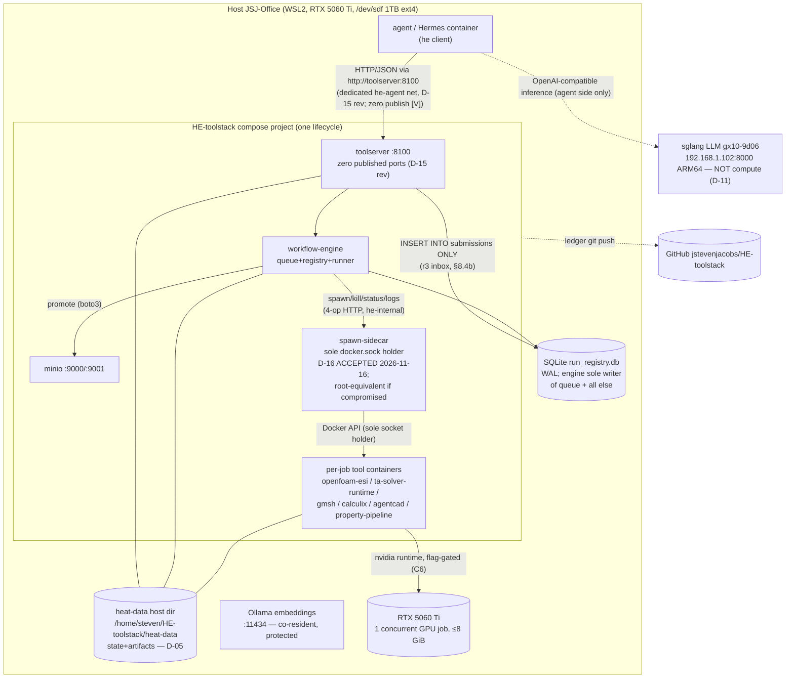
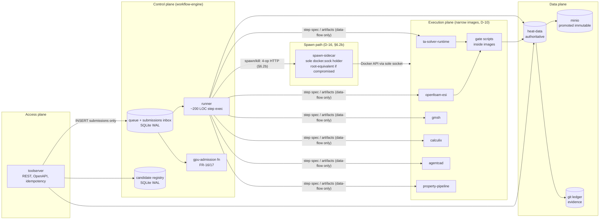
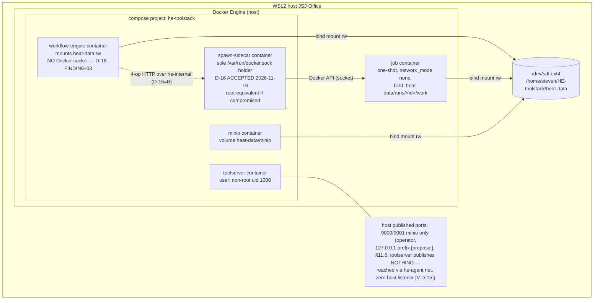
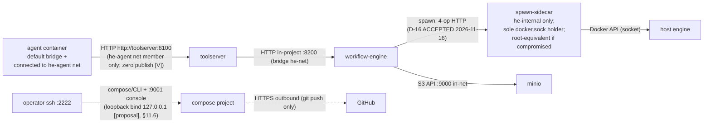
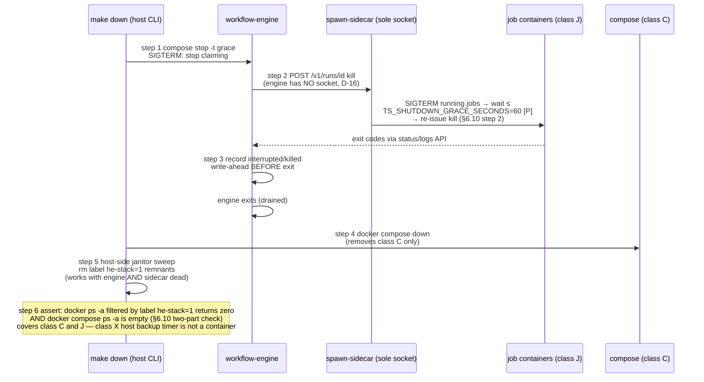
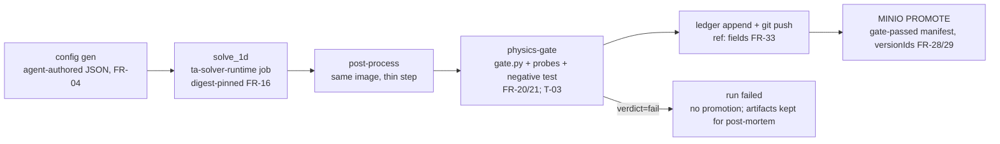
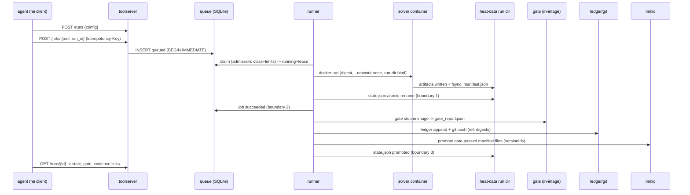
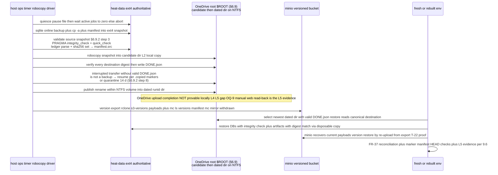

# HE-toolstack Technical Design Document

**Document:** `HE-TOOLSTACK-TECHNICAL-DESIGN.md` · v1.13 (rev 2026-11-17 **r13 — final-review exceptions closed: §14 ADR count 18→17 (§14 ADR-count phantom-gap note; §8.2 status aligned to ACCEPTED D-08 A1 (ruling 2026-11-16); §18 v1.2 self-assessment scoped as filing-time; prior r12 — documentation synchronization: App. B/C counts+baselines corrected, test baseline T-01…T-24, Q16-coherence wording; prior r11 — D-16 status confirmed ACCEPTED by operator (v1.1 filing-time label annotated)**; r10 — health/job/sidecar API contracts + v1.9 (rev 2026-11-17 **r9 — lifecycle ownership + diagram semantics**: class-C canonical enumeration (5 core incl. spawn-sidecar); make-down 6-step choreography = HOST RECIPE not engine; janitor 3-duties/3-owners; class-X exclusion in zero-assertion; D1/D3/D4/D9 redrawn; superseded socket-alternative drawings removed. v1.8 (rev 2026-11-17 r8: OQ-1 CLOSED — ADR-D-02 Accepted as written per operator ruling 2026-11-17; OQ/status mirrors updated. v1.7 r7 — network-isolation correction: bind-vs-publish separation made normative (§6.1/§11.3/§11.6), gateway client-URL probe retracted, six-leg T-15 isolation matrix referenced (§7.1/§10.1), Diagram 3 host-listener node fixed, D-15-accepted wording aligned; NOTE: the r6 ruling-record commit left this header line stale at v1.5 — caught in r7 recon; register flips themselves were verified at r6. Prior r5 rev: **round-5 backup corrections** — §6.9 rewritten (quiesce-and-wait §6.9.1; candidate→verify→DONE→NTFS-publish §6.9.2; MinIO version export §6.9.3 replacing the retracted mc-mirror-history claim; OneDrive L1–L5 proof ladder §6.9.4 with the explicit no-L4/L5-signal statement + OQ-8/OQ-9); §9.4 RPO reclassified local-completion; §9.6 restore-drill spec added; R-8 two-part staleness; D8 redrawn. Prior rev v1.4 (round-3 corrections — §8.8 ticket claim = flock(2) held-lock protocol; §7.5/§8.4b queue write-ownership resolved via submissions inbox. Earlier rev 2026-11-15b: review-response 2 — §6.2b normative spawn-sidecar API spec; §6.10 lifecycle classes + labels; §8.8 real claim mutual exclusion (O_EXCL lockfile arbiter); §6.7 WAL fairness corrected; §5.1 probe matrix re-run + Ollama bind finding [V]; D1/D2/D3/D4/D5/D8/D9 redrawn; prior v1.2: review response 1) · 2026-11-14
**Status:** Revised for re-review (DESIGN STATUS: CHANGES REQUESTED response package; Phase 2 deliverable A of DesignStandards §8)
**Revision log (v1.9 → v1.10, r10 health/contract canonicalization):** §7.2 `/healthz` pure-liveness row + `/readyz` + `/deps` rows + six-scenario canonical response table; non-normative `state` field removed from the 201 example (schema = exactly `{job_id, queue_pos}`); §6.2b cross-cutting rows (caller identity/audit, authz+root-equivalent caveat, idempotency, timeouts, explicit no-`reap`); §7.5 stray `/v1/jobs` paths → `/jobs`; §8.2 canonical four-state evidence ladder; `/health` retired from the normative set (NFR-23 canonical contract).
**Revision log (v1.2 → v1.3, r2 second-review items 1–8):** sidecar API normative spec §6.2b (operation-canonical paths; ADR/QA/TD synced); §8.8 claim = O_EXCL lockfile CAS (rename-CAS was the reviewer's item-3 objection, valid); WAL db-wide-write correction §6.7/§7.5; network probe matrix corrected + host-bind audit §5.1/§5.3/§6.4/D1/D4 (the hdi-refusal claim was over-generalized — fixed); backup: mc-mirror version-history + cross-fs transfer (mv-is-atomic claim only holds same-fs) §6.9; diagrams D1/D4 now show sidecar+gateway; lifecycle label triple normalized §6.10. (v1.1 → v1.2 adds review-§5.5 failure-class taxonomy (§12.5) + R-9 drill; §5.1 session/claim protocol §8.8; §5.2 durability matrix §5.4a; §5.4 security-boundary table §5.4b; §5.3 admission-soundness note §6.4; FM-11…13; T-17…19 refs; OQ-7; gateway-form client URL).**
**Revision log (v1.1):** F1 client URL/bind topology (§5.1 D1, §6.4, §7.1); F2 lifecycle classes + §6.10 + D9; F3 spawn-sidecar §6.2/§10.1; F4 per-table writers §6.7/§7.5/§8.2/§8.4; F5 backup procedure §6.9/§12.2; F6 MinIO dependency semantics §6.1/§6.5/§7.2/§12.3; F7 201 contract + state boundaries §7.2/§8; F8 counts/refs across the package.
**Companions:** `HE-TOOLSTACK-REQUIREMENTS.md` (requirement IDs FR-xx/NFR-xx/T-xx/OR-xx),
`HE-TOOLSTACK-ADR.md` (decision IDs D-xx/X-x/F-x/OQ-x), `PHASE1-ARCHITECTURE-DISCOVERY.md`
(evidence inventory C1–C6, gaps G1–G11).
**Evidence tags used throughout:** [V] verified live 2026-11-14 · [E] PD-toolstack evidence
artifact (STACK-AS-BUILT `SA`, STACK-DESIGN-v3 `SD`, ledgers) · [P] proposed here, not yet
implemented · [U] unverified assumption. **Nothing marked [P]/[U] is presented as existing
functionality.** Where the standards document mandates a component that Phase 1 proved does
not exist (e.g. "GPU broker", §6.4), this document specifies what actually carries that
responsibility instead of restating the phantom.

---

## 1. Executive Summary

**Purpose.** HE-toolstack is the agentic engineering tool stack for designing, testing, and
refining heat engines: an AI agent (the primary "user") drives geometry, meshing, CFD, FEA,
thermo-property and validation tools through a narrow HTTP/JSON API, while every run leaves
auditable, digest-verified physics evidence. It is the second attempt; the first
(PD-toolstack) is frozen and read as evidence only [U→user ruling].

**Problems this architecture solves.** Attempt 1 proved the physics loop works end-to-end on
CPU (D2 gate pass [E]) but died of *operational* failure modes: state scattered across three
filesystems with no declared owner (D25), an orphaned infrastructure container with no
consumer (C4), a design that referenced components never built (C1), and hardware premises
that no longer matched reality (C4/C5/C6 [V]). HE-toolstack keeps every validated asset and
re-architects the operating envelope around single-lifecycle, single-writer, file-visible
state.

**Approach.** One Docker Compose project owns every stack service including MinIO (D-01). A
thin toolserver exposes job submission over loopback HTTP; a workflow engine (SQLite queue +
registry + ~200-line runner over `workflows/` files) owns scheduling and resumable state
(D-02). Six narrow, digest-pinned tool images (OpenFOAM-ESI, TaSMET runtime, gmsh,
CalculiX, agentcad, property-pipeline — measured 0.31–2.82 GB each [V]) execute the tools as
one-shot containers spawned per job (D-10). Canonical state lives in one host directory,
`/home/steven/HE-toolstack/heat-data`, with normative write-ahead ordering
artifacts→state→ledger (D-05); MinIO holds the promoted immutable tier.

**Major decisions.** D-01 single compose; D-02 files-first workflow engine, framework behind
tripwires; D-03 no broker daemon — queue serialization + dispatcher admission; D-04 shared
RTX 5060 Ti GPU tier with hard budget, inert until re-measure (C6); D-05 host-dir state owner;
D-10 no image consolidation (user ruling — narrow images = future adaptability); D-11 the
GB10/ARM64 sglang host is excluded from compute.

**Key technologies.** Docker Compose (single project), FastAPI-class toolserver [P], SQLite
WAL queue/registry [P], MinIO (in-project), 6 pinned solver/tool images, `he` python client
over HTTP (no MCP, D-09 inherited).

**Capabilities (initial release).** M0 vertical slice (config→deck→1D solve→gate→ledger,
CPU-only, target <10 min — proposal OR-01) through M2 hardening: 6 tool classes, candidate
registry, promoted-artifact tier, cold-session resume ≤10 min, GPU *machinery* present but
class flag off. **Limitations:** single host, single operator, no auth beyond loopback
binding, GPU unproven until C6, no multi-host scaling, no web UI.

**Significant risks.** GPU passthrough state volatility (C6 materialized; contingency = CPU-
only Option A always available); hand-rolled runner bugs (crash-matrix T-07 is an M0
acceptance artifact); host-disk SPOF (versioned MinIO tier is the copy); phantom-component
recurrence (every §6 component lists its *existing* code lineage or is marked [P]).

**Readiness.** Architecture is review-ready: requirements baselined (v1.3: 66 IDs, 100%
trace-mapped), 17 ADR records (12 Accepted after the 2026-11-16/17/23 operator rulings — D-15 Option D, D-16 Option B, D-08+Amendment A1, **D-02 as written (OQ-1 closed 2026-11-17)**, **D-06 Option A as written (OQ-4 closed 2026-11-23)**, plus earlier rulings D-01/D-03/D-04/D-05/D-09/D-12/D-14; D-07/D-11/D-17/D-18 remain Proposed),
open questions surfaced (OQ-1…7). No milestone's acceptance depends on an unverified premise.

---

## 2. Project Scope and Objectives

### 2.1 Goals
1. Reproduce attempt-1's validated physics result (1D thermal loop, D2 gate [E]) on the new
   stack — same answers, same tolerance, bit-identity checked (FR-22, T-04).
2. Make every agent session resumable from disk in ≤10 min cold (NFR-18; D25's failure made
   this non-negotiable).
3. Make the stack's lifecycle total and disposable: `make down` ⇒ zero stack containers
   (NFR-01; C4's failure made partial lifecycle unacceptable).
4. Keep tool capability independently swappable: one capability = one image = one service
   (D-10 user ruling).

### 2.2 Functional scope (initial release)
Tool execution (6 classes), engine-config generation, solver execution, GPU-class *admission
machinery* (flag off), physics gating, file-based workflow orchestration with SQLite queue,
artifact hot tier + MinIO promoted tier, candidate registry + historical comparison,
crash-safe resume, `he` HTTP client. Requirement rows: FR-01…FR-40.

### 2.3 Explicitly excluded (initial release)
Multi-user/multi-tenant; API authentication beyond loopback binding (F-1); image registry
(host-seed + `pull_policy: never` + MANIFEST digests instead, A6/F-5); multi-host workers
(FR-41/42 boundary, M3+); web dashboard/UI; metrics/tracing stack (optional profile, F-3);
Windows-host direct execution; ARM64 builds (D14 lesson [E] — images are amd64-only by
decision).

### 2.4 Users and consuming systems
- **Primary consumer:** the coding/physics agent (Hermes sessions) via `he` client →
  toolserver HTTP on `127.0.0.1`.
- **Human operator:** Steven — compose lifecycle, ledger review, MinIO console (host port),
  host disk.
- **Downstream:** future optimizer/MDO loops (M3+, FR-41) read the candidate registry; the
  memory subsystem (cognee/Ollama, external) is *not* a stack consumer and is protected as a
  co-resident service (D-04 floor).

### 2.5 Primary operational use cases
UC-1 Design-to-result: agent submits a run (config→geometry→mesh→solve→post→gate→ledger).
UC-2 Sweep/compare: registry queries historical candidates; new run references parent digests.
UC-3 Resume: new agent session reconstructs in-flight work from `workflows/` + registry
alone (T-02 harness). UC-4 Ops: operator `make up/down`, backup = heat-data + git, restore
drill on versioned MinIO (T-11).

### 2.6 System boundaries
Inside: compose project services (toolserver, workflow-engine, minio), spawned per-job
tool containers, `heat-data` host dir, repo (`MANIFEST`, `workflows/`, CI).
Outside (dependencies, §11.2): host Docker Engine + WSL2, host disk `/dev/sdf`, GitHub
remote (ledger/git evidence), sglang LLM host `gx10-9d06` (192.168.1.102:8000, agent-side
inference only [V]), Ollama embeddings (host `:11434` [V] — **note:** host-verified bind is `*:11434` (all interfaces), NOT loopback-only [V ss 2026-11-15]; container reach is via gateway IP, and the `host.docker.internal` alias works from *desktop-docker-managed* containers only — the agent is reached today via 172.17.0.1; §5.1 matrix), SSH to host
(port 2222). Boundary rule: nothing stack-owned may be created outside the compose project
(NFR-10).

### 2.7 Assumptions and constraints
Assumption IDs are **Phase 1's canonical register** (`PHASE1-ARCHITECTURE-DISCOVERY.md` §3,
A1–A12) — this design adds A13–A15 and does not renumber them:
- carried: **A2** [V] host ext4 volume holds stack root + heat-data (`/mnt/c` banned for
  compute I/O); **A4** [V→drives design] all evidence-producing work so far is CPU-only — no
  GPU number may be claimed until C6 passes; **A6** [V] no private registry — host-seed +
  `pull_policy: never` + MANIFEST digests (A6 inherited [E]); **A8** [operator] single human
  is operator and final gate authority; **A11** [to-verify] Chainguard MinIO rebuild track
  available (→ OR-05); **A12** [V] no guarantee of agent chat-context durability — hence the
  external-state requirement.
- **added here:** **A13** [P] the GitHub remote stays available for ledger pushes; degraded =
  engine local-commit queue with retry (§6.2). **A14** [V] the agent runtime can reach host
  loopback ports (observed: toolserver/agent co-location on this host). **A15** [V by
  convention] uid 1000 maps host↔container for bind-mounted state (attempt 1's chown
  workarounds prove the friction of *not* designing for it).
- constraints: 8 GiB VRAM ceiling / 5.5 GiB floor (D-04 defaults, adjustable via OQ-2), 1
  concurrent GPU job, CPU cores shared with co-resident services, 1 TB disk shared with
  co-resident stacks (813 GB free at audit [V]).

### 2.8 Initial release vs later releases
Initial = M0–M2 (§16. Later = M3 fleet/multi-host (FR-41/42), M4 optimizer
automation (FR-41) — specified only as boundaries, not as promised functionality.

---

## 3. Requirements

The normative baseline is `HE-TOOLSTACK-REQUIREMENTS.md` **v1.10** (r12-synced; was a stale
v1.0 reference): **42 FR rows (FR-01…42; FR-41/42 reserved [M3+], 40 in the initial-release
matrix), 24 NFR (NFR-01…24), 24 verification tests (T-01…T-24), 5 open requirements
(OR-01…05)**. Every row carries ID, description, priority, rationale,
verification method, acceptance criteria; §5 of that file is the requirement→component→test
traceability matrix (script-verified 100% mapped, no dangling IDs). DesignStandards §3's
mandatory categories are each populated: tool invocation FR-06…15, config generation FR-04,
solver execution FR-10…14, GPU management FR-16…19, physics validation FR-20…22, workflow
orchestration FR-23…26, artifact management FR-27…29, run tracking FR-31…32, registry
FR-30…34, recovery FR-35…38, agent interaction FR-39…40; NFR categories map to REQUIREMENTS §3.1–3.10 (reliability/perf/scalability/security/maintainability/observability/
portability/data-integrity/recoverability/extensibility). This design references those IDs;
it does not restate or renumber them. Sections 5–16 carry a "covers:" line per component so
reviewers can move both directions through the matrix.

---

## 4. Current-State Architecture and Lessons Learned

### 4.1 What worked (retained because evidence says so)
| Asset | Evidence | Retention |
|-------|----------|-----------|
| Physics loop end-to-end on CPU (fork + dataset + gate + ledger; D2 gate pass incl. negative test) | SA Stage D/E rows [E] | Migrated as-is (D-12); gate methodology → physics-gate (§6.3) |
| 6 tool images (measured 0.31–2.82 GB [V]) with build recipes carrying hard lessons (D8 OpenFOAM-from-source on noble, D13 hash-pinned property stack, D14 amd64-only wheels) | host `docker images` [V]; SA [E] | Kept unchanged as proven baselines (D-10); append-frozen |
| Digest/MANIFEST discipline (`resolve.py`, `pull_policy: never`) | SA infra rows [E] | Becomes dispatcher admission rule (FR-16, NFR-09, T-16) |
| Claim/done ticket + append-only ledger workflow practice | SA Stage-E practice [E] | Formalized as `workflows/` state law (§8) |
| Backup/restore drill against MinIO | SA restore rows [E] | Re-hosted in-project (D-01), drill becomes T-11 |
| `/mnt/c` avoided for solver I/O (28–39× measured penalty) | SA D9 [E] | Encoded as heat-data-on-ext4 constraint (D-05) |

### 4.2 What failed, and why (the design drivers)
| Failure | Root cause | Design response |
|---------|-----------|-----------------|
| `infra-minio-1` orphaned — worked, then consumed nothing and outlived its project (C4) | lifecycle split across compose projects; ownership ≠ use | D-01: one project owns all; T-13 zero-orphan gate |
| State/artifact divergence; session could not answer "what is in-flight" (D25) | no declared state owner; writes ordered arbitrarily | D-05 write-ahead protocol; T-07 crash matrix |
| Design docs listed components that never existed as code (C1: gpu-broker; C2: gate "service") | summaries copied forward without code verification | This doc's evidence tags; CI MANIFEST-vs-service check (NFR-11); Phase 1 verified inventory [V] |
| gpu1 premise (DGX Spark as compute worker) | hardware reality moved: gx10-9d06 is GB10 **ARM64** running sglang; gpu2 (5090) never purchased [V] | D-04/D-11: host-only compute, ARM64 excluded, GPU budgeted + flag-gated |
| `nvidia-smi` over SSH returned no rows this pass while the card exists (C6) | WSL GPU passthrough/driver state volatility [V] | GPU class inert until C6 re-measure ticket passes; T-06 uses simulated numbers until then |
| Docker-run uid friction forced chown workarounds | container uid ≠ host uid on bind mounts [E A15; Phase-1 A1 chown workaround] | heat-data at uid 1000 by design (D-05); NFR-08 non-root audit |

### 4.3 Previous → proposed migration comparison
| Area | Previous (attempt 1) | Proposed (HE-toolstack) | Rationale | Risk carried |
|------|----------------------|-------------------------|-----------|--------------|
| Lifecycle | stack + separate `infra` project | one compose project incl. MinIO | orphan failure mode is ownership, not tech (C4) | healthcheck coupling on `up` (§11.3) |
| GPU path | gpu-broker (designed) → deleted, never ran | dispatcher admission fn + queue class | a mechanism must exist where code exists (D-03, C1) | lease semantics deferred (worker seam, NFR-05) |
| Workflow engine | LangGraph leaning (SD v3) + agent-memory state | files-first runner + SQLite; tripwires (§8) | resume-from-context-loss is a checkpoint pattern; durable-exec platform cost unjustified (D-02) | hand-rolled runner bugs → T-07 required M0 artifact |
| State location | container scratch + host tree + git, no owner | `heat-data` host dir, write-ahead normative | single-writer collapse; cold-session `ls`/`jq` contract (D-05) | manual host-dir drift → digest checks NFR-16 |
| Images | 8 images / 4 services (v1), ≤4 consolidation drafted (v2) | N images, 1 per capability, append-frozen (D-10 ruling) | user ruling: narrow scope = future adaptability; blast radius per digest | sprawl drift → MANIFEST CI; per-image host seed step (§11.3) |
| Physics-gate | scripts + methodology (proven) mis-described as service | methodology in images + thin one-endpoint wrapper (D-06) | keep what D2 proved; enforcement point without phantom daemon | wrapper drift → T-03 runs both paths |

### 4.4 Lessons directly encoded as requirements
C4→NFR-01/10; D25+C1→evidence tags + §6 lineage rule; D9→FR/D-05 ext4 placement; D8/D13→
NFR-09/11 image discipline; D14→amd64-only + D-11 exclusion; D7 (driver floor ≥591.59
sm_120)→C6 prerequisite; cleanup observation→NFR-12 per-ticket clause.

---

## 5. Target System Architecture

### 5.1 System context
The agent runs in a Hermes container on the host's Docker Engine. **FINDING-01 correction (v1.1, measured
2026-11-15 from inside the agent container):** agent→`127.0.0.1:8100` is its *own* netns →
refused [V]; `host.docker.internal` (192.168.65.254) **does** reach host listeners that are
bound to non-loopback addresses [V corrected 2026-11-15: ollama `*:11434` was refused→then
shown reachable: the v1.2 claim was tested against 8100-class loopback binds and
over-generalized]; what is actually true per host `ss` [V 2026-11-15]: stack-class services
must bind **127.0.0.1 only** on the host — such binds are reachable from the agent netns
ONLY via the NAT gateway `172.17.0.1` (probe: TCP connect 172.17.0.1:11434 succeeded), never
via the agent's own `127.0.0.1` [V]. Probe matrix, corrected: §5.1. For the **toolserver**
boundary a stronger rule now applies [r2 item 2, D-15 rev. 2026-11-16]: a host-published port —
even `127.0.0.1:` — is reachable from ANY engine container via the gateway alias [V probe
2026-11-16], so publishing publishes to containers too, not just to the host. The toolserver
therefore publishes NOTHING: agent and toolserver share a dedicated `he-agent` compose network,
client URL `http://toolserver:8100` (service DNS), `HE_API_BASE` override retained. Both
directions (member reaches 200; non-member triple-refusal) measured — ADR-D-15 Demonstration. The stack never calls the LLM; the LLM/embeddings services are
*co-residents to protect* (D-04 floor), not dependencies of any job. TaSMET/OpenFOAM/OCCT/
CoolProp are in-image dependencies; GitHub is the evidence remote outside the boundary.


*Diagram 1 — system context. Solid = stack-internal; dotted = external dependency.*

### 5.2 Logical architecture
Four logical planes, one process topology. **Access plane:** toolserver (HTTP edge, auth
boundary = loopback). **Control plane:** workflow-engine — SQLite(WAL) queue + registry +
runner + GPU-admission function (the *replacement* for the designed-but-never-built broker,
D-03). **Execution plane:** spawned one-shot tool containers; images are append-frozen
capability units. **Data plane:** heat-data host dir (hot, authoritative) + MinIO (cold,
immutable, versioned) + git (evidence). State flows one way per D-05 ordering.


*Diagram 2 — logical components. Every box names real or [P]-proposed code; no broker box
exists because D-03 deleted the responsibility into ADM. Sole Docker control path is
runner → spawn-sidecar → host engine (§6.2b, D-16); runner→image edges are data-flow only
(step specs, artifacts), never container-control.*

### 5.3 Physical / deployment architecture
Single host; single compose project; toolserver published **NOTHING** — reachable from the
agent only via the dedicated `he-agent` compose network (members: toolserver + Hermes agent
container only; D-15 rev. 2026-11-16: measured proof that any published port, loopback
included, is gateway-reachable from every engine container, so publish ≠ isolation —
isolation is now structural membership; both directions probed [V], ADR-D-15 Demonstration).
MinIO published
on host for operator console only (config parameter `MINIO_CONSOLE_BIND=127.0.0.1`, §11.6 —
[proposal], not current config; **host-state audit owed at M0**: co-resident third-party
services on this box are demonstrably NOT loopback-bound today [V: ollama `*:11434`,
sglang-proxy `*:3000`] — they are out of scope but named so the "loopback is the control"
claim is scoped to stack-owned services only). Spawned job containers attach the default `he-net` bridge
only when they need egress (none in initial release — tools run offline, an explicit
posture: `network_mode: none` for solver jobs [P]).


*Diagram 3 — deployment boundaries (r9 redraw). The job-spawn channel was OQ-5; the operator
ACCEPTED Option B (scoped spawn-sidecar, ADR-D-16, 2026-11-16) — shown as the current
architecture. The honest residual is drawn with it: the sidecar is the sole socket holder and
remains **root-equivalent on the host if compromised** — privilege redistribution, not
elimination (D-16 ruling text). The superseded Option-A drawing (socket mounted into the
engine as "ALTERNATIVE") is removed: the engine never sees a socket under any option.*


*Diagram 4 — network communication (r7). The agent↔toolserver path exists only on `he-agent`
(zero host publication, D-15 Accepted). No inbound path is claimed from LAN or any non-member
namespace: expectations for every route are derived in the T-15 six-leg matrix (§5.4b) and
EXECUTED at M0 before NFR-07 is marked satisfied. External egress is git-over-HTTPS and nothing
else in M0.*

### 5.4 Architectural principles
1. **One lifecycle per system** (D-01). Implication: every service has compose healthcheck +
   restart policy; `make down` is an acceptance test (T-13), not a convenience.
2. **State has exactly one owner per artifact** (D-05). Implication: heat-data is
   authoritative; MinIO/git are derived tiers; agent scratch is defined non-authoritative —
   deletion is always safe, which makes the cleanup rule enforceable (NFR-12).
3. **Write-ahead ordering is protocol, not convention**: artifacts fsync → state.json atomic
   rename → ledger append + git push. Implication: every crash window has a defined recovery
   (see §5.4a for the exact fsync/durability matrix — what is guaranteed by code vs by
   filesystem behavior is stated there, per review §5.2)
   (§12 FMEA rows FM-6/FM-8) and the crash matrix T-07 is a required M0 artifact.
4. **Thin, domain-agnostic core** (SD inheritance [E]): engine/queue/gate code contains zero
   TaSMET/OpenFOAM specifics; domain knowledge lives in images + job-type registry rows.
   Implication: new tool = new image + service + registry row (NFR-20), reviewed for
   core-diff absence at M1 (T-14).
5. **HTTP/JSON at every boundary; nothing crosses a process boundary that isn't specified**
   (§7). Implication: undocumented internals are prohibited; interfaces precede
   implementation (contract tests T-08 before endpoints mark done).
6. **Filesystem-visible state is the agent contract** (NFR-14): everything answerable by
   `ls`/`jq` over heat-data + `workflows/`, without container logs — because the consumer is
   a context-limited agent, not a dashboard.
7. **Append-frozen capability units** (D-10): images gain *versions*, never new tools;
   capability growth spawns a new image/service pair. Implication: blast radius per digest,
   rebuild recipes stay single-purpose, and A/B bit-identity (FR-22) gates every bump.
8. **Budgeted sharing over exclusive claims** (D-04): GPU/CPU admission at the dispatcher,
   with floors protecting co-resident services; no job may assume it owns hardware.
9. **Evidence tags survive into code**: MANIFEST digests, ledger `ref:` fields, and CI
   MANIFEST-vs-compose checks keep phantom components structurally impossible (NFR-09/11).

---


### 5.4a Durability matrix — what fsync guarantees vs what filesystem behavior guarantees
[review §5.2, added 2026-11-15; normative for §8.6 and T-07]
| Step | Operation | Durability mechanism | Guarantee if process killed | Guarantee if power/host dies |
|------|-----------|---------------------|-----------------------------|------------------------------|
| 1 job outputs | worker writes `jobs/<id>/out/…` + `manifest.json` last | `fsync(file)` then `fsync(dir)` before manifest rename [code requirement, T-07 asserts via syscall trace or crash-point test] | complete (kernel flushes on process exit) | complete only if data already on platter; **crash-point test tolerance**: partial output = incomplete manifest ⇒ §8.6 re-queue |
| 2 state.json | write temp → `fsync` → `os.replace` → `fsync(dir)` | atomic rename (ext4 guarantee: rename is atomic w.r.t. readers) + dir fsync for rename persistence | readers see old-or-new, never torn (FM-8) | same, with ≤ one rename-window uncertainty — resolved by §8.6 ordering rules |
| 3 ledger | append line → `fsync` → git push later | append-only + fsync | partial line possible at EOF ⇒ **ledger reader tolerates trailing torn line** (parse-lenient; last-good-line checkpoint in state.json) | same |
| 4 git push | network op | not a durability step (copy, not authority); retry queue (FM-9) | drained on retry | drained on retry |
**Declared dependencies on filesystem behavior:** ext4 with `data=ordered` default (WSL2 default [V preflight]) — rename atomicity + rename-on-write are relied upon; **not** relied upon: delayed-allocation atomicity of *content* writes (hence explicit fsync in rows 1–2); **not** relied upon: O_DIRECT (absent). SQLite rows: SQLite's own WAL fsync discipline (per SQLite docs [V]), engine adds none. Disk-failure beyond OS crash is explicitly outside every row — RC-5/backup territory (§12.5). **Boundary note (r5): every rename-atomicity guarantee here is SAME-filesystem (ext4) only — the backup publication path crosses into `/mnt/c` (NTFS via 9p/DRVfs) where POSIX rename does not span the boundary and durability semantics differ entirely; the backup protocol therefore uses copy + destination digest verification + completion marker (§6.9.2), never a cross-FS rename claim.**

### 5.4b Security-boundary table [review §5.4, added 2026-11-15 — one place, all boundaries]
| Boundary | Mechanism | Credential crossing it | Blast radius if crossed |
|----------|-----------|------------------------|-------------------------|
| agent → toolserver | dedicated `he-agent` network membership ONLY — zero host publication makes every gateway/bridge path structurally impossible (T-15 matrix §5.4b; §6.1, D-15 Accepted) | none — **network membership is the boundary**: it is an access-control mechanism enforced by Docker routing, NOT authentication; any `he-agent` member acts as the operator (credential-equivalent; §10.2) | can submit/inspect jobs as operator — same trust class as operator shell |
| toolserver → engine | compose-internal network, service DNS (§7.5) | none | engine is same trust class (both operator-owned code) |
| engine → Docker daemon | **ruled 2026-11-16 (OQ-5 closed, D-16 Option B)**: sidecar holds the socket, engine talks narrow HTTP (§6.2b spec) | sidecar exposes ONLY `create_run`/`status`/`kill`/`logs` (§6.2b paths) for digest-pinned images | with sidecar: one container's lifecycle; with raw socket (rejected option): full host root |
| solver container | `--user`, `--pids-limit`, mem/cpu caps, single bind `jobs/<id>/` rw (§6.2), `--network none` for batch phases | none — inputs arrive pre-staged on its bind; no token in env | only its own job dir |
| MinIO credentials | root creds compose-env (operator-only ports `127.0.0.1:9000` [V §11.3]); service account per-writer bucket prefix [P] | engine holds promote-scoped service key, toolserver none | evidence bucket (delete-able tier, not authority) |
| Git credentials | host-side only — ledger push runs via host git askpass [E proven PD pattern]; **no git creds inside any container** [V: current PD-toolstack push is host/session-side] | n/a into containers | cannot be leaked by a container compromise |
| host filesystem | heat-data owned `steven:1000`, containers run `user: 1000:1000` (§11.3) | file perms = only gate | heat-data subtree; host OS unreachable (no socket in containers, §6.2) |
| network isolation | dedicated `he-agent` net for the API (zero publish, D-15 rev); remaining published ports all `127.0.0.1:` prefix (host/LAN control — **not** container isolation, measured [V]); solver `--network none` at batch | — | LAN never exposed; accepted residual: MinIO `127.0.0.1:9000/9001` remain gateway-reachable from engine containers, credential-gated (D-15 Consequences) |
This table is the checklist answer for review §5.4; each row's [E]/[V] tag is the same evidence discipline as elsewhere.


**T-15 isolation probe matrix (r7, mechanism-derived expectations; execution due M0 —
NFR-07 is NOT marked satisfied until run; design contract per §10 STOP):**

| Leg | Source namespace (IP class) | Destination | Expected | Enforcement mechanism |
|-----|------------------------------|-------------|----------|------------------------|
| 1 Hermes agent | agent container (default bridge + `he-agent` member) | `http://toolserver:8100/healthz` (service DNS) | **reachable, 200** | `he-agent` membership (only path) |
| 2 Peer on Docker default bridge | fresh container, default bridge only (`172.17.0.0/16`) | (a) `http://toolserver:8100` (b) `http://172.17.0.1:8100` (c) `http://host.docker.internal:8100` | (a) **DNS unresolvable** (b) **refused** (c) **refused** | (a) not on `he-agent`; (b/c) **no host listener exists** — zero published port |
| 3 Container on compose net | fresh container joined to project `he-net` | (a) `http://toolserver:8100` (b) `http://<toolserver-task-ip>:8100` | **(a) unresolvable, (b) refused** if the service has no `he-net` alias; **reachable → FINDING** if it does | service attached to `he-agent` only; leg 3 is the design's discriminating test |
| 4 Host-local | WSL host shell (`127.0.0.1`, `172.17.0.1`) | `http://127.0.0.1:8100`, `http://172.17.0.1:8100` | **refused** (nothing listening) | zero host publication; preflight asserts absence (§11.3) |
| 5 LAN-side | separate machine on LAN → WSL host IP :8100 | TCP :8100 | **refused/closed** (no listener; also subject to WSL NAT) | zero publication — replaces the old "port closed because loopback-bound" expectation, which described the RETRACTED publish model |
| 6 Other bridges/paths | container on any other local bridge (e.g. `br-<id>` networks) | `http://<gateway-ip-of-that-bridge>:8100` | **refused** | no host listener on any interface; measured precedent [V 2026-11-16]: published ports WERE gateway-reachable from any bridge on this engine — absence of publication is what closes every leg |

**Anti-claim guard (r7):** loopback binding is not authentication or authorization, and a
loopback-published port still accepted connections from other containers on this engine
(measured). The only structural control is **absence of a host listener + named-network
membership**; container-IP allow-lists are explicitly rejected (IPs are ephemeral).

## 6. Detailed Component Design

Component inventory note (DesignStandards §6 lists "Solver service" and "GPU broker" as
subsections): the verified architecture has **no long-running solver service** (solvers are
one-shot containers spawned per job — verified pattern from Stage D/E [E] plus D-03) and **no
GPU broker** (deleted in v3.2 before Stage E; C1). §6.2 and §6.4 specify what actually
carries those responsibilities. Each component below answers the §7 reviewability questions
(problem solved, necessity, responsibilities, interfaces, data owned, dependencies, failure,
testing, deployment, limits). Code-lineage column: **[existing]** = code in PD-toolstack
evidence tree [E]; **[P]** = new code this design proposes; **[asset]** = methodology/scripts
proven by ledger.

### 6.1 Toolserver  [P — thin; lineage: no prior HTTP server existed; agent called scripts directly [E]]
- **Problem/necessity:** the agent needs one narrow, contract-testable door into jobs,
  queue, registry and gate — instead of ssh-and-pray shell access (attempt-1 practice). It
  is also the single place reach-control for the API (NFR-07: `he-agent` network **membership**, zero published port — D-15 rev) and idempotency (FR-39) live.
- **Owns:** HTTP request validation, job submission records, idempotency-key store,
  OpenAPI surface, error envelope. **Explicitly does not own:** scheduling (engine), state
  writes into workflows/ (runner), physics verdicts (gate scripts), MinIO credentials
  (engine's promote worker holds them).
- **Internal modules [P]:** `api.py` (FastAPI app, ~400 LOC budget), `jobs_repo.py`
  (SQLite via same WAL file as engine — **r3 ownership (canonical §8.4b)**: toolserver opens RW for
  `INSERT INTO submissions` **only** (queue/idempotency dedup moved engine-side at consume,
  §7.5); engine owns every other table; everything else read-only. **WAL note (r2 item 7):** SQLite WAL serializes
  writes **database-wide** — one write transaction at a time across ALL tables, not per
  table — so *table ownership is an application-level discipline* (prevents logical
  write-write conflicts on the same rows), not a SQLite enforcement; `busy_timeout 5 s`
  retries with **no fairness guarantee** (busy is retried, not queued FIFO), so a writer can
  be starved under sustained load [V: SQLite WAL docs]. `idempotency.py` (key→job-id map, 24 h window),
  `errors.py` (single envelope §7.3).
- **Tech/version:** python 3.12-slim base (same base as property-pipeline image pattern [V]),
  FastAPI + uvicorn (versions pinned at first build; no version claimed here — none verified).
- **Interfaces:** §7.2 (all endpoints). **Reachability (D-15 rev 2026-11-16):** **agent-side
  (`he`) → `http://toolserver:8100`** over the dedicated `he-agent` network (§7.1 canonical;
  agent joined by operator `docker network connect`, re-asserted by `he doctor`); host-side
  CLI/health → `make health` (one-shot container on the he-agent net — host does not route to
  dedicated-net IPs [V probe], and the toolserver publishes NO port). **Normative: any
  `:8100` host listener (bare OR loopback-prefixed) is a preflight failure** (§11.3) —
  publishing a port publishes it to every engine container, measured [V 2026-11-16]. **Configuration (§11.6 — two distinct layers, r7):** (1) *inside-container listen address*
`TS_BIND=0.0.0.0` — the process must bind `0.0.0.0` on its container interface; a loopback
in-namespace bind would make Docker's forwarding path unable to reach it, and an in-namespace
`0.0.0.0` bind is **not** exposure (the namespace is the boundary). (2) *host publication* —
there is **none for 8100** (D-15 rev: zero published ports; exposure control is no longer a
`ports:` prefix question at all). One variable must never stand for both layers (r7 item B).
`TS_PORT=8100`,
  `HE_DATA=/data`, `QUEUE_DB`, `IDEMPOTENCY_TTL`.
- **Persistence:** none of its own beyond queue DB rows + idempotency table.
- **Startup/shutdown:** compose `depends_on: workflow-engine: condition: service_healthy`;
  boot = open WAL read/insert, serve; SIGTERM = drain in-flight HTTP (≤5 s), no job state to
  flush (all durable state is in SQLite WAL).
- **Health/logging (NFR-23 canonical):** `/healthz` = pure liveness (event loop serving; a DB-open failure is surfaced via `/readyz`/`/deps`, not liveness — r10 alignment); JSON stdout logs with
  `run_id/job_id` fields (NFR-13).
- **Failure modes:** crash ⇒ zero data loss (stateless edge; agent retries with same
  idempotency key, FR-39); WAL lock contention with engine ⇒ single-writer ordering means
  toolserver inserts are rare small writes; p95 read target NFR-04 (T-09 under load).
- **Security:** reach = `he-agent` network membership only (zero host publication; any host `:8100` listener = preflight failure), non-root uid 1000, no MinIO creds, request body caps
  (artifact pointers not bytes — §7.4), CORS off.
- **Testing:** contract suite T-08 (OpenAPI fixtures incl. error envelope, idempotency
  replay, 413/409/422 paths). Deployed as compose service `toolserver` (§11.3).
- **Limits:** no authN/Z (F-1); single instance; not a file server (never streams artifact
  bytes — agent reads heat-data directly [V host-dir contract]).

### 6.2 Job dispatcher + queue + runner (the "workflow engine")  [P core; runner lineage: Stage-E claim/done scripts [E asset]]
- **Problem/necessity:** serializes contention-prone resources (the GPU, CPU slots),
  survives agent-context loss, and enforces the write-ahead protocol (§5.4-3) in one place.
  This is the component that *replaces* both the never-built gpu-broker and the LangGraph
  leaning (D-02/D-03).
- **Owns:** queue rows (**sole writer**, fed by the toolserver's `submissions` inbox §7.5), job leases (single-writer within this process), worker seam,
  `workflows/` state law enforcement, ledger appends, promotion triggers. **Does not own:**
  HTTP edge (§6.1), physics logic, image builds.
- **Internal modules [P]:** `queue.py` (SQLite WAL, states §8.2, one-writer loop),
  `admission.py` (GPU budget fn: nvidia-smi-when-available + reservation ledger, FR-16/17;
  pure function, unit-tested with simulated values — T-06 — because C6 is unresolved),
  `worker_docker.py` (**the Worker seam**: `Worker.spawn(job_spec)->handle`; v1.1 per
  FINDING-03: engine never sees a Docker socket under any option. Option B (**ACCEPTED — operator ruling 2026-11-16**, ADR-D-16): engine calls the `spawn-sidecar` HTTP API
  (the four operations of ADR-D-16 with **paths canonicalized to the operations**:
  `POST /v1/create_run`, `GET /v1/runs/{id}/status`, `POST /v1/runs/{id}/kill`,
  `GET /v1/runs/{id}/logs` — full spec §6.2b) over the `he-internal` net; expired-
  container reclamation is the sidecar's own janitor timer, not an engine-facing method;
  sidecar exclusively holds `/var/run/docker.sock` and **server-side** enforces the spawn
  contract (digest allow-list §11.2, `network=none`, cap-drop/non-root, cpuset+mem ceilings
  §6.8, bind paths ⊂ `{he-scratch, job-scratch, run inputs}` only) + semantic audit row per
  call. Options A (socket→engine) and C (host systemd engine) remain open for the operator;
  the honest cost of B is one more container and one more failure mode (sidecar down =
  dispatch stall, detectable, queue keeps work). `runner.py` (~200 LOC: read `workflows/<flow>/state.json`
  → claim next ticket → exec step → write-ahead per D-05), `promote.py` (boto3 client →
  MinIO, gated by FR-29 rule), `ledger.py` (append + git push + local-commit queue when
  remote unreachable, A13).
- **Job-type registry (not a separate service):** table `job_types(tool, image_digest,
  entry, cpu_class|gpu_class, limits…)` — the extensibility point NFR-20; new tool = row +
  image + compose service entry, zero core edits (T-14 proves at M1).
- **Concurrency control:** `max_concurrency` per class (cpu: cores-based default 2 [P];
  gpu: **1** hard, D-04); GPU class refuses to start any job while
  `GPU_CLASS_ENABLED=false` (default until C6 passes — FR-18).
- **Startup/shutdown (v1.1, FINDING-06 — MinIO reclassified as OPTIONAL dependency,
  ADR-D-17):** boot = crash-recovery pass (§8.6: reconcile running-state jobs vs container
  reality), then loop; **MinIO is waited for ≤60 s and boot proceeds regardless** with
  `minio=unavailable` in health — job dispatch and physics never block on MinIO (FR-13
  promotion is async). SIGTERM = stop claiming, drain per §6.10 class-J rules, WAL clean
  close. Compose `depends_on: minio: condition: service_healthy` is demoted to
  `service_started` (§11.3) so a MinIO crash-loop can never wedge engine startup.
- **Long-running jobs, cancellation, reconciliation (review §5.1, explicit 2026-11-15):**
  a solver container is a **child of the dockerd daemon, not of the engine process** —
  engine restart (RC-1/RC-2) does not kill a running job; boot reconcile (§8.6) re-adopts
  it by container label probe (`heat.job_id`) within the lease window. Cancellation is
  engine-driven: `/jobs/{id}/cancel` → queue flag → engine sends SIGTERM to the container
  (grace 30 s [P]) → kill; the terminal state is written by the engine, not the job.
  Reconciliation runs at **boot and every 60 s tick**: for each `running` row, the
  sidecar's container-exists query is ground truth (state vs daemon, §6.2); mismatches
  resolve via the §8.6 matrix — never silently.
- **Health/logging (v1.1 F6/NFR-23):** `/healthz` = **pure liveness** (loop heartbeat
  <30 s old; never 503s for dependency loss); `/readyz` = readiness for required deps (DB + sidecar);
  MinIO appears in `/deps` (`{minio: ok|down, sidecar: ok|down|absent, docker: via-sidecar, promotion_backlog: n}`)
  but NEVER gates solver-execution readiness (D-17); queue-depth gauge in JSON logs;
  every state transition emits one structured event (run_id, from, to, cause).
- **Failure modes/recovery:** full matrix T-05/T-07; crash mid-claim = lease timeout
  re-queues (idempotent step exec: step re-run sees its own artifact manifest and skips —
  FR-38); WAL survives kill -9 (NFR-02).
- **Security:** sole holder of MinIO root creds (§10); sole writer to `workflows/`. Under
  the accepted OQ-5=B shape (operator ruling 2026-11-16) the **security-critical container is the spawn-sidecar** (§10.1
  threat model row; review gate), not the engine — engine compromise caps at queue/workflow
  integrity + sidecar-API abuse within the allow-list, not host root.
- **Performance:** queue ops are sub-ms local SQLite [P, measure at M0]; step overhead
  budget counted into OR-01 timing (NFR-03 flag).
- **Testing:** unit (admission math, lease logic), integration (queue+reboot T-05), crash
  matrix T-07, cold-session harness T-02. **Deployed:** compose service `workflow-engine`.

### 6.2b Spawn-sidecar API — normative specification  [r2 item 6; single source of truth]
One operation vocabulary and one path set for **all** documents (ADR-D-16 lists the
operations; this table is the wire contract; §11.6 knobs `SIDECAR_BIND`,
`SIDECAR_ALLOWED_IMAGES` apply). HTTP/1.1 over `he-internal`, mTLS **deferred to M0 build**
[proposal: shared-secret bearer token from sidecar-only tmpfs file until then]; all bodies
JSON; unknown fields `422`.

| Operation (canonical) | Method + path | Request (core fields) | Success | Notable errors |
|---------|----------------------|----------------------|---------|----------------|
| `create_run` | `POST /v1/create_run` | `{image_digest, cmd[], env{}, binds[{src,dst,ro}], labels{he-run,he-job-id}, cpuset, mem_limit, network:"none"}` | `201 {container_id, pid}` | `403 not_allowed` (digest ∉ allow-list, bind prefix, network≠none, caps); `422` schema; `429` per-run cap (`SIDECAR_MAX_RUNNING`) |
| `status` | `GET /v1/runs/{id}/status` | — | `200 {state, exit_code?, started_at?, finished_at?}` | `404 no_such_run` (unknown/foreign id — no existence oracle) |
| `kill` | `POST /v1/runs/{id}/kill` | `{signal: "term"|"kill", grace_s}` | `202` (idempotent: terminal → `200 already_terminal`) | `404` |
| `logs` | `GET /v1/runs/{id}/logs?tail=N&since=` | — | `200 {lines[], truncated}` | `404`; `413` tail > 1 MiB |

**Cross-cutting contract rows (normative, r10):**
- **Caller identity & audit:** `caller_id` = the `he-internal` peer token principal (shared-secret bearer until M0 mTLS, above); every call writes exactly one `sidecar_audit` row: `{ts, caller_id, op, run_id?, image_digest?, verdict, deny_reason?}`.
- **Authorization / trust assumptions:** reach = `he-internal` membership (the only route to the port — same structural zero-publish pattern as D-15 for the toolserver); the sidecar trusts *reach*, then enforces server-side: digest allow-list, `network=none`, `cap_drop=ALL`+non-root user, bind-prefix allow-list (§6.2). Threat-model caveat **stands unchanged**: a compromised sidecar is still **root-equivalent** on the host — this API reduces the surface reachable from engine/toolserver; it does **not** eliminate host privilege (ADR-D-16).
- **Idempotency:** `create_run` is **not idempotent** (caller-generated `he-job-id` label = dedup key: a second live container for the same `he-job-id` ⇒ `409 dup_run`); `status`/`logs` read-only idempotent; `kill` idempotent (terminal ⇒ `200 already_terminal`). No `Idempotency-Key` header applies below `/v1/` — the label scheme is the mechanism.
- **Timeouts:** server answers `create_run`/`kill` ≤ 5 s (`create_run` returns at container-created; never waits for exit); `status`/`logs` ≤ 2 s; §7.1 client defaults apply (10 s + 3× backoff on 5xx/conn); sidecar's own docker-API deadline 5 s exceeded ⇒ `500 spawn_timeout`, any created container is reaped by the janitor like any orphan.
- **No fifth operation:** reaping stays the sidecar's internal janitor duty (`SIDECAR_REAP_AFTER_S`, default 900 [P]) — **no engine-facing `reap` exists and none is added**; changing that would require an explicit ADR-D-16 amendment. Server-side enforcement
matrix per operation = §6.2 contract paragraph; every call writes one `sidecar_audit` row
(caller-id from `he-internal` peer cert/token, operation, digest, verdict). **QA gate:** the
gate script extracts operation+path strings from TD/ADR/QA/REQ and asserts they equal this
table (r2 item 6 closure condition).

### 6.3 Physics-gate  [asset: gate.py + probes + negative test proven D2 [E]; wrapper [P thin]]
- **Problem/necessity:** no run may claim `succeeded` without a verdict (FR-20); attempt-1
  proved the methodology *including a negative test that catches corrupted results* (D2).
  The design decision (D-06) is to ship the scripts unchanged inside images and add one thin
  endpoint — the endpoint adds no verdict logic.
- **Owns:** gate checklist definitions (`gates/*.py` in repo → baked/bound), report format,
  tolerance tables (dataset-derived, from D2 evidence [E]). **Does not own:** solver numerics,
  verdict interpretation beyond pass/fail/warn.
- **Execution path:** runner step `gate` runs `python -m gates <run-dir>` inside the tool
  image that owns the physics (TaSMET/OpenFOAM) — same image = same numeric stack (bit-
  identity FR-22); toolserver `POST /gate/run` execs the identical command in a spawned
  container (T-03 tests both entry paths produce byte-identical reports).
- **Inputs/outputs:** run-dir (state.json + artifacts + digests) in; `gate_report.json`
  (checks[], values, tolerances, verdict, digests covered) out — written to heat-data,
  referenced by ledger row.
- **Failure/recovery:** script crash ⇒ verdict `error`, run cannot succeed (fail-closed);
  report absent ⇒ registry refuses `succeeded` (constraint enforced at registry write, not
  convention).
- **Tech:** numpy/CoolProp already in images [V]; no new dependencies (deliberate).
- **Testing:** T-03 incl. the carried-over corruption-injection negative test; tolerance
  changes require an ADR row (physics semantics = decisions).

### 6.4 "GPU broker" responsibility — dispatcher admission  [P; lineage: designed never built, deleted v3.2 [E C1/D-03]]
- **Problem/necessity:** one shared 16 GB card with a protected 4.98 GiB embeddings floor
  [E] needs *admission control*, which is arithmetic + a reservation ledger — not a daemon.
- **How "handles GPU jobs" is actually implemented [P]:** `admission.can_start(job)` reads
  (1) class flag, (2) current GPU-class running count (queue truth), (3) reserved VRAM sum,
  (4) latest `nvidia-smi --query-gpu=memory.used` sample (cache ≤30 s; when probe returns
  nothing — the C6 state — behaves as if usage = floor + safety margin), and refuses unless
  `running == 0` and `reserved + job.vram_ceiling ≤ total − floor`. Reservation lives in the
  queue row (crash-safe; no separate store). Numbers: ceiling 8 GiB / floor 5.5 GiB (D-04
  defaults, OQ-2 adjustable), all three as config keys (§11.6), none hard-coded.
- **What it explicitly is not:** no worker protocol, no leases to remote hosts (M3+ re-ADR
  per D-03 revisit clause), no MPS/time-slicing (job count is 1 by policy).
- **Failure modes:** probe lies (WSL volatility, C6) ⇒ class stays off (flag) or admission
  errs conservative (margin) — the *acceptance schedule* is protected because no M0–M2 gate
  uses GPU (FR-19).
- **Testing:** T-06 pure-function suite over simulated `nvidia-smi` matrices + flag-off
  refusal + boundary math; live variant runs only after C6.
- **Admission-math soundness review (review §5.3, 2026-11-15):** the inequality
  `reserved + ceiling ≤ total − floor` is **conservative against the known floor**
  (4.98 GiB observed LLM/embedding co-residency [E]) but NOT against *unmodeled* consumers
  (a browser using the dGPU, Windows desktop compositor). Two honesty clauses added:
  (a) `nvidia-smi memory.used` is sampled and treated as **advisory-only** (WSL2 under-reports
  Windows-side allocations — known limitation, so the *floor* is the safety mechanism, the
  sample can only make admission stricter, never looser); (b) OOM failure mode FM-4 is
  accepted-realistic: worst case is one killed job + console re-queue, never host instability
  claim. **No numbers changed** (D-04 accepted; OQ-2 still gates activation — unchanged).

### 6.5 MinIO / artifact storage  [existing image pattern [E]; now in-project (D-01); promote worker [P thin]]
- **Problem/necessity:** attempt-1's one *successful* storage story (backup/restore drill)
  must survive without orphan risk (C4). MinIO = versioned, immutable, S3-API cold tier for
  promoted evidence; it is deliberately **not** in the solver hot path (X-5).
- **Owns:** buckets `he-promoted` (+ `he-quarantine`), object versioning + retention config,
  lifecycle: put-only from promote worker; operator UI on host loopback. **Does not own:**
  hot artifacts (heat-data, D-05), registry links (engine writes, registry row stores
  bucket+key+versionId).
- **Promote path [P]:** engine step after ledger push (ordering §8.4): files listed in the
  gate-passed manifest → `s3:PutObject` (versioning on) → versionId recorded in registry →
  ledger row `minio:` field. Restore drill T-11: delete local copy, `GetObject` by
  versionId, digest-compare.
- **Startup/shutdown:** compose `minio` service, healthcheck `mc ready local`; volume under
  heat-data so backup = one dir (plus MinIO metadata inside it — single-owner principle).
- **Failure/recovery:** unavailable ⇒ promote step retries with backoff; **runs keep
  succeeding** (promotion is an evidence step, not a physics step — a job blocked on MinIO
  surfaces as `degraded-evidence` state §8.2, never `failed`); disk-full shares FM-6 §12.
- **Security:** root creds env-injected to engine only; console binds loopback (§11.6
  proposal); anonymous access disabled; buckets private. **Supply chain:** A11 Chainguard
  rebuild question stays an open ticket (OR-05) — digest pin in MANIFEST meanwhile.
- **Testing:** T-11 drill + T-13 lifecycle + T-16 digest admission for its image.

### 6.6 HE Python client (`he`)  [P thin; lineage: none — agent used shell [E]]
- **Problem/necessity:** the agent's resume guarantee (FR-36/T-02) requires that status
  questions be answerable by *files*, but day-to-day driving wants a typed call surface; the
  ruling D-09 [E SD v3.8.1] keeps it HTTP, not MCP.
- **Owns:** request/response models mirroring §7, retry-with-backoff honoring
  `Retry-After`, idempotency-key generation (uuid4 default), `he` CLI for humans.
  **Does not own:** any state — it is a stateless stub (resume runs on files regardless).
- **Distribution:** installed in the agent container image via repo wheel (dev: `-e`);
  versioned with the repo (client/server drift caught by contract suite T-08 fixtures).
- **Failure modes:** server down ⇒ typed `ConnError` after bounded retries with identical
  keys (no duplicate submits, FR-39); long solves ⇒ client may exit; job state unaffected
  (NFR-18 contract).
- **Testing:** T-08 client-side fixtures; T-02 proves *nothing essential* needs the client.

### 6.7 Candidate registry  [P; lives in the engine's SQLite (D-08), one file, **per-table writers** — engine sole writer of `candidates` (F4 wording fix: v1.0 "one writer" per-file was ambiguous)]
- **Problem/necessity:** M3 optimizer work (and human review) needs "what have we tried,
  with what config, what gate verdict, where is the evidence" — attempt-1 had the D-ledger
  prose but no queryable store (G-gap, P1).
- **Schema (design, §A-json):** `candidates(run_id UNIQUE, parent_run, config_digest,
  tool_versions_json, gate_verdict, metrics_json, created_at)` + `evidence(run_id, kind,
  path|bucket+key+versionId, digest)` + `job_types` (§6.2). Foreign keys + `PRAGMA
  foreign_keys=ON`; registry rows are the only join point between the three tiers.
- **Write rule (enforced, not conventional):** a candidate may reach `succeeded` **only** if
  a gate_report with matching digests exists (DB trigger rejects otherwise — FR-20 mechanical
  enforcement). Legacy: one-time import of the PD-toolstack D-ledger *read-only* (OQ-3
  pending) as provenance rows tagged `legacy:` with digest-of-file (D-ledger evidence row
  probe, T-10).
- **Reads:** toolserver `/candidates*` (§7.2); comparison views = SQL over metrics_json.
- **Failure/recovery:** same WAL durability as queue (NFR-02); corruption = restore from
  promoted ledger + rebuild script (registry is derivable from ledger+heat-data — declared
  *rebuildable*, not sacred).
- **Testing:** T-10 lifecycle, link integrity, trigger refusal path.

### 6.8 Supporting infrastructure
- **compose project + Makefile [P]:** services `toolserver`, `workflow-engine`, `minio`;
  profiles `gpu` (post-C6), `console` (MinIO UI), `postgres` (F-2 parked). `make up|down|
  logs|test`; zero-orphan acceptance T-13.
- **CI [P, pattern proven in SA: gitleaks ran in CI [E]]:** gitleaks on push; MANIFEST↔
  compose image cross-check (NFR-11); pytest suites (unit/contract); done-check lint
  (cleanup attestation present — NFR-12). GitHub Actions on private repo (standard runners;
  nothing exotic claimed).
- **Host pre-seed step [P, one script]:** loads 6+ images from saved tars / builds on host,
  writes digests to MANIFEST, verifies `docker images --digests` match (A6 no-registry
  consequence, FR-16/T-16, NFR-15 reproducibility).
- **heat-data layout:** normative tree §9.2 + Appendix directory listing.


### 6.9 Host backup job  [thin host timer, in-repo `deploy/backup/` [P]; not a compose service — lifecycle class X, §6.10]

**Cadence:** nightly 03:30 CST (host timer; **Windows host** — WSL itself may sleep when the
machine is off), plus optional manual trigger. **Source:** `/home/steven/HE-toolstack/heat-data`
(authoritative, ext4 [V]). **Destination (canonical, ruling D-14):**
`/mnt/c/Users/steven/OneDrive/Backup/HE-toolstack/` (`$ROOT`), WSL-visible at the same path [V].
Solver I/O does **not** move to `/mnt/c` (WSL-mount metadata overhead, FM-9): the backup reads
the ext4 tree, it never relocates it. **Status: designed, never run — the stack is unbuilt.**

**Application-consistency property (normative):** no solver artifact file is read for backup
while its producing job is still writing it. This holds **because the run refuses to copy while
the stack is not quiet (§6.9.1)** — not because any read pattern is inherently race-safe. A tree
copied with active solver output must never be called application-consistent.

**§6.9.1 Active-job policy (r5 — one coherent choice; replaces the r2 "refuse by default +
`--allow-active` drill override", which contradicted §6.9's own refusal and is WITHDRAWN).**
Chosen for M0: **quiesce-and-wait; no live-state override exists** (`--allow-active` is removed
from the design, not gated). Rationale: the safe alternative — a snapshot mechanism that
captures active job state + artifacts consistently — would have to be *proven*, and none exists
for this workload on this filesystem pair (`cp`-ing a live tree is the torn-copy case the review
named). Behavior matrix:
- **Job already running at backup start** → run aborts **before copying anything** (exit 2, no
  candidate, nothing published). A skipped night is loud: `backup_stale` (§6.9.4, R-8).
- **Job submitted during the copy window** → paused: the timer installs
  `heat-data/.backup-pause` **before** the active-job check; the toolserver answers new
  submissions with 409 `backup_paused` while the file exists (§8.7 row added).
- **Job starting after the initial active-job check** → impossible under policy (pause precedes
  check); if observed anyway (hand-submitted violation), the re-check after snapshot aborts the
  run — nothing published.
- **Crash during the backup** → a `.candidate-*` dir, or a dated dir, **without** a valid
  `DONE.json` is by definition not a backup: next run quarantines or resumes it (§6.9.2 step 8);
  restore selection never sees a partial tree as complete.
- **Incomplete run restored from backup** → cannot happen for *included* runs: every run dir in
  the manifest was complete when copied (quiet stack). A restore to an instant *before* a run
  completed leaves that run `active`/`queued` at the backup point → FR-37 reconciliation at
  restart handles it (§9.6 step 3), which is the designed behavior, not corruption.
- **Operational tradeoff (stated):** submissions see a minutes-long `409 backup_paused` window;
  on a busy box a night may be **skipped entirely** until a quiet window opens — `backup_stale`
  is the compensator, cadence grace absorbs one miss. Accepted for M0 in exchange for never
  copying a torn artifact. Revisit only if skip rate becomes material, and then only with a
  *proven* snapshot mechanism, not with a renamed override flag.

**§6.9.2 Physical data path (r5 correction).** The r2 step "stage on ext4 → **atomic rename**
into final dir under `BACKUP_ROOT`" was a category error: ext4 → `/mnt/c` is **not** a
same-filesystem rename — POSIX rename cannot span the mount (and the r1 wording "atomic rename
into `BACKUP_ROOT`" is retracted everywhere). Valid copy-and-publish protocol:
1. **Quiesce gate (§6.9.1):** flock `heat-data/.locks/backup.lock` (§8.8 machinery, single
   writer) → write `.backup-pause` → poll stack status (loopback, host-reachable): active
   tickets + solver procs == **0** → re-check after step 2; any nonzero → abort per §6.9.1.
2. **Application-consistent snapshot on the ext4 working filesystem:** `sqlite3 .backup`
   online-backup API for `queue.db`/`registry.db` (WAL folded — a plain `cp` of a live DB is
   explicitly rejected; WAL checkpoint state is inside the snapshot); `cp -a` ledger + tickets
   trees (quiet under step 1); write `.snapshot.json` (included paths + sizes + source stat).
   ext4 staging holds **only** these small consistent files; the large artifact tree is read
   direct from its authoritative location (frozen, per step 1) — one local copy per byte.
3. **Validate the source snapshot:** `PRAGMA integrity_check` + `quick_check` on each snapshot
   DB; ledger parses to its final line; sha256 per file over the **included set** →
   `manifest.src`. Under the quiesce gate the source cannot change mid-copy (the r2 §6.9
   step-4 "source moved during copy" self-race is eliminated by policy, and any violation
   still trips step 5).
4. **Copy the snapshot to a temporary destination directory under the canonical root:**
   `$ROOT/.candidate-<runid>/`. Transport = **robocopy from the Windows host** (native NTFS +
   9P read path, bulk-copy proven on this box [E]; `/E /ZB /MT:8 /R:3 /W:5 /LOG+:<run log>`,
   driven by a path-prefixed file list generated at step 3). Exit codes < 8 = *local write
   complete* (level **L2**, §6.9.4) — nothing more. In-container `mc`/`rsync` are not the
   transport.
5. **Verify all destination files and digests:** re-hash every file in the candidate against
   `manifest.src` (size + sha256; `.copied` progress markers make re-runs skip only
   checksum-verified files — size-only is never sufficient). Any mismatch → quarantine (§8 of
   this list), exit 1.
6. **Publish a completion marker ONLY after destination verification:** write `DONE.json`
   inside the candidate (`runid`, manifest digest, per-file digests, engine/git HEAD,
   `quiesce: {active_jobs_at_check: 0, pause_installed: true, checked_at}`, timestamps). Re-hash
   manifest + DONE.json lines (catches last-write races). Local sync-client quiet via
   `robocopy /MON:1 /MOT:1` — still **not** upload proof (§6.9.4).
7. **Publish = rename `.candidate-<runid>` → `$ROOT/heat-data/<yyyymmdd>.<runid>/` — a rename
   **within the NTFS volume** (valid, same-volume); then a final `/MON:1 /MOT:1` quiet pass.
   No consumer ever observes a half-named tree.
8. **Interrupted transfer — detection, resume, retention (normative):** what is detected: a
   `.candidate-*` dir, or a dated dir, **without** valid `DONE.json` → not a backup. Handling:
   resume per `.copied`/digest markers (idempotent) or delete-and-restart; quarantine =
   `$ROOT/.quarantine/<runid>.<reason>/`, retained **14 d** then timer-deleted with an R-8 log
   line. Incomplete trees are never restore sources (§9.6 step 1).
9. **Restore reads the canonical destination** (`$ROOT/heat-data/<date>.<runid>/`), never the
   live source tree (§9.6).
The legacy second-disk copy (`/home/steven/backups` [E]) stays optional local redundancy, never
a restore source.

**§6.9.3 MinIO data: version-history **export** (r5 — the `mc mirror` version-history claim is
WITHDRAWN).** Verified against vendor behavior: `mc mirror` (with or without `--overwrite`/
`--remove`) replicates **current object data only** — it copies **no** non-current versions and
**no** bucket versioning configuration; the r2 line that server-side versioning was
"retained for version-aware restore" via mirrored staging preserved **zero** history, so
version-aware restore from that backup was impossible [research 2026-11-16; rclone maintainer
confirms mirror-class tools read versions but cannot recreate them at a destination].
Resolution — export history **as data**, and state exactly what it buys:
- **Mechanism (proposal, runtime-verify T-22):** backup exports the versioned bucket with
  `rclone` source-remote `--s3-versions` (every historical version lands as a distinct payload
  file with a version-suffixed name) **plus** a **version manifest** (`mc ls --versions --json`
  dump: VersionId, key, size, etag, mtime per version) written into the backup tree. Restore
  of a *specific* version = select from manifest, re-upload that payload as a new object.
- **Preserved:** the content of every version (recoverable bytes) + the complete version
  register. **Lost vs native:** no `?versionId=` read-back, no in-place un-delete, no restored
  versioning semantics at the recovery site (re-upload creates fresh versions).
- **Honest bound (do not read past it):** until T-22 runs, backup version coverage is
  *specified, not proven*. If T-22 fails with the deployed rclone/MinIO versions, **OQ-8**
  fires: fallback = latest-version-only backup + **explicit NFR-17 relaxation** — what would be
  lost is restorability of *superseded* promoted objects after bucket loss (in-app versioning
  still protects runtime hot-promotions; promoted artifacts keep their git-side copy §9.3).
  The design does **not** silently weaken NFR-17 and does **not** claim historical versions are
  backed up while they are not.
- `mc mirror` is removed from the backup design entirely (it never earned its place: the
  versioning rationale was the only one it had).

**§6.9.4 OneDrive synchronization proof — five levels, honestly separated (r5: the r2
"`File-Attributes` API / `attrib -r`" placeholder read-back is WITHDRAWN; a local `DONE.json`
is NOT upload proof).**
- **L1** file exists in the WSL-visible directory — proves nothing.
- **L2** copied to destination + digest-verified (§6.9.2 steps 4–5). `DONE.json` is **L2
  evidence only** — it records that the *local* backup completed.
- **L3** the OneDrive client has *processed* the file locally. The `attrib` placeholder/offline
  bits are **negative-only** evidence: set ⇒ definitely not uploaded; cleared ⇒ **still no
  proof** of completion.
- **L4** upload to the remote OneDrive service completed.
- **L5** the remote copy was read back and verified (content/digest from the service).
- **Real mechanisms available in THIS host environment (verified inventory):** for L4/L5 —
  **(a) manual web read-back**: operator opens the OneDrive web folder, confirms `DONE.json` +
  manifest, signs `drills/onedrive-readback.log` (L5-grade when performed); **(b) Microsoft
  Graph API** read-back — requires an app registration + token that **do not exist in this
  design today** → **OQ-9**. Robocopy `/MON:1 /MOT:1` quiet waits prove only that the local
  sync client stopped touching the tree (between L2 and L3 — below L4, stated as such). No
  supported CLI/file-attribute signal reaches L4/L5 without credentials.
- **Consequence, stated plainly (reviewer C):** **no reliable automated completion signal
  exists today → the RPO is NOT guaranteed off-host.** §9.4's RPO is a **local-completion RPO**
  (last `DONE.json` + git on the host disk). Durability beyond the host disk is **unproven**
  per OQ-9 as **RULED 2026-11-16: operator accepted Option A — the manual web read-back ritual is the
  standing mechanism; Graph (Option B) may be commissioned later.** The consequence statement above stands unchanged.
- `backup_stale` is two-part (§11.8 R-8): (i) no fresh `DONE.json` under `$ROOT` within cadence
  + grace → alarm (L2-level); (ii) no L5 evidence newer than **7 d** → operator reminder.

### 6.10 Container lifecycle classes, shutdown, and the janitor  [FINDING-02, GitHub #3 — added 2026-11-15; r9 ownership rewrite]
- **Canonical lifecycle classes (normative; ADR-D-01 A1). Exactly one lifecycle owner per
  container; every stack-owned container carries the canonical ownership label `he-stack=1`:**
  - **Class C — compose services (core 5):** `toolserver`, `workflow-engine`, `spawn-sidecar`
    (D-16 ACCEPTED 2026-11-16 — sole `docker.sock` holder; §6.2b), `minio`,
    `he-scratch-keeper`. Profile-conditional member: `gpu-probe` (added only by the `gpu`
    compose profile, §11.3; not part of CPU-only M0 acceptance). The Hermes **agent container
    is NOT class C** — it is a host-run external (§11.9), attached to `he-agent` as an
    external network member. Compose owns class C create/start/stop/remove; `docker compose
    down` removes **exactly and only** class C.
  - **Class J — one-shot job containers:** created **by the engine** *through* the
    spawn-sidecar API (creator = engine, via the sidecar's socket; §6.2b) with labels
    `he-stack=1`, `he-run=<id>`, `he-job-id=<id>`. Compose never knows them. Registry owner =
    the engine (every spawn writes a registry row; exit recorded to registry). Cleanup policy
    = the **janitor** (duties and owners enumerated below): exited containers kept ≤15 min
    [P] for log-tail capture, then reaped.
  - **Class X — declared host-level infrastructure exceptions (§6.9, §11.9):** the backup
    **systemd timer** on the host. Never a container at all, never a compose resource, never
    a stack dependency; its absence degrades backups, not execution. **Class X is excluded
    from every zero-container stack assertion** (it never appears in `docker ps`).
- **The janitor — three duties, three owners (r9: no duty depends on a component that is
  already stopped):**
  1. **Steady-state reap:** the sidecar's own internal janitor timer reaps expired exited
     class-J containers (label-matched) — engine-independent, runs while the stack is up.
  2. **Startup sweep:** the sidecar sweeps label `he-stack=1` remnants on its own boot —
     covers engine-crash and daemon-restart abandonment without the engine.
  3. **`make down` final sweep:** executed **host-side by the `make down` recipe** (step 5
     below) *before* class C is brought down further — completes even when the engine and
     sidecar are dead or dying; implementation: `docker rm -f` over
     `docker ps -aq --filter label=he-stack=1` minus live class-C ids.
  Engine-boot **reconciliation** (§8.6) is a distinct duty of the engine: registry rows vs
  labeled containers (container-without-row → ask sidecar to reap; row-running-without-
  container → mark `interrupted` → requeue via idempotent step re-entry, FR-38). Invariant
  NFR-24 makes "container exists that no owner claims" a detectable defect, not a leak.
- **`make down` — the COMPLETE stack shutdown (normative; diagram D9). It is a host-side
  recipe (Makefile), not an engine-internal act — the engine never runs compose commands:**
  1. **Stop new job claims:** `docker compose stop -t <grace> workflow-engine` sends SIGTERM;
     the engine's handler stops claiming from the queue.
  2. **Gracefully terminate active class-J jobs:** for each running job the engine calls the
     sidecar `POST /v1/runs/{id}/kill` (SIGTERM); waits ≤ `TS_SHUTDOWN_GRACE_SECONDS=60` [P],
     then re-issues kill.
  3. **Record interruption/termination state:** engine writes `interrupted`/`killed` to the
     registry **write-ahead, before it exits** (step 1's stop flag keeps the engine alive
     through steps 2–3 — no step requires an already-stopped engine).
  4. **Stop class C via Compose:** `docker compose down` removes the compose-managed
     services (sidecar included, after the engine has drained).
  5. **Reap remaining stack-owned class-J containers:** janitor duty 3, host-side,
     engine-independent and sidecar-independent.
  6. **Verify:** `docker ps -a --filter label=he-stack=1 -q` = **0 rows** (classes C∪J, incl.
     job/one-shot orphans) **and** `docker compose ps -a` empty. **Class X is explicitly out
     of scope of this assertion** — the host backup timer is not a stack container.
  The bare `docker compose down` (step 4 alone) removes **only class C** compose-managed
  resources — never complete stack shutdown; it remains an operator escape hatch whose class-J residue is
  healed by janitor duties 1–2 + reconcile-on-start at next `make up`. `make down` is the
  sole acceptance target (T-13/NFR-01/NFR-10).
- **Recovery from daemon restart:** boot sequence runs reconciliation before serving.

### D9 — Lifecycle & shutdown sequence (FINDING-02; r9 redrawn to the D-16 boundary)

*Diagram 9 — shutdown with running jobs (r9). Choreography is the host `make down` recipe;
no step depends on an already-stopped engine, and jobs are killed through the sidecar
because the engine holds no Docker socket (D-16 accepted 2026-11-16). The backup timer
(class X) is host infrastructure outside this flow (D-01 A1) and outside the zero-container
assertion.*

## 7. API and Interface Specifications

### 7.1 Conventions
- **Canonical client URLs (D-15 rev):** agent/`he` → `http://toolserver:8100` (service DNS on
  the dedicated `he-agent` network; `HE_API_BASE` override); host operator → `make health`
  (one-shot `docker run --rm --network <project>_he-agent` probe — the host cannot route
  dedicated-net IPs directly [V]). Acceptance connect test runs **from inside the agent
  container** (§11.5 — host-side curl proves nothing, F1), and the negative half runs from a
  NON-member container (T-15: service name unresolvable, no gateway path — refusal expected).
Canonical base = §7.1 client URLs above (`http://toolserver:8100`); JSON only; auth: **none by
design in initial release — `he-agent` network *membership* is the control** (NFR-07 r7: not the
bind — a bind address is exposure control, never authN/Z; deferred auth F-1 documented there,
never implied present). All timestamps RFC 3339 UTC. All list endpoints cursor-paginated (`?cursor=&limit=`,
default 50). Errors (§7.3) on every endpoint; unknown fields rejected (`422`) so contract
drift is loud. Idempotency: mutation endpoints accept `Idempotency-Key` header (client-
generated uuid4; server keeps 24 h map; replays return stored response + `Idempotent-Replay:
true`, FR-39). Timeouts: server request timeout 30 s except submission endpoints (payloads
are pointers, not bytes — §7.4); client default 10 s + 3 retries w/ backoff on 5xx/conn.

### 7.2 Endpoints [P — proposed contract; T-08 fixtures are the normative artifact]
| Method | Path | Purpose | Auth | Idem | Success | Notable errors |
|--------|------|---------|------|------|---------|----------------|
| GET | `/healthz` | **liveness only** — process alive + serving; dependency state NEVER reflected here or in its code (NFR-23) | — | — | 200 `"alive"` | 503 only when the process itself cannot serve |
| GET | `/readyz` | **readiness for the operation requested**: toolserver requires DB+engine; engine requires DB+sidecar; **MinIO is NOT required for solver execution** (D-17) | loopback | — | 200 `{"ready":true}` | 503 `{"ready":false,"missing":[…]}` when a REQUIRED dep is down (never for MinIO) |
| GET | `/deps` | **detailed dependency status** (200 whenever the process can answer; dep state lives in the body — canonical map below) | loopback | — | 200 `{deps:{engine,minio,sidecar,docker,db}, promotion_backlog:int}` | 503 only if the responder itself is down |
| POST | `/jobs` | submit tool job `{tool, params, run_id?, vram_ceiling?, priority}` | loopback | ✔ | 201 `{job_id, queue_pos}` | 422 unknown tool/digest not in MANIFEST (`409 digest_unpinned`); 413 body>1 MiB; 429 queue-full (bound 200 [P]); 409 `backup_paused` during the §6.9.1 pause window |
| GET | `/jobs/{id}` | status `{state, started?, finished?, exit?, gate?}` | loopback | — | 200 | 404 |
| GET | `/jobs?state=&tool=&cursor=` | list/filter | loopback | — | 200 | — |
| POST | `/jobs/{id}/cancel` | request cancel (SIGTERM→grace→kill 30 s [P]) | loopback | ✔ | 202 | 409 already terminal |
| POST | `/runs` | create run `{goal, parent_run?, config{}}` | loopback | ✔ | 201 `{run_id}` | 409 parent unknown |
| GET | `/runs/{id}` / `/runs/{id}/state` | run meta / state.json mirror | loopback | — | 200 | 404 |
| GET | `/runs/{id}/artifacts` | manifest listing `{path, digest, size, promoted?}` | loopback | — | 200 | — |
| POST | `/gate/run` | run gate for run `{run_id, checks?}` → exec §6.3 path | loopback | ✔ | 201 → job_id (async) | 409 run not in gateable state |
| GET | `/candidates` / `/candidates/{run_id}` | registry queries + comparison `{metrics, gate, evidence[]}` | loopback | — | 200 | 404 |
| GET | `/workflow/{flow}` | `workflows/<flow>/state.json` mirror (agent resume aid) | loopback | — | 200 | 404 |
Example `POST /jobs`: req `{"tool":"gmsh","params":{"geo":"runs/r7/geom.step","hmax":0.4},"run_id":"r7"}` → **201 `{"job_id":"j-01H…","queue_pos":2}` — the normative body is EXACTLY `{job_id, queue_pos}` (FR-01/ADR-D-18); no `state` field (read it via `GET /jobs/{id}`). Idempotent replay returns the SAME body + SAME status + `Idempotent-Replay: true` (§7.1).

**Health contract — canonical responses for the six scenarios** (NFR-23; T-08 fixtures; `/health` retired r10 — `/deps` is the component map):

| Scenario | `/healthz` | `/readyz` | `/deps` body (engine view) |
|----------|-----------|-----------|---------------------------|
| 1 all deps healthy | 200 | 200 | `{engine:ok, minio:ok, sidecar:ok, docker:via-sidecar, db:ok}`, `promotion_backlog:0` |
| 2 MinIO unavailable | 200 | **200 (solver execution NOT gated — D-17)** | `{minio:down, …}`, `promotion_backlog:n` |
| 3 workflow engine unavailable (from toolserver) | 200 | **503** `{missing:[engine]}` | toolserver `/deps`: `{engine:down}` |
| 4 toolserver unavailable | connection refused (agent-side retry, FR-35) | — | — |
| 5 promotion backlog nonzero | 200 | 200 | `{minio:ok}`, `promotion_backlog:>0` (drain lag) |
| 6 solver runs, promotion delayed | 200 | 200 | `{minio:ok|down}`, backlog>0; affected runs show `degraded-evidence` (§8.2) — **never `failed`** |

### 7.3 Error envelope (single shape everywhere)
`{"error":{"code":"digest_unpinned","message":"image sha256:aa.. not in MANIFEST rev 0ed664b","details":{…},"trace_id":"t-…"}}` + matching HTTP class (4xx caller, 5xx stack). `trace_id` appears in server JSON logs (NFR-13 correlation).

### 7.4 Artifact rule (interface-relevant)
API moves **pointers + digests**, never bytes; byte access is the filesystem (agent mount /
host path) or presigned-free in-net S3 for tool containers. Keeps the HTTP edge stateless
and the p95 latency budget honest (NFR-04).

### 7.5 Component-to-component interfaces
- **toolserver → engine (r3 — submissions inbox; resolves the write-ownership contradiction):**
  the r2 text here contradicted §6.7/§8.4 by giving the toolserver an
  `UPDATE queue SET state='claimed'…` operation — **that operation is deleted from this
  design** (it made two processes writers of one table while §6.7/§8.4 claimed per-table
  single-writer). Adopted model = reviewer option 2: an explicit **inbox table**.
  `submissions(id, kind ∈ {submit,cancel,retry}, payload_json, idempotency_key UNIQUE,
  created_at, consumed_at NULL)`. The toolserver's **only write anywhere in the engine DB
  is `INSERT INTO submissions`** (submit/cancel/retry endpoints all land there; `POST
  /jobs` 400-checks schema first). The engine consumes: ONE `BEGIN IMMEDIATE`
  transaction — dedup `idempotency_key` against `idempotency_keys` (authoritative dedup
  happens HERE, engine-owned; the toolserver pre-insert check is a best-effort read, never
  a write) → `INSERT INTO queue` (+immutable job_spec snapshot) → `DELETE FROM submissions
  WHERE id=?` (+ `UPDATE idempotency_keys…`) → commit; affected-rows checked;
  `busy_timeout=5000 ms` + ≤3 bounded retries; persistent busy ⇒ honest `503`
  (busy_timeout buys wait-time, **not fairness** — WAL admits one committer db-wide,
  §8.4). **Transaction boundaries / crash windows:** inserted-not-yet-consumed ⇒ row
  visible, engine retries (idempotent via key); consumed ⇒ queue row exists in the SAME
  commit (half-consumed impossible); a queued job never double-executes because the sole
  dispatcher transitions `queued→admitted` under `BEGIN IMMEDIATE` + affected-rows==1
  (§8.2 guards). Reads (`GET /jobs/{id}`, queue, ledger, gate) = read-only SQL
  connections (WAL readers don't block the committer). Engine owns migrations
  (`schema_migrations`, additive-only pre-M1 [P]) + weekly `PRAGMA integrity_check`
  logged. Rejected alternatives (shared-table dual-writer = the r2 contradiction;
  engine-internal enqueue HTTP = one hop removed but engine takes the public-API surface)
  stay documented in OQ-6/ADR-D-08 for the reviewer.
- **engine → tool containers:** `docker run` equivalents from `job_types` rows: image by
  digest, `--network none`, binds `heat-data/runs/<id>/work`, env allowlist, cpu/mem
  limits, GPU device + nvidia runtime only when class enabled (FR-18). Exit code + captured
  stdout/stderr tail (64 KiB) become artifact rows. **spawn channel = spawn-sidecar API (D-16 ACCEPTED 2026-11-16).**
- **engine → MinIO:** boto3 (S3 API, in-net `minio:9000`), put+versioning, creds env-only.
- **engine → git:** `git -c user…commit` + `push` on heat-data mirror; remote failure = local
  queue + retry each loop tick (A13).
- **agent ↔ everything else:** §7.2 + filesystem. Legacy D-ledger import (D-06/T-10): file-
  system read of frozen PD-toolstack evidence (git clone), one-shot importer inside engine —
  no runtime dependency on the frozen repo (it stays source-of-information only [U ruling]).
- **TBD, explicitly:** multi-host worker protocol (M3+ ADR; not fabricated here); auth
  headers (F-1); webhook/event callbacks (no consumer exists — none invented).

---

## 8. Workflow and Orchestration Design

### 8.1 The state law (normative)
`workflows/` files, tickets, and this ledger **are** the operational state (D-02: "workflow
files = state"). Rules: (1) a ticket is *open* only if its file exists in
`workflows/tickets/`; (2) progress claims are `claimed: <session>, <ISO time>` lines written
**before** work, and **only while holding the per-ticket flock (§8.8)** — mutual exclusion
is the lock, not the timestamp (r3: the earlier "earlier timestamp wins" rule was prose
convention with no enforcing mechanism); (3) completion = a ≤3-line done-check (what changed, how
verified, cleanup attestation) + ledger row + commit (NFR-12 makes the attestation
mechanical via CI lint); (4) machine state (queue, registry, run state.json) lives in
heat-data; `workflows/` lives in the repo and is *human/agent-legible* — a session with zero
memory must be able to answer "what is in flight, what is next, what is blocked" with
`ls workflows/tickets/ && cat workflows/state.json` (NFR-14; T-02 harness).

```mermaid
stateDiagram-v2
    [*] --> open: ticket file created
    open --> in_progress: flock acquired + claimed line under lock (§8.8)
    in_progress --> in_progress: progress commits (ledger rows)
    in_progress --> blocked: blocker recorded in ticket file (why + unblock condition)
    blocked --> in_progress: unblocked (evidence appended)
    in_progress --> done: done-check <=3 lines + verification refs + cleanup attestation
    done --> [*]: commit + ledger row; ticket file remains (history, not state)
```


*Diagram 5 — ticket lifecycle (the human-visible half of orchestration; D-02 state law; claim transitions enforced by the §8.8 flock).*

> **Contract boundary (v1.1, FINDING-07 — one canonical contract):** HTTP status codes and
> error bodies are canonized **only** in §7.2 (201 = FR-01 as revised in REQUIREMENTS v1.2;
> the 202 vs 201 conflict is closed). Requirement FR-02's state list is the *informative
> subset*; §8.2's machine is the normative superset (REQUIREMENTS v1.2 states this). Layer
> boundaries: **workflow/ticket** states (§8.1/§8.1-law, agent-visible, owner = engine
> workflow loop) ≠ **job** states (§8.2, owner = engine dispatcher, trigger = worker exit) ≠
> **run** phases (`solving → physics_complete → promotion_pending → promoted | promotion_failed`;
> physics completion is terminal-for-physics and NEVER waits on evidence promotion — promotion
> is async with retry backlog in `promotion_queue`, FINDING-06 semantics). Every §8.2
> transition row carries its owner + trigger; acceptance = T-02/T-12 assert exactly these
> tables (the single source of truth).

### 8.2 Job/run state machines (machine half; SQLite; **r3 ownership:** engine owns ALL queue writes — toolserver enqueues via the `submissions` inbox (§7.5/§8.4b); ADR-D-08 A1 ACCEPTED — operator ruling 2026-11-16, OQ-6 CLOSED)
Job: `queued → admitted → running → {succeeded | failed | cancelled}`, plus
`degraded-evidence` (physics done, evidence step blocked — §6.5) and `stale-lease` (crash
recovery re-queues, §8.6). Run: `created → active → gate_pending → {succeeded | failed} →
promoted`; terminal states immutable. **Canonical evidence ladder (r10 — the four states named apart, never conflated):** (1) *solver execution completed* (worker exit 0) ≠ (2) *physics gate passed* (verdict, owner: engine gate step) ≠ (3) *evidence promotion pending* (`promotion_pending`/`degraded-evidence`, backlog row exists) ≠ (4) *evidence promoted* (`promoted`, versionId in registry). A run at (1)-(3) with physics green is **successful-with-pending-evidence, never a solver failure** (D-17; runs carry `evidence_available=false` while pending). **Transition guards (DB triggers):** →`succeeded`
requires gate report with matching digests (§6.7); GPU-class jobs cannot leave `queued`
while class flag off (FR-18); `admitted` commits the VRAM reservation atomically.

### 8.3 The M0 vertical slice (flow definition [P]; content lineage: D2 pipeline [E])

*Diagram 6 — M0 slice. One end-to-end path before breadth (Phase-2 rule "M0 vertical
slice"); CPU-only; GPU machinery present-but-off is acceptable here because no arrow needs
it (FR-19).*
Step exec is runner-driven (§6.2): each arrow is one job submission; state.json per run
records step boundaries (D-05 artifacts→state→ledger order visible in file timestamps +
`journal/` sub-record).

### 8.4 Single-writer points (per-table; F4 disambiguation)
SQLite WAL: one committer db-wide; exact operation-level ownership in the §8.4b table (r3) — toolserver write path = INSERT on `submissions` only, engine = everything else (busy_timeout, bounded retry). `workflows/`: claim-before-
work convention + git merges as backstop. heat-data run dirs: only the job container holds
its run-dir RW bind during `running`; promote worker is sole MinIO writer; ledger: engine
sole appender (agent edits go through tickets, not the ledger). Git: engine pushes; agent
repo edits and engine ledger commits share the remote via fetch-rebase-retry loop (push
contention = transient, retried; [P], reviewed at M0).

#### 8.4b — SQLite operation-level write ownership (normative; r3)

WAL admits **one
committer db-wide at a time**; "ownership" below is an application *convention* that makes
contention predictable — the DB does not enforce per-table writers, and no fairness is
promised by `busy_timeout`.

| Table | Writer process(es) | Operations | Transaction mode |
|-------|--------------------|-----------|------------------|
| `submissions` | toolserver: INSERT only · engine: DELETE on consume | submit/cancel/retry enqueue; consume | toolserver: 1-stmt autocommit; engine: BEGIN IMMEDIATE (with queue insert) |
| `queue` | **engine only** (toolserver = read-only) | INSERT (from consume), `queued→admitted→running→terminal` updates | BEGIN IMMEDIATE + affected-rows==1 (§8.2 guards) |
| `idempotency_keys` | **engine only** (authoritative dedup at consume) | INSERT/lookup inside consume txn | BEGIN IMMEDIATE |
| `runs`, `job_types`, `gate_results`, `evidence_links`, `candidates`, `promotion_queue`, `reconcile_log`, `schema_migrations` | **engine only** | per-subsystem (§6) | BEGIN IMMEDIATE where multi-row |

Read path: toolserver opens all of the above **read-only** (WAL readers coexist with the
committer). Duplicate-job-execution prevention = single dispatcher + §8.2 conditional
transitions (an executor that doesn't win the affected-rows check never runs the job).

### 8.5 Idempotency and replay
Every mutation carries an idempotency key (§7.1); step exec re-check (FR-38): a step re-run
finds `manifest.json` with its expected outputs + digests → skips to boundary. Promote is
versioned puts (re-put = new versionId, registry keeps latest — T-11 tolerates the dup).
Git push retry is naturally idempotent (no-op when up to date).

### 8.6 Crash recovery (engine boot + lease timeouts)
On boot / lease expiry (60 s [P]): for each `running` job → probe container: exists →
re-adopt (renew lease); gone → inspect artifacts vs manifest: complete → advance state
(the fsync-boundary case); partial → re-queue step (idempotent exec absorbs it); state.json
ahead of artifacts (impossible under D-05 ordering — detected as `integrity_violation`, run
quarantined for human review, never auto-"fixed"). Registry rebuilt-ability (NFR-02) is the
ultimate backstop; the matrix T-07 enumerates kill points at every arrow of diagram 6.

### 8.7 Escalation to a durable-execution framework (tripwires)
[proposal, D-02] **Trigger (any one):** runner growth >500 LOC; ≥2 distinct state-machine
shapes needed (e.g. human-approval steps); retry/replay logic duplicated in >2 places;
resume failures exceeding 1/month in practice. **Migration shape:** queue+registry survive
as-is; runner step-exec becomes framework activities; `workflows/` state law unchanged
(files stay authoritative view). **Cost estimate:** ~1 service + ops overhead on a box
already running 3 stacks [V] — unjustified today; revisit at M2 review with T-07/T-02 stats
as evidence.

### 8.8 Concurrent agent sessions and ticket claims  [review §5.1; **r3 rewrite: flock(2) held lock replaces the r2 O_EXCL/rename design** — §5.4b's "no lock manager" row still holds: a per-ticket advisory lock is a filesystem primitive, not a daemon]
Multiple `he` clients are supported **at the API level**. Ticket-level concurrency is an
**agent-protocol** matter and is mechanized here. **Why r2 was wrong (accepted finding):**
atomic rename — and equally `O_CREAT|O_EXCL` creation — are *point* operations; neither is a
lock. Nothing serialized a claimant's read→check→modify window (two sessions could both pass
the "no live claim" check and both write replacements, last writer wins), and the r2
supersede's rename-then-recreate carried its own unlink/recreate race. The r2 text also
mislabelled these as "CAS" — retracted: an operation is only a CAS if applied under mutual
exclusion. The mechanism now:
- **flock protocol (normative):**
  1. **Lock:** `open("workflows/tickets/.locks/<id>.lock", O_CREAT, 0o644)` then
     `flock(fd, LOCK_EX | LOCK_NB)`, retrying with 100 ms backoff up to
     `HE_CLAIM_WAIT_MAX` (default 5 s [P]). **Creating the file is not the arbiter;
     acquiring the lock is.** Timeout while a holder exists ⇒ `409 already_claimed`; a loser
     never reads or modifies the ticket.
  2. **Critical section (all under the held lock):** read ticket → classify (fresh /
     claimed-live / claimed-stale / done) → append the `claimed:` line to the ticket
     (write→fsync) → append the ledger claim event → write claim payload
     `{session_id, pid, claimed_at, heartbeat_at, status}` → release. No ticket read or
     mutation ever happens outside the lock (payload is informational; flock arbitrates — so
     a crash mid-section is recoverable, not corrupting).
  3. **Lock-file location/permissions:** `workflows/tickets/.locks/` (same ext4 owner/D-05
     root, dir 0755 / file 0644, single HE user [A2]).
  4. **Process-crash behavior:** flock is bound to the **open file description**, not the
     pathname, and is released by the kernel when the **last fd referencing that file
     description closes** — process death closes that process's fds, so any exit or signal
     **including SIGKILL and container kill** releases the lock as the kernel tears down the
     process. Caveat stated explicitly [DP-R2a 2026-11-23 clarification]: an fd **inherited
     via fork/exec or duplicated to another process keeps the lock alive after the original
     holder dies** — hence the claim process stays single-process (§8.8 claim model) and
     **must not leak the lock fd across fork+exec**; T-20's crash leg includes this
     inheritance check. No unlink protocol, no stale-lock sweep, no delete/recreate race —
     a leftover lock *file* with no live fd is simply unlocked.
  5. **Heartbeat/expiry:** holder rewrites `heartbeat_at` every 60 s [P,
     `HE_HEARTBEAT_SEC`]; a claim is *stale* when `heartbeat_at` older than
     `HE_CLAIM_STALE_MIN` (default 30 min [P]) **and** no holder currently has the lock
     (detection = `LOCK_EX|LOCK_NB` succeeds, then re-verify staleness inside). A hung-but-
     alive holder keeps the lock **by design** (mutual exclusion excludes zombies too); ops
     path = deliberate `kill` of the pid named in the payload, after which the kernel
     releases and supersede proceeds.
  6. **Stale-claim supersede, under the held lock:** acquire → re-verify staleness (two
     superseders cannot both be inside; the flock loser waits or times out with 409) →
     ledger note `superseded: <old session> @ <ts>` → write own claim → release. **No
     rename acts as arbiter anywhere in this design.**
  7. **Completion:** under the lock: done-check lines + rename ticket → `done/` (rename is
     the atomic *replace* of ticket state, not the arbiter), ledger append, payload
     `status=done`, release. Crash between rename and release ⇒ ticket done + lock
     free — consistent (done/ is truth, §8.1).
  8. **Filesystem/host assumptions:** one host [A2], `workflows/` on **local ext4** — flock
     has no valid semantics over NFS/9p; preflight **asserts** this (`stat -f`) and fails
     closed if the repo root is ever remoted. Design requirement to verify at M0, not an
     asserted fact.
  9. **Bounded wait:** lock acquisition is bounded (`HE_CLAIM_WAIT_MAX`); exhaustion =
     clean `409` + hint naming holder pid + heartbeat age — never a hang, never a silent
     proceed.
- **What is NOT promised:** no cross-session coordination of *work content* (git + human
  reconcile), no priority fairness, no multi-operator RBAC (§10.2), no cross-host claims
  (single host, [A2]).
- **Concurrency tests:** claim race = **T-20** (≥2 independent processes, fresh ticket,
  exactly one winner; 10× repetition), supersede + crash + retry = **T-21**, duplicate-
  execution/crash-windows = **T-23** (REQ §4). [P — designed, not run]

---

## 9. Data Architecture and Storage

### 9.1 Storage tiers and ownership (D-05 applied)
| Tier | Store | Content | Authority | Writer | Backup |
|------|-------|---------|-----------|--------|--------|
| Hot | `heat-data/runs/<id>/` (ext4 [V]) | state.json, journal, work, artifacts + manifest.json (sha256s) | **canonical** | job containers + engine | nightly mirror → canonical backup root (§6.9, D-14) |
| Registry | `heat-data/stack.db` (SQLite WAL) | queue, candidates, evidence links, job_types, idempotency | canonical-but-rebuildable (derivable from tier-1+ledger) | engine | same dir |
| Cold evidence | MinIO `he-promoted` (volume under heat-data) | gate-passed manifests' files, versioned | immutable copy | promote worker | MinIO versioning + nightly mirror (in-dir volume rides along) |
| Git evidence | repo `workflows/` + ledger + docs | narrative state, decisions, done-checks | canonical for *process* | engine + agent (ticket files) | GitHub remote (A13) |
| Scratch | agent container dirs | anything | **non-authoritative by definition** → deletion always safe | agent | none (by design) |

### 9.2 Canonical layout (normative directory contract — NFR-14/T-02 readable without logs)
```
/home/steven/HE-toolstack/heat-data/          # D-05 owner dir (/dev/sdf ext4)
├── runs/<run_id>/
│   ├── state.json        # atomic rename; step boundaries, digests (§8.3)
│   ├── journal/          # append-only step events (crash forensics, FM-8)
│   ├── work/<job_id>/    # per-job writable (solver I/O lives HERE — D9 lesson)
│   ├── artifacts/        # fsync'd outputs + manifest.json {path,size,digest}
│   └── gate_report.json  # §6.3 output (gate-verified run only)
├── stack.db (+-wal/-shm)                     # queue+registry (§6.7)
├── ledger/               # ledger working mirror (engine sole appender)
├── minio/                # MinIO data volume (in-project, in-owner-dir — D-01/D-05)
└── quarantine/           # integrity_violation runs (§8.6) — review, never deleted silently
```
Repo-side (git): `workflows/state.json`, `workflows/tickets/*.md`, `workflows/ledger.md`,
`docs/MANIFEST` (image → digest pin), `deploy/docker-compose.yml`, `deploy/.env`,
`images/<name>/Dockerfile` (one per capability, D-10), `ci/`.

### 9.3 Data model — core entities
```json
{
  "run_id": "r-01HX…", "parent_run": null, "goal": "ring-liner-v3 sweep point 12",
  "state": "gate_pending",
  "config_digest": "sha256:…", "tool_versions": {"ta-solver-runtime": "sha256:4a9…", "property-pipeline": "sha256:7c2…"},
  "steps": [{"name":"solve_1d","job_id":"j-01…","exit":0,"manifest":"artifacts/manifest.json#solved"}],
  "gate": {"verdict":"pass","report":"gate_report.json","covered_digests":["sha256:…"]},
  "evidence": {"ledger_rev":"9f2…","minio":[{"bucket":"he-promoted","key":"r-01…/solved.csv","version_id":"…"}]}
}
```
Registry tables mirror this queryably (§6.7); `config_digest` is the join key for sweep
comparisons (FR-34).

### 9.4 Retention and deletion
Runs: hot tier retained until explicitly archived (disk watermark: engine alerts at 80 %
of /dev/sdf, refuses new runs at 95 % — FM-6; deletion is human/operator choice, never
automatic — physics evidence is the product). Promoted objects: MinIO versioning with
Keep-Version retention, no auto-expiry [proposal; revisit when >500 GB]. Git: append-only.
Scratch: 24 h pruning, safe by §9.1 definition. Backup cadence: heat-data nightly **application-consistent backup under the §6.9.1 quiesce-and-wait** policy to the **canonical backup root**
`/mnt/c/Users/steven/OneDrive/Backup/HE-toolstack/` (ruling D-14, NFR-22; §6.9 — OneDrive-managed,
WSL-visible); the legacy second-disk copy (`/home/steven/backups` [E]) is optional extra local
redundancy, never a restore source. **RPO = last `DONE.json` completion marker + git (NFR-19) — a LOCAL-COMPLETION RPO: off-host durability is unproven pending the §6.9.4 L4/L5 proof gap (OQ-9).**

### 9.5 Versioning and integrity
Images: semver tags + immutable digest pins in `docs/MANIFEST`; `pull_policy: never` means
"what runs is what was admitted" (FR-16/T-16 CI check both directions). Artifacts: sha256 in
manifest at fsync boundary; gate + promote + registry each re-verify on read (NFR-16).
State: atomic rename = single valid version at all times (partial writes impossible by
construction). Config: compose + `.env` committed minus secrets (§10.3); every parameter
cross-referenced §11.6.

---

### 9.6 Restore drill from the canonical destination (T-11; consistency alarms T-18) [design]

**Execution status: NOT executed.** The stack does not exist (§7 law). **T-11 has not passed and
nothing in this package may state or imply that it has** — runtime tests are *specified, not
executed* (DesignStandards: proposed ≠ verified). This section specifies what the drill will
prove, all steps reading `$ROOT = /mnt/c/Users/steven/OneDrive/Backup/HE-toolstack/` (the
canonical destination, never the live source):
1. **Preflight / selection:** newest dated dir with a schema-valid `DONE.json` (no-DONE =
   incomplete → §6.9.2 step 8, excluded); re-hash every file against its manifest before any
   restore action (digest chain re-established at drill time); open
   `drills/T-11/<runid>.log`.
2. **SQLite integrity + WAL consistency:** snapshot DBs restored to scratch → `PRAGMA
   integrity_check` + `quick_check` clean; WAL folded inside the online-backup product (no
   stray `-wal` dependency); state spot-checks vs `DONE.json.quiesce` block.
3. **Run-state / job-state reconciliation:** in a **disposable copy** of heat-data (isolation
   dir — never the authoritative path), start the stack → FR-37 matrix converges every run to
   terminal-or-queued with zero manual repair (§8.6); services reach `healthy` (design-time).
4. **Artifact digests:** included-set re-hash == manifest, exactly.
5. **MinIO object integrity + version-history behavior:** current-payload recovery digest match;
   **version-export count == version-manifest count == overwrite count** (T-22 acceptance — the
   falsifiable test behind §6.9.3, not an assumed property).
6. **Git bundle recovery:** `git bundle verify $ROOT/repo/*.bundle` + clone to temp; HEAD ==
   `DONE.json.repo.head`.
7. **Completion marker + manifest integrity:** DONE.json validates, self-digest round-trips,
   dir name matches `runid`.
8. **OneDrive read-back evidence (L5, §6.9.4):** attach current L5 artifact — M0 = signed manual
   web read-back log; Graph-based once OQ-9 decides. **No L5 evidence → drill is INCOMPLETE,
   not passed** (honesty rule; absence is a result, not a footnote).
9. **Post-restart reconciliation:** `/readyz` + `/deps` + status endpoints answer; ledger parses; no orphan
   claimed (no live lease §8.8); evidence log closed with per-step pass/fail.

**Acceptance criteria (conjunction):** integrity_check clean · destination digests == manifest ·
version-export counts match (T-22) · repo HEAD restored · reconciliation converges, zero manual
repair · DONE.json valid · L5 evidence attached · **the drill was actually executed** and its
log is the artifact.

---

## 10. Security Design

### 10.1 Threat model (proportionate: single trusted operator, one physical box, no
internet-facing surface)
| Threat | Vector | Mitigation | Residual |
|--------|--------|-----------|----------|
| Stray process / other container reaching stack API | compose net, default bridge, or LAN hit :8100 | **structural (r7): zero published port for 8100 (a host `:8100` listener of any kind = preflight failure) + dedicated `he-agent` network whose members are only toolserver + agent** — a non-member has no route to the port, proven per-leg by the T-15 six-leg matrix (legs 2/3/5/6 negative; expected results derived from mechanism, execution due M0) | host-local processes reaching `make health`'s launched container = same trust domain (accepted); MinIO published ports carry the documented residual (§5.4b) |
| Data exfil / tamper via credentials in repo | gitleaks CI [E-proven pattern]; secrets only in `deploy/.env` (gitignored) + env injection | `.env` file perms 600, host uid 1000 | operator disk trust |
| Container escape via spawn channel | OQ-5 docker.sock mount | preferred resolution: sidecar-scoped socket (option b) — flagged as the review-gate decision, NOT swept under a default | if option (a) chosen: host-trust equivalent, documented |
| Malformed params → solver abuse (path traversal, arg injection) | toolserver validation | schema-enforced params (allowlist per job_type), run-dir jail (bind only that dir; `--network none`; read-only rootfs where image allows) | solver-internal bugs (out of scope; images are pinned OSS) |
| Supply chain (image substitution) | registry pull | A6: no pulls at runtime (`pull_policy: never`) + digest admission + MANIFEST CI (FR-16/NFR-11); seed script writes digests from build provenance | seed-tar tampering = host trust; Chainguard question OR-05 |
| Prompt-injection-adjacent (agent tricked into destructive API calls) | agent compromise is upstream of stack | idempotency not authority: no destructive endpoints exist (no delete/overwrite paths in §7.2 — deletion is filesystem-only, human-mediated) | honest note: full agent-integrity is a platform concern, out of scope here |

- **Spawn-sidecar row (v1.1, FINDING-03, ADR-D-16 Proposed at filing — ruled ACCEPTED Option B 2026-11-16, conflict resolved by operator 2026-11-17):** the socket's *only* holder
  becomes the highest-value container escape target. Mitigations that are normative for
  option B: distroless-grade minimal image, read-only rootfs, no env secrets, API auth =
  per-deploy shared secret over `he-internal` net (no host port), **server-side** spawn
  contract enforcement (allow-listed image@digest, network=none, cap-drop ALL, non-root,
  cpu/mem ceilings, bind-path prefix allow-list) — the sidecar refuses requests it did not
  construct policy for, so an engine compromise alone cannot `docker run -v /:/host`:
  attacker must also break the contract validator. Residual honest limit: a compromised
  sidecar is still root-equivalent (Docker daemon truth); B moves the wall, thins the
  privilege, and audits the crossing — it does not eliminate the class. Option A's
  *cheaper* alternative is accepted only with the operator's eyes open (OQ-5).
### 10.2 Authentication/authorization
**None at the HTTP layer — by explicit design.** The control is **`he-agent` network
membership, r7** — *not* a bind address: binding to loopback (any namespace) is exposure
control and has never been authentication or authorization (F-1 documents the deferral, never
implies presence). No JWT/API keys are implied anywhere in §7. Cross-container: per-network
Docker ACL scoping (membership checked per packet; `he-agent`/`he-internal` are separate
networks — a compose-net or bridge container gets no service-DNS alias and no route to the
toolserver, T-15 legs 2/3/6) + MinIO root creds scoped to engine container env only. Deferred
options (never claimed present): mTLS or token auth if membership ever widens beyond the
two-member rule — that move *requires* an ADR.
### 10.3 Data protection
At rest: no encryption at rest on host ext4 (single-user workstation trust; stated, not
hidden); MinIO SSE not enabled initial release [proposal, revisit at M2]. In transit: HTTP on the
`he-agent`/`he-internal` networks (no TLS — membership-gated, same trust domain; r7 wording — it is
not 'loopback', there is no loopback path to the service at all); to GitHub: HTTPS/git over TLS (platform); to MinIO
from tool containers: in-network plain HTTP *only on the internal bridge* — flagged.
Secrets: `.env` + env-injection; gitleaks; the cognee/agent PATs live outside the stack
entirely.
### 10.4 Least privilege / audit
All services non-root (uid 1000; calculix image already runs non-root [V]; NFR-08 audit
test). Solver jobs: `--network none`, read-only rootfs where possible, single run-dir bind.
Audit = JSON logs (NFR-13: every mutation request line carries trace_id; engine state
transitions are the audit trail by construction — §5.4-6 "state is filesystem-visible") +
append-only ledger + git history. No log rotation service — docker json-file max-size caps
[M0]; log-integrity claims deliberately modest.
### 10.5 Compliance / data handling
Personal data: none processed. Physics data license: OSS solver terms respected (all images
OSS-licensed builds [E]). Evidence immutability is an *engineering integrity* requirement
(D-05/gate), implemented via versioning + append-only + digest checks — not claimed as
compliance-grade tamper-evidence.

---

## 11. Deployment and Operations

### 11.1 Environments
**dev** = the same host, run at the agent's working checkout (heat-data dir `…/heat-data-
dev` override) — no fake second env invented. **prod** = `/home/steven/HE-toolstack/heat-
data`, compose from repo `deploy/`. Paradox acknowledged: one box; the *config* differences
are path + published-console + restart-policy — listed in §11.6 (nothing hidden in code).

### 11.2 Prerequisites (host, documented, checked by `make preflight`)
WSL2 + Docker Engine ≥ [host's installed version — recorded by preflight, not asserted from
memory]; image tars pre-seeded (§6.8, A6); heat-data dir at uid 1000 (D-05); `/dev/sdf`
mount healthy; Ollama embeddings live (co-resident check, informational); GPU probe logged
(C6 state recorded at every preflight — honesty mechanism).

### 11.3 Compose topology [P — the normative file lives at `deploy/docker-compose.yml`]
Services: `toolserver` (build `images/toolserver`; **no `ports:` entry for 8100 — zero host
publication, D-15 Accepted**; attached to the dedicated `he-agent` network, §6.1/§11.6),
`workflow-engine` (build `images/workflow-engine`, binds heat-data rw, spawn via sidecar API D-16,
`depends_on: minio: service_started` — F6/ADR-D-17: NOT `service_healthy`; engine treats
MinIO as an optional dependency and self-degrades promotion, §6.2), `minio` (image digest-pinned in MANIFEST, `pull_policy:
never`, volume `./heat-data/minio`, ports `127.0.0.1:9000/9001` operator-only), `spawn-sidecar` (D-16 accepted 2026-11-16: sole
`/var/run/docker.sock` holder, `he-internal` only, digest-pinned allow-list, `cap_drop:
ALL`, non-root; §6.2b), `he-scratch-keeper` (long-lived scratch reaper, §6.8; long-lived
helpers stay ≤2). **Class-C canonical list = these 5 core services (TD §6.10).** Profiles:
`gpu` (adds `gpu-probe` sidecar that samples nvidia-smi into heat-data/metrics/ when host
passthrough verified — inert until C6), `console`, `postgres` (F-2 parked). Tool images are
NOT compose services (one-shot spawns per job — §6.2) except none-run-daemons: correct —
zero long-running solver containers (verified stance carried from attempt 1 [E]).
Every service: healthcheck, `restart: unless-stopped`, json-file caps, `user: "1000:1000"`
where image supports (audit NFR-08), image pinned by **digest** not tag (T-16).
- **Network bindings (r7, D-15 rev supersedes the v1.1 literal-publish rule):** the compose
  file MUST declare top-level `he-agent` (internal) with the toolserver attached and MUST publish
  **no host port for 8100 — under any prefix**. Any `:8100` host listener (bare OR
  `127.0.0.1:`) = preflight failure: the old `"127.0.0.1:8100:8100"` requirement is **RETRACTED**
  (measured [V 2026-11-16]: loopback-published ports are gateway-reachable from every engine
  container — publishing even loopback fails the peer-container negative test by construction).
  Inside-container `TS_BIND=0.0.0.0` remains required (§6.1 layer 1) and is not exposure.
  spawn-sidecar publishes NOTHING; job containers spawn `--network none` (sidecar-enforced).
- **Client-URL probe (r7, replaces the v1.1 gateway-URL probe):** preflight runs, **from
  inside the agent container** (`docker exec <hermes> python3 -c "urllib probe"`), `GET
  /healthz` against **`http://toolserver:8100`** (he-agent service DNS) — this is the *only*
  connectivity proof preflight accepts, paired with the **negative leg** from a fresh
  non-member container (service name unresolvable + gateway :8100 refused, T-15 legs 2/3).
  The old gateway-URL probe is **RETRACTED** — it probed the retracted host-publish topology.
  Host-side curl remains supplementary, never the acceptance test (F1).
- **Lifecycle labels (F2; canonical label `he-stack=1`):** compose services get label
  `he-stack=1` + compose project label; class J gets `he-stack=1` + `he-run=<id>` +
  `he-job-id=<id>` at sidecar spawn. Post-`make down` assertion (six-step sequence, §6.10):
  `docker ps -a --filter label=he-stack=1 -q | wc -l` == 0 (classes C∪J; class X excluded —
  host timer, not a container) **and** `docker compose ps -a` empty (T-13). Bare
  `docker compose down` satisfies only the second half (class C) — never an acceptance target.


### 11.4 Configuration management
Layering (precedence low→high): compose defaults → `deploy/.env` (committed `.env.example`,
real `.env` gitignored 600) → (no third layer initial release — no config service invented).
Every knob in §11.6 is read by exactly one named component; CI greps for env reads without
a table row (config drift gate [P]). Secrets: none in git (gitleaks); the two secret-adjacent
items = MinIO root creds (`.env`) + git push credential on the host/engine side (§6.2), both
env-injected.

### 11.6 Configuration parameter table (cross-referenced §6; [proposal] = new here)
| Key | Default | Consumer | Notes |
|-----|---------|----------|-------|
| `HE_DATA` | `/home/steven/HE-toolstack/heat-data` | all | D-05 owner dir |
| `TS_BIND` / `TS_PORT` | `0.0.0.0` / `8100` | toolserver | **inside-container listen layer only (r7)** — must be `0.0.0.0` on the container interface for Docker's forwarding path; NOT an exposure knob: host publication is a *separate* compose `ports:` concern and is ZERO for 8100 (D-15 rev; §6.1 two-layer note). The old `127.0.0.1`-default + 'non-overridable away from loopback' guard is RETRACTED (in-namespace loopback bind would break the service-DNS path other containers use to reach it) [proposal] |
| `QUEUE_DB` | `$HE_DATA/stack.db` | engine+toolserver | WAL |
| `MAX_CONC_CPU` / `MAX_CONC_GPU` | `2` [proposal] / `1` (D-04) | engine | gpu=1 is a ruling, not tuning |
| `GPU_VRAM_CEILING_GIB` | `8` (D-04, OQ-2) | admission | job-declared ceilings validated against it |
| `GPU_RESERVED_FLOOR_GIB` | `5.5` (D-04, OQ-2) | admission | protects sglang+Ollama co-residency [E: 4.98 GiB measured] |
| `GPU_CLASS_ENABLED` | `false` until C6 ticket passes | admission | FR-18/19 |
| `LEASE_TIMEOUT_S` | `60` [proposal] | engine | crash recovery §8.6 |
| `IDEMPOTENCY_TTL_H` | `24` | toolserver | FR-39 |
| `QUEUE_MAX_DEPTH` | `200` [proposal] | toolserver | 429 beyond |
| `DISK_WARN_PCT` / `DISK_HARD_PCT` | `80` / `95` [proposal] | engine | FM-6 watermark |
| `MINIO_BUCKET` / endpoint | `he-promoted` / `http://minio:9000` | promote | in-net |
| `MINIO_CONSOLE_BIND` | `127.0.0.1` [proposal] | compose | operator UI posture |
| `LEDGER_REMOTE` | `origin/main` | engine | A13 queue-on-failure |
| `BACKUP_ROOT` | `/mnt/c/Users/steven/OneDrive/Backup/HE-toolstack` | host backup timer (R-8) | D-14/NFR-22 canonical destination; WSL-visible; layout `heat-data/`, `repo/`, `drills/` |
### 11.5 Build, deploy, rollback, migration sequence
*(Standards list build before topology in §11's enumeration; this document's subsection numbering follows the on-page
order 11.1 envs → 11.2 prereqs → 11.3 topology → 11.4 config layering → 11.5 build/deploy →
11.6 parameters → 11.7 monitoring → 11.8 runbooks → 11.9 external systems, so cross-refs
resolve by content, not by the standards' flat list order.)*
**Build:** host seed script builds 6+ images from `images/*/Dockerfile` (one capability per
Dockerfile — D-10) → writes `docs/MANIFEST` digests → compose `build:` only for the 2 new
thin services. **Deploy:** `git pull && make preflight && make up` (one command; T-13 on
teardown). **Rollback:** compose `image:`/MANIFEST git revert + `make up` (images are
append-frozen so old digests always exist locally — rollback is one `make up`, minutes
[measured basis: local image ops [E]]). **Migration:** stack.db schema via `PRAGMA
user_version` step-scripts run at engine boot (single-writer safe). **Smoke after deploy:**
`make test-smoke` = T-01 echo + healthz trio + zero-orphan `down/up` cycle.

### 11.7 Monitoring [proposal — minimal, no metrics stack (F-3)]
Signals with *owners and thresholds*: engine loop heartbeat (log age >30 s → warn), queue
depth (warn >20), disk watermark (§11.6 — engine refuses), WAL checkpoint lag (weekly
`wal_checkpoint` check in `make doctor`), `make doctor` composes: healthz trio, preflight
re-run, lease-stuck scan, orphan scan (T-13 as ongoing hygiene), digest admission drift
check. Alerts = ledger note + agent-visible file (`heat-data/ALERTS.md`) — the agent is the
on-call; no pager system claimed.

### 11.8 Operational runbooks (each: symptom → verify → act → verify — DesignStandards §7
prohibition: no step a fresh session can't run blind)
- **R-1 stack down/unresponsive:** `make ps` → `make logs svc=X tail=200` → per §6.1/6.2
  shutdown designs: crash ⇒ `make up` (WAL recovers; §8.6 boot pass) ⇒ smoke ⇒ ledger note.
  If WAL corrupt (impossible-unless-disk-fault): restore nightly backup (R-4), rebuild
  registry (derivable §9.1).
- **R-2 stuck job / lease storm:** `make doctor` lease scan → cancel via API (§7.2) → if
  container live: engine cancel path (SIGTERM→kill) → if spawn-channel broken: R-5.
- **R-3 GPU class won't admit:** check `GPU_CLASS_ENABLED` + C6 ticket state + probe file
  (profile `gpu`); expected *normal* state until C6 — do not "fix" by toggling flag (FR-18
  ruling).
- **R-4 restore (FM-3/FM-13 disk-loss class; concrete procedure — R-05/round-05 gap fix):**
  (1) **Select source:** newest dated dir under `$ROOT` (§6.9) with a schema-valid
  `DONE.json`; dir without valid DONE.json = incomplete tree → excluded, never a restore
  source (§6.9.2 step 8, §9.6 step 1). (2) **Re-hash before touching live paths:** every file
  vs its manifest (`manifest.src`) at drill/restore time. (3) **DB check in scratch first:**
  restore snapshots to scratch dir → `PRAGMA integrity_check` + `quick_check` clean (§9.6
  step 2). (4) **Restore:** `heat-data/` per §9.2 layout into fresh ext4 dirs on the owner
  disk (drill mode: disposable isolation dir, never the authoritative path — §9.6);
  `workflows/` ledger tier comes from the GitHub remote (or the backup's git bundle), not
  from the file tree. (5) `make up` → §8.6 boot reconcile converges every run to
  terminal-or-queued, healthz trio green (§7.2). (6) **Versioned-tier proof:** pull one
  promoted object by versionId (§6.9.3 export list), digest-compare vs ledger.
  (7) `make test-smoke` (M0 slice, §11.5) → ledger note.
- **R-5 spawn channel broken (sidecar is the broken service — round-05 gap fix: former text
  named `make up workflow-engine`, which is the WRONG target):** symptom = every
  `create_run` returns `500`/`spawn_timeout` in engine logs while `status` calls fail.
  (1) `make ps` → identify which of engine vs sidecar is unhealthy. (2) Restart the **sidecar
  only**: `docker compose up -d spawn-sidecar` (scoped; class-C service, §6.10) — the engine
  keeps serving queue while the sidecar returns; restart the engine separately only if IT is
  the unhealthy one. (3) Verify sidecar leg directly: any `GET /v1/runs/{id}/status` (§6.2b)
  answers (or `404 no_such_run` for a probe id = alive) → then `make test-smoke`. (4) If the
  sidecar itself cannot reach `/var/run/docker.sock`: host docker service check (host action,
  out-of-stack, class-X owner §11.9) → `sudo systemctl status docker`. Do not grant the
  engine a socket (D-16 invariant — a "fix" that exposes the socket to the engine is a
  violation, not a repair).
- **R-6 evidence degraded (`degraded-evidence` state):** minio healthz → creds env present →
  promote retries auto; if bucket-missing: recreate bucket (idempotent) — runs already
  succeeded stand (design §6.5).
- **R-7 disk full (archive destination + procedure made concrete — round-05 gap fix):**
  engine refuses new at the 95 % hard watermark (FM-6; §9.4). Procedure: (1) **report:**
  `du -sh heat-data/runs/* | sort -rh | head -20` (Makefile target `make disk-report` =
  exactly this + df of the owner disk [proposal, M0 build]). (2) **Eligibility:** a run is
  archivable only when terminal (state.json terminal + gate_report present + ledger line
  appended + all promoted objects verified present in MinIO via §6.9.3 export list —
  promotion copies are the canonical heavy tier). (3) **Destination:** move selected cold-run
  `work/` + heavy `artifacts/` to the optional local archive dir
  `/home/steven/backups/archive/` [E] (legacy second-disk precedent, §9.4; if absent,
  operator may delete
  locally ONLY after step-2 verification, since MinIO holds the copy) — never to `$ROOT`
  (backup root is not an archive). (4) Keep per run: `state.json`, `journal/`,
  `gate_report.json`, `manifest.json` (≤ few MB — crash forensics + digest chain stay).
  (5) Re-verify: `df` headroom + a new job admitted. Deletion of ledger/evidence rows stays
  human-only (§9.4 — never automatic).
- **R-8 backup health / stale backup (two-part, §6.9.4):** **(i) L2/local** — timer missed, `BACKUP_ROOT` unreachable (C: `/mnt/c` unmounted, OneDrive paused), or **no fresh valid `DONE.json`** under the canonical root within cadence + grace: nightly job writes a ledger line + sentinel `heat-data/backup.status.json` (`{ts, runid, dest, done_verified}`); `make doctor` fails if sentinel age > 36 h [P]. Fix path: re-mount/enable → run `make backup` → confirm DONE appears. **(ii) L5/remote** — `drills/onedrive-readback.log` mtime older than 7 d [P] → operator reminder: manual web read-back due (M0 default) or Graph automation once **OQ-9** decides. `attrib` placeholder inspection is **negative-only** diagnosis (attribute set ⇒ provably not uploaded yet; cleared ⇒ still unproven), never a completion check. Promotions continue during staleness (git + MinIO tiers unaffected) but `backup_stale` surfaces in healthz (NFR-22 guard).
- **R-9 Docker-daemon restart drill (RC-3):** `sudo systemctl restart docker` (host)
  with one synthetic job running ⇒ all containers return ⇒ reconcile log shows re-adopt or
  re-queue decisions per §8.6 ⇒ job completes, ledger gapless. Runs as part of M0 acceptance
  [new — review §5.5: daemon restart is a real WSL2 event class, never lumped with RC-1].

---

### 11.9 Host-level externals (class X and non-stack containers) [r9 — closes the dangling §11.9 refs]
Containers/units outside the compose project, each with exactly one non-compose owner:
- **Backup timer (§6.9):** host **systemd timer** — lifecycle class **X** (D-01 A1). Not a
  container; excluded from `docker ps` and from every zero-container stack assertion (T-13).
- **Hermes agent container:** host-run (outside this compose project); lifecycle owner =
  its own host runner. Joins `he-agent` as an external network member (§6.1) — membership,
  not compose ownership.
- **Inference containers (Ollama / SGLang):** co-resident host infrastructure, boundary
  §2.6 — no runtime dependency claimed; not stack-owned, not in any stack assertion.
`docker compose ls` therefore shows exactly **one** `he-toolstack` project; everything else
is external by this table, never an unlabeled orphan (NFR-10).

## 12. Reliability and Failure Analysis

### 12.1 Failure-mode table
13 failure modes (FM-1…FM-13; FM-11…FM-13 added at round 2 — stated count kept in sync
with the table by gate Q16).
| ID | Failure | Likelihood (basis) | Impact | Detection | Mitigation (design) | Recovery | Tested |
|----|---------|--------------------|--------|-----------|---------------------|----------|--------|
| FM-1 | toolserver crash | med (any new code) | API unavailable; jobs unaffected | healthz fail | stateless edge; auto-restart policy | auto; idempotent client retries | T-07 kill matrix |
| FM-2 | engine crash mid-step | med | step orphaned; lease holds until timeout | boot pass + lease scan | §8.6 re-adopt/re-queue; idempotent exec | ≤ lease_timeout + step re-run | T-05, T-07 |
| FM-3 | queue (WAL) corruption | low (WAL; ext4) | queue+registry down | healthz + boot integrity check | nightly backup + rebuild-from-ledger path | restore + registry rebuild (hours [proposal]) | T-07 |
| FM-4 | job container OOM/killed | med | job failed | exit code capture | per-class mem limits; failure = terminal, artifacts kept | re-submit; post-mortem via journal/ | M2 fault-inject |
| FM-5 | GPU probe volatility (C6 materializes persistently) | **already occurred [V]** | GPU class stays off | admission conservative; preflight logs state | CPU-only Option A always available; no M0–M2 gate depends (FR-19) | C6 ticket passes → flag on | T-06 simulated |
| FM-6 | heat-data disk full | med (1 TB shared disk [V]) | all runs stall | disk watermark refuse + ALERTS.md | engine refuses new (protects *in-flight*), R-7 archive path | operator archive; verified by run re-flow | M2 fault-inject |
| FM-7 | MinIO down at promote time | low-med | evidence degraded, physics fine | `degraded-evidence` state | promote decoupled (§6.5), auto-retry | R-6; backlog flushes when up | T-11 variant |
| FM-8 | torn state.json | designed-out [P-claim] | session misreads state | N/A (atomic rename) | rename-on-write + digest in ledger | — | T-07 write-window kill |
| FM-9 | git remote unreachable | real precedent [E Stage-E friction] | ledger local-only | push-retry counter in logs | local queue + retry (A13); process continues | push drains on restore | contract-test w/ mock remote [proposal] |
| FM-10 | image digests drift from MANIFEST | low | wrong-bits physics | admission refuses (`409 digest_unpinned`) + CI | pull_policy never; seed is the writer | re-seed / MANIFEST update via ADR-shaped review | T-16 |

| FM-11 | **Daemon restart wedges orphaned `running` rows** (WSL2 class RC-3) | real class [V C6 volatility] | jobs stuck-looking; queue stalls | boot+tick reconcile (§6.2 long-running bullet) | re-adopt or re-queue per §8.6 matrix | ≤ lease window | **R-9 drill** (new) |
| FM-12 | **OneDrive backup target offline/paused at job time** (Windows-side sync daemon) | med [V: user runs OneDrive] | backup write fails silently | §6.9: write-only-when-reachable check + last-success stamp + ALERTS line | next nightly retried; staleness escalates at 72 h | T-18 (new) |
| FM-13 | **D-05 disk loss** (`/dev/sdf` ext4 volume dies) | low-med (1 TB shared mech disk [V]) | **only unrecoverable class** | RPO ≤24 h backup (§6.9) | RC-5 restore drill evidence | R-4 restore procedure (was mis-pointed to R-5; corrected round-06 — R-5 is the spawn-channel runbook) |

### 12.2 Backups & restore
Backup = host-dir mirror (nightly) to the canonical backup root
`/mnt/c/Users/steven/OneDrive/Backup/HE-toolstack/` (§6.9, D-14) + git bundle of `workflows/` into the
same root (the GitHub remote remains the process-state tier, not a backup destination). **RPO:** ≤24 h for hot tier
(nightly cadence; git near-real-time for process state) — stated openly as weak spot,
improvement path = hourly incremental [proposal, M2 decision]. **RTO:** fresh install =
seed script (pre-baked tars) + `make up` + restore from backup root (WSL) + R-4 drill; target ≤60 min
[proposal — validated by the drill itself, the *only* credible metric source].

### 12.3 Graceful degradation
GPU off ⇒ CPU class full throughput (the *designed* steady state until C6). MinIO down ⇒
`degraded-evidence`, physics continues. git down ⇒ ledger queues. Embeddings/LLM co-resident
down ⇒ stack unaffected (boundary §2.6 — no runtime dependency). Every degradation lands in
ALERTS.md + ledger, never silently.

### 12.4 Operational readiness vs long-term ops
M0 is explicitly "single operator + agent" scale: runbooks exist so a *fresh agent session*
is the operator (T-02 doubles as ops-readiness proof). No 24/7 posture claimed; if usage
exceeds one operator's attention (metric: ALERTS.md volume at M2 review), tripwire §8.7 /
F-3 revisited with data.

### 12.5 Failure-class taxonomy  [FINDING response, GitHub #9 / review §5.5 — added 2026-11-15]
Generic "restart and resume" is replaced by seven named classes, each with **detection →
affected state → required action → proven-by**:
| Class | What died | Detection | State consequence | Required action | Proven by |
|-------|-----------|-----------|-------------------|-----------------|-----------|
| RC-1 **Process restart** (compose-managed service) | uvicorn/engine process inside a live container | `restart: unless-stopped` + healthcheck gap | none (WAL survives; leases held ≤60 s) | automatic; engine boot reconcile pass (§8.6) | T-07 kill matrix |
| RC-2 **Container restart** | container (OOM, `docker restart`, image change) | compose restart counter; boot banner digest | same as RC-1; scratch `jobs/<id>/` survives (heat-data) | automatic + boot reconcile | T-07 variant |
| RC-3 **Docker daemon restart** | dockerd (host-side; **real event class on WSL2**, C6 precedent [V]) | every container restarts together; engine boot sees **all** jobs as `running` with no live container | jobs re-adopted **only if** their container is back within lease window, else re-queued (idempotent exec absorbs) | automatic; R-1 check "docker state vs queue state" | T-07 + **R-9 (daemon restart drill)** |
| RC-4 **Host reboot** | whole box (WSL shutdown, Windows update — routine here [V]) | fresh boot: nothing runs until operator (or WSL session) brings the stack up | heat-data intact (ext4 on `/dev/sdf`); queue resumable; **no auto-start claim** — stack starts when the WSL session exists | `make up` (runbook R-1) + boot reconcile; verify backup freshness | R-1 + R-9 drill (round-06 erratum: row said "R-5 drill" since v1.2 — R-5 is the spawn-channel runbook, never a drill; a reboot tears the daemon down too, so R-9 is the matching drill class) |
| RC-5 **Host disk failure** (`/dev/sdf`) | authoritative state volume | data unreadable/missing | **total state loss** — the only unrecoverable-without-backup class (D-05 single point, stated) | restore §6.9 procedure to fresh WSL + seed script; RPO ≤24 h hot tier | **R-4 full restore drill + T-11 (the only credible evidence)** (round-06 erratum: pointed at R-5 since the row's v1.2 introduction — R-5 has always been the spawn-channel runbook, §11.8) |
| RC-6 **Network outage** (GitHub remote / LAN) | connectivity, not data | push-retry counter (FM-9); `git push` fails | ledger+state local and consistent; no job impact (loopback) | continues locally; drains on restore | T-09 (mock remote) |
| RC-7 **Agent context loss** (session ends/crashes) | the *agent*, not the stack | new session starts with empty memory | **zero** stack consequence — state law (D-02): `workflows/` + `state.json` + ledger are the memory | new session reads the ledger + `workflows/` (resumption law, §2.1 goal 2 / §8.8), resumes from open ticket files | **T-02 doubles as this proof (a fresh session is the operator)** |
Key claims that survive: RC-1..RC-4 need no operator and no restore; RC-5 is the only
backup-dependent class; RC-7 is deliberately out-of-scope for the stack because state is
externalized (§5.4-6, FR-11). Agent-caused *misuse* (e.g. a dying session leaves a stale
`claimed:` line) is a stale-claim problem handled by §8.8, not a recovery class.

---

## 13. Performance and Scalability

### 13.1 Expected load (honest small numbers, no invented scale)
Single agent session submits ≤2 jobs concurrently (queue bound 200 is headroom, not
expectation); job mix: sweeps of tens–hundreds of solve_1d jobs (seconds–minutes each [E
D2 pipeline timings]) vs occasional CFD jobs (tens of minutes–hours, CPU-bound — D9-class
work). Read paths (status/candidates) see bursts of agent polling (~1 req/30 s/session
[proposal assumption [U]]). API envelope: payloads <1 MiB (§7.4), p95 read target NFR-04
(T-09 measures under T-08 load gen; no number pre-claimed).

### 13.2 Hot paths and bottlenecks
1. **GPU: 1 concurrent job, by ruling** — GPU throughput is *capped by policy*, not tuned;
   class is off anyway until C6 (FM-5). 2. **CPU class: N cores ÷ MAX_CONC_CPU** — queueing
   theory is the design (FIFO + priority tie-break; no fancy scheduling claimed). 3. SQLite
   WAL single-committer db-wide: the submissions-inbox write path (§7.5 r3 — toolserver INSERT-only, engine sole queue writer) keeps write contention trivial at this
   volume; the known ceiling (≈single-digit thousands writes/s local WAL) is ~3 orders above
   load — revisit trigger: >50 submissions/s sustained (never expected; F-2 = postgres trip
  _wire, recorded not acted). 4. heat-data I/O: solver I/O stays in run work dirs on ext4
   (D9's 28–39× lesson is the measured baseline for what *not* to do [E]); promote is
   sequential puts off the hot path. 5. git push per ledger row: seconds-scale, serialized
   in engine — fine at row-per-run volume; row-per-step would need batching (flag, not
   built).

### 13.3 Scalability strategy (what grows first, and how)
Order: (a) **more tools** — designed-in: image+service+registry row, zero core diff (NFR-20
proven at M1 via T-14); (b) **more queue volume** — WAL is the first suspect; F-2 migration
path exists in-table (SQLite→postgres behind the same DAO module boundary [P design rule:
queue access only through `queue.py`]); (c) **more compute** — multi-host workers require the
broker re-ADR (D-03 revisit clause) + worker protocol (explicitly un-specified, §7.5); the
Worker seam (§6.2) is the one hedge we paid for: spawn is already behind an interface. No
horizontal-scaling story is claimed beyond that — single-host is the scope (§2.3).

### 13.4 Caching (short, true list)
Embeddings cache = Ollama's (external). Solver warm starts = job-type param (dataset-
specific, not architecture). Idempotency map = the only server-side cache (§6.1) — 24 h TTL,
uuid4 keys collide-safe. nvidia-smi sample cache 30 s (§6.4). Nothing else cached, so no
cache-invalidation surface exists.

---

## 14. Alternatives Considered

Full evidence lives in `HE-TOOLSTACK-ADR.md` (17 records — numbering note: no D-13 record was ever made; the …D-18 range has that phantom gap — incl. rejected options D-02/D-03/D-05/
D-08/D-09/D-10/D-12/X-1…X-8 with rejection reasons). The five architecture-level ones:
**D-01 single compose vs split infra** — split re-created the C4 orphan exactly as observed;
rejected. **D-02 files-first engine vs LangGraph/Temporal** — durable-exec platform cost on
a 3-stack box for a checkpoint-resume pattern that ~200 LOC + tripwires covers; rejected with
*explicit* migration triggers (§8.7), not vibes. **D-03 dispatcher admission vs broker
daemon** — the broker was designed, never built, and deleted (C1 [E]); admission is a pure
function over queue truth; rejected *a priori* as over-engineering for single-host, kept as
M3+ re-ADR. **D-05 host-dir state owner vs bind-volume owner** — a named host path is what
the agent can `ls`/`jq` and what backup operators understand; bind-volume owner hides state
from the resume contract; rejected. **D-10 N narrow images vs ≤4 consolidated** — the
consolidation target was *my* v2 draft; the operator's ruling (narrow scope = maintainability
for future adaptation) replaces it outright [U→ruling]; rejected with cost honestly on the
table (≈9.4 GB raw [V], per-image seed step) and accepted because the ruling owns the
tradeoff.

---

## 15. Technology Stack and Dependencies

| Layer | Choice | Version (verified basis) | Why / evidence | Upgrade owner |
|-------|--------|--------------------------|----------------|---------------|
| Orchestrator | Docker Compose v2 | host Docker Engine [preflight records; no version asserted here] | lifecycle ruling D-01 | operator via compose file review |
| Lang runtime (stack services) | python 3.12-slim base | 3.12 [V — same base as proven property-pipeline/agentcad images] | consistency w/ proven images; D14 amd64-only | image bump = ADR + FR-22 bit-check |
| Web framework | FastAPI + uvicorn | pinned at first build (TBD — **not claimed**, none verified yet) | OpenAPI = contract tests T-08 free | dependabot-style manual, CI green |
| Queue/registry store | SQLite WAL | stdlib sqlite3 (host python 3.13 / image 3.12 — both ≥ WAL era) | D-08; zero-ops, rebuildable | F-2 trip-wire |
| Object store | MinIO | image digest-pinned in MANIFEST (version = what seed script baked [V host: infra image existed]; tag recorded by MANIFEST, not here) | proven drill [E] + in-project (D-01); Chainguard rebuild OR-05 | seed script + MANIFEST rev |
| S3 client | boto3 | pinned first build | promote worker only | same |
| Solver images | 6 capability images | **measured inventory [V]**: openfoam-esi:2606 2.82 GB; ta-solver-runtime:tasmet-e1 1.78 GB; agentcad:py3.12 1.97 GB; gmsh:4.15.2 1.55 GB; calculix:2.23 1.0 GB; property-pipeline:cp7.2.0 0.31 GB | built+battle-tested attempt 1 (D8/D13/D14 lessons baked in) [E] | append-frozen: new version = new tag + digest bump + ADR-shaped review |
| Physics libs in-image | CoolProp/OCCT/armadillo etc. | CoolProp 7.2.0 hash-pinned [V via image name+D13] | D13 lesson: provenance over convenience | property ADR only |
| CI | GitHub Actions + gitleaks + pytest | gitleaks pattern ran in attempt-1 CI [E] | proven pattern | repo owner |
| Git remote | github.com/jstevenjacobs/HE-toolstack | [V] | ledger evidence + docs | — |
[proposal] rows: toolserver/workflow-engine/client code, seed script, compose file — none
exist yet; tagged [P] throughout §6 and CI-gated so absence stays visible (C1 defense).

---

## 16. Phased Implementation Plan

Each milestone = acceptance criteria (test IDs) + required test results + cleanup evidence +
exit gate; cleanup clause per NFR-12: *every* ticket's done-check includes scratch/
artifact/temp-branch removal attestation — checked by CI lint, not memory.

**M0 — vertical slice works (diagram 6).** *Deliverables:* compose 3 services, seed script,
heat-data layout, engine runner+queue (≤500 LOC budget — §8.7 tripwire counter starts),
ta-solver-runtime + property-pipeline job types, gate path, ledger+promote, `he` client
minimal. *Acceptance:* **T-01** (echo round-trip) + **T-04** (D2-config reproduced, gate
pass, digests match E-ledger values [E]) + **T-07** crash-matrix pass (required M0
artifact, D-02 honesty condition) + **T-13** zero-orphan + **OR-01 timing recorded** (<10 min
target — measured, reported, not claimed). *Acceptance addendum [DP-R4, ACCEPTED by operator 2026-11-24 per R-04a final recommendation]:* **+ T-11 and T-18 execution + NFR-22 real-copy read-back — pulled forward from M2** (P0 NFR-22 vs M2 placement conflict resolved conservatively; T-11 must precede any C3 MinIO-volume removal; read-back of the actual `pd-minio-orphan/` copy logged before purge, or exception-logged purge approval — original text above preserved). *Cleanup:* scratch dirs pruned, no stray
containers/images post-suite, `make down` clean. *Exit gate:* all above green + fresh-session
resume smoke (mini-T-02). [no date claim — sequencing: after OQ-4 sign-off (OQ-1 closed 2026-11-17, OQ-5 resolved 2026-11-16)].

**M1 — breadth: 6 tool classes + registry.** *Adds:* openfoam-esi/gmsh/calculix/agentcad job
types, registry + gate-verification triggers, sweep comparison queries, candidate A/B
bit-identity (FR-22). *Acceptance:* **T-03** (gate both entry paths byte-identical + negative
test) + **T-10** (registry lifecycle incl. trigger-refusal) + **T-14** (5th-tool-add test
with zero core diff) + **T-16** (digest admission) + NFR-08 non-root audit. *Exit gate:* T-14
diff shows core untouched; ledger documents each image's digest provenance.

**M2 — resilience hardening (pre-optimization confidence).** *Adds:* fault injection suite,
lease/recovery tuning from real runs, backup drill wired to schedule, runbooks R-1…R-7
proven by table-top exercise (fresh session runs each blind). *Acceptance:* **T-05** (reboot
durability) + **T-06** (admission math incl. simulated nvidia-smi matrices; + live variant
iff C6 has passed) + **T-11** (MinIO version restore drill — **initial drill execution moved to M0 acceptance 2026-11-24 per R-04a; M2 retains scheduled recurring drills** [DP-R4]) + **T-15** (negative-network
probe) + **NFR-18/T-02** cold-session resume ≤10 min measured + tripwire review §8.7 +
degradation drills (FM-7, FM-6 injected). *Exit gate:* crash-matrix re-run green on the
*grown* codebase (runner LOC still ≤500 or tripwire fired & decided).

**M3+ — boundary only (not scheduled work here).** Multi-host worker ADR (D-03 revisit),
optimizer loop automation (FR-41), F-2/F-3 decisions with M2 telemetry, OQ-2 GPU re-measure
outcome feeding capacity. **No functionality promised** — recorded so the Phase-1 lesson
(premises outliving reality [C4/C5]) can't repeat as silent drift: these rows get re-
verified before any M3 planning session, same discipline as C6.

---

## 17. Open Questions and Risks

### 17.1 Open questions (each: why it matters / who decides / when)

> **Mirror note (r5):** OQ-8 (MinIO version-history fallback, §6.9.3/T-22) and OQ-9 (OneDrive L4/L5
> upload-proof mechanism, §6.9.4) are registered in **ADR §4 only** — the ADR is the canonical
> register (gate Q7 compares TD table rows ⊆ ADR); TD references them from §6.9 body text.
| ID | Question | Why it matters | Decides | When |
|----|----------|----------------|---------|------|
| OQ-1 | **RULED 2026-11-17 — CLOSED: operator accepted ADR-D-02 as written ("OQ-1 accepted as written") — files-first + ~200-line runner + tripwires stands.** | wrong-layer complexity if wrong | ~~reviewer~~ operator | ~~design freeze~~ satisfied |
| OQ-2 | GPU VRAM ceiling/floor final values (D-04 defaults 8/5.5 GiB) + C6 re-measure ticket execution | gates `GPU_CLASS_ENABLED`; numbers are safety margins for co-resident LLM services | operator (Steven) w/ measured nvidia-smi data | before GPU profile activates; **not** blocking M0–M2 (FR-19) |
| OQ-3 | PD-toolstack D-ledger historical import: which candidate rows are worth mining into the registry? | free provenance for sweeps vs migrating attempt-1 cruft | operator + agent triage pass | during M1 (registry live) |
| OQ-4 | physics-gate endpoint wrapper (D-06) + registry/SQLite colocation (D-08) acceptance — **CLOSED: D-08 half ruled 2026-11-16 (ADR-D-08+A1 Accepted); D-06 half ruled 2026-11-23 [DP-R3b] — Option A (as written) Accepted; see ADR OQ-4 row.** | M0 design freeze | operator | CLOSED 2026-11-23 |
| OR-05 | MinIO Chainguard-hardened rebuild (open ticket [E]) — rebuild at seed-script authoring or leave digest-pinned OSS image? | supply-chain posture of the evidence tier | operator | before promote is load-bearing (M1) |
| OQ-5 | **Job spawn channel** (§6.2) — **CLOSED 2026-11-16: operator ruled Option B (scoped spawn-sidecar, ADR-D-16 Accepted).** Residual honestly kept: compromised sidecar still root-equivalent | decides the security-critical component; docker.sock = escape-class power in a container | operator (security posture call) | **M0 blocker CLOSED — implementation may build §6.2b** |
| OQ-6 | toolserver shares SQLite WAL vs engine-internal HTTP (§7.5) — **CLOSED 2026-11-16: operator ACCEPTED ADR-D-08 Amendment A1 (submissions inbox; toolserver INSERT-only); §8.4b/§7.5/§6.1 freeze as written; T-23 acceptance test** | coupling vs one-less-hop | reviewer + operator (ADR-D-08 A1) | design freeze |
| OQ-7 | **Bind topology** — **CLOSED 2026-11-16: operator ACCEPTED D-15 Option D (dedicated `he-agent` network, toolserver publishes nothing).** | agent can reach tools at all (FINDING-01 proof: published-port topology measurably fails) | operator | design freeze; **ruled** |
### 17.2 Risk register (top 5, owner + mitigation + contingency)
| Risk | Owner | Mitigation | Contingency if it lands |
|------|-------|-----------|------------------------|
| C6: GPU passthrough stays broken (already observed [V]) | operator (ticket) | class off by default; T-06 simulated math; no gate depends (FR-19) | Option A permanent (CPU-only) — design loses nothing structurally |
| OQ-5 forces the unsafe socket option | operator | sidecar preferred; review gate on this exact choice | accept documented host-trust equivalence, shrink blast radius elsewhere |
| Phantom-component drift returns (C1 class risk) | docs+CI | evidence tags (§header), MANIFEST CI (NFR-11), §6 lineage rule | Phase-1-style spot audit (proven procedure, 1 day) |
| Hand-rolled runner bugs > 500 LOC creep (D-02 gamble fails) | eng | LOC tripwire counter from M0, §8.7 triggers, T-07 as M0 gate | migrate per §8.7 (queue/registry/files survive) |
| Disk growth outruns 1 TB shared volume [V: 813 GB free now] | operator | watermarks FM-6, R-7 archive path, retention §9.4 | second disk / archive tier before M3 planning |

---

## 18. Formal Review Readiness

**Self-assessment vs §7 checklist (v1.2 snapshot, re-run 2026-11-15 — filing-time record, superseded by rounds 2–13: the then-baselines **66 IDs**/**T-01…19**/OQ-2…7 no longer describe the current register (42 FR + 24 NFR, T-01…T-24, OQ-1…OQ-9 with OQ-1/OQ-5/OQ-6/OQ-7 closed); current traceability is re-checked per branch gate, not standing.**
Complete: every §6 component answers the §7 question set or is explicitly [P]; traceability
100% (**66 IDs** → components → **T-01…19**, matrix in REQUIREMENTS §5, script-re-verified
this revision); interfaces at process boundaries (§7 incl. error envelope, 201 contract,
timeouts, versioning, idempotency); FM-1…**13** + RC-1…7 failure taxonomy (§12.5) with
runbooks R-1…**9**; durability contract explicit (§5.4a); security boundaries in one table
(§5.4b); performance/limits all cited or marked [proposal]; fresh-session operability
(R-runs + §8.8 claim protocol); open questions surfaced (OQ-2…7). **Gaps acknowledged
honestly:** performance numbers remain targets (stack unbuilt — stated, not hidden); §13.1
payload/poll assumptions stay [U] until T-08 measures; diagrams D1–D9 are design views.
**External input needed (v1.2):** OQ-5/D-16 spawn-channel ruling (M0 blocker), D-15 bind
topology accept, D-08 A1 + D-17/D-18 accepts, OQ-2 timing (non-blocking), OQ-1/OQ-4 sign-off **(v1.8 update: OQ-1 CLOSED 2026-11-17 — D-02 accepted as written; D-15/D-16/D-08 ruled 2026-11-16)**. This 2026-11-15 line is otherwise retained as filing-time text.
**Verdict (proposed): APPROVE WITH EXCEPTIONS** — structure complete and internally
consistent; the named exceptions are the operator decisions above, each with a filed ADR,
alternatives, and a recommendation; D-16 gates M0 build start by design.

---

## 19. Implementation Notes

Coding/working rules that make the design keep working (process, not product):
1. **Done-check ≤3 lines** per ticket (what changed / how verified / cleanup attestation) —
   CI-linted presence (NFR-12). 2. **1 ticket per session default** — context-loss is the
   design assumption, not the edge case (attempt-1 death mode [E D25]). 3. **Contracts before
   endpoints:** T-08 fixture files merged *before* server code marks endpoints done (§5.4-5).
   4. **Internet-first with `ref:` provenance:** solver invocations carry config+input+
   code digests end-to-end (FR-13/T-04, T-10 per the r2 ID disambiguation); no result without its `ref:` chain. 5. **Image =
   capability** (D-10): a Dockerfile that grows a second tool is a review error — split it.
   6. **Write-ahead ordering in code, not docs** (§5.4-3): one function `commit_boundary()`
   in runner; tests assert order under kill -9 (T-07). 7. **Cleanup is acceptance** (user
   standing ruling [U]): scratch pruned, temp branches deleted, `docker system prune`-class
   leftovers = ticket not done. 8. **Legacy coexists, never entangles:** legacy PD-toolstack
   refs are `legacy:`-tagged read-only rows + the `ref:` discipline from §19-4 covers
   migrated assets; the frozen repo is cloned for the one-time import and never mounted at
   runtime (§6.8). 9. **No silent auto-fix** (standing user rule): engine repairs crash
   *state* per §8.6 only; physics verdicts are never auto-patched; integrity violations
   quarantine + surface (ALERTS.md), a human/agent decides. 10. **Facts from the toolchain**
   (Phase-1 law, user ruling [U]): doc claims update only from `docker images`, `nvidia-smi`,
   compose ps — this doc's [V]/[E]/[P]/[U] tags are the pattern implementation.

### Appendix A — Glossary
gate: scripted physics-consistency verdict (pass/fail/warn/error) w/ negative-test lineage
[D2]. Digest: sha256 content hash; pins images (MANIFEST) and artifacts (manifest.json).
Ticket: one `workflows/tickets/*.md` file = unit of claimed work (state law §8.1). Run: one
end-to-end physics attempt (state machine §8.2). Job: one container execution of one tool.
Candidate: registry row = a run + its config/metrics/verdict/evidence. Class: cpu|gpu job
category driving admission. Tier: hot (heat-data) / cold (MinIO) / git (process). Lease:
time-boxed running-claim in queue enabling crash recovery. Slice: M0's single end-to-end
path. Tripwire: pre-agreed condition that converts "feels wrong" into a decision (§8.7).

### Appendix B — Diagram index (mermaid sources inline; 8 required view *types*, 9 diagram instances D1–D9 — r12-synced: D7/D8 sequence views share the failure/e2e-sequence type)
D1 system context (§5.1) · D2 logical components (§5.2) · D3 deployment boundaries (§5.3) ·
D4 network communication (§5.3) · D5 ticket lifecycle (§8.1) · D6 M0 flow (§8.3) ·
D7 state-maintenance timeline (§D7 below) · D8 backup/restore sequence (§D8 below) · D9 lifecycle/shutdown (§6.10, v1.1; **r9 redraw** to the six-step `make down` + D-16 spawn boundary). D1/D3/D4 carry r9 spawn-path redraws (D1 spawns via the accepted D-16 sidecar; D3 drops the legacy socket-exposure alternative and its open-question marker; D4 labels the accepted spawn edge).

### D7 — Data flow of one M0 run (write-ahead ordering visible end-to-end)


### D8 — Backup & restore (T-11 / R-4 normalized; §6.9 round-5 rewrite)


### Appendix C — Document QA self-check
Every §6 component states its code lineage ([existing]/[P]/[asset]) — C1-class phantoms are
structurally visible. Numbered cross-refs used: FR/NFR/T/OR (REQUIREMENTS **v1.10**, r12-synced; was v1.4), D/X/F/OQ
(ADR **v1.11**, r12-synced; was v1.2), C/G (PHASE1), FM/R (this doc §11–12), D1…D14 (attempt-1 ledger evidence IDs).
No performance number appears without [V]/[E]/[proposal] tag. Diagrams 9/9 (D1–D9, r2-synced
— was "8/8" stale). Sections 19/19
(§11.5 numbering note). Unverified: every pinned-version "at first build"
row (§15) and OR-01 timing — both *deliberately* empty rather than guessed.
