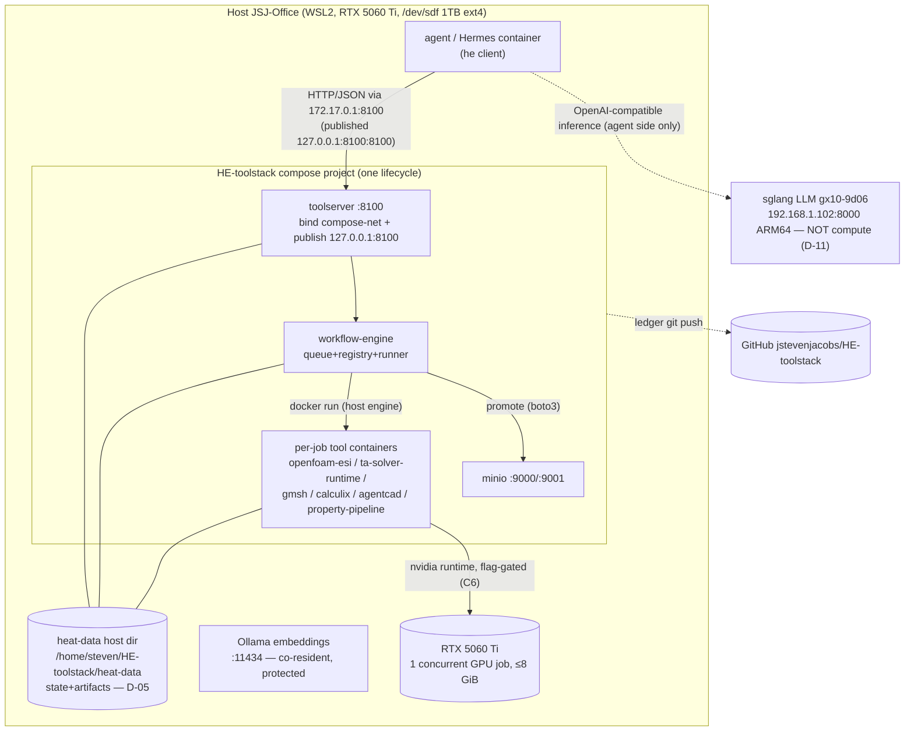
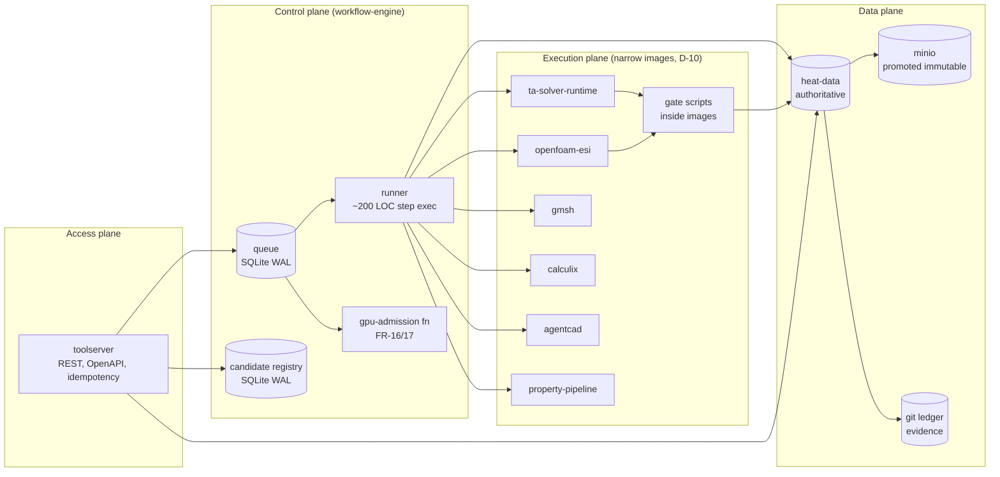
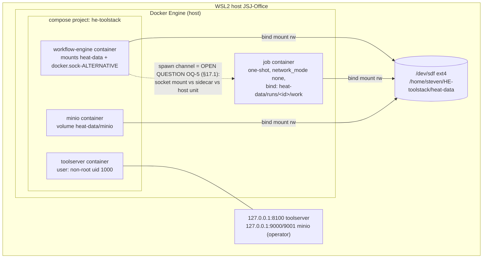
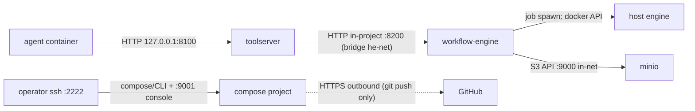
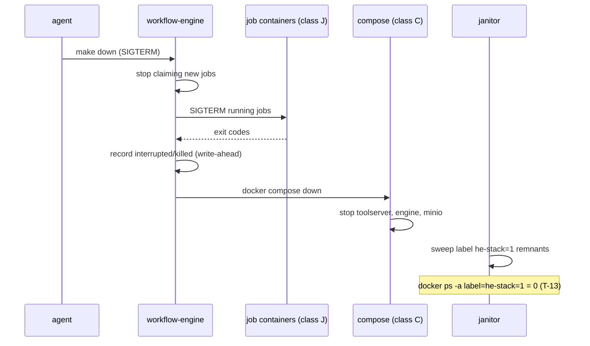
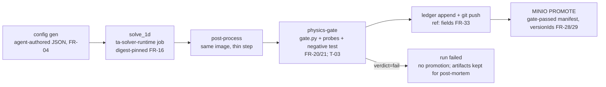
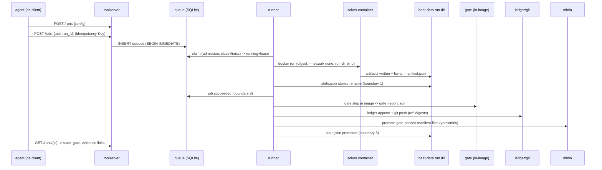
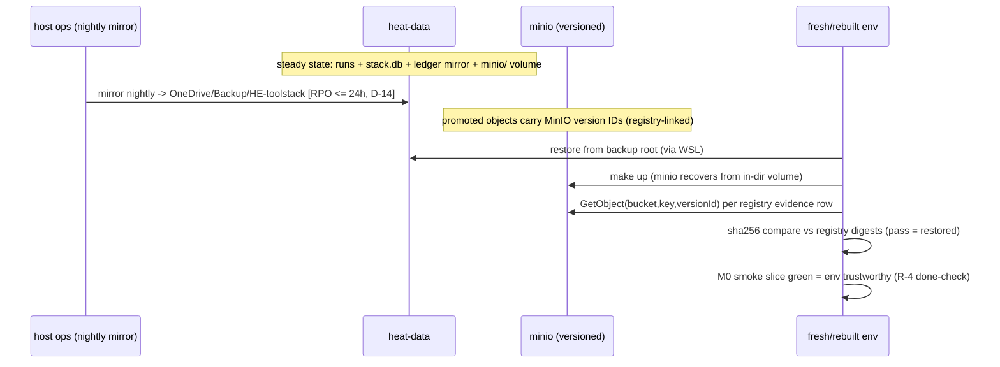

# HE-toolstack Technical Design Document

**Document:** `HE-TOOLSTACK-TECHNICAL-DESIGN.md` · v1.2 (rev 2026-11-15b: architecture-review response, FINDING-01…08 + review §5 independent areas — see revision log) · 2026-11-14
**Status:** Revised for re-review (DESIGN STATUS: CHANGES REQUESTED response package; Phase 2 deliverable A of DesignStandards §8)
**Revision log (v1.1 → v1.2 adds review-§5.5 failure-class taxonomy (§12.5) + R-9 drill; §5.1 session/claim protocol §8.8; §5.2 durability matrix §5.4a; §5.4 security-boundary table §5.4b; §5.3 admission-soundness note §6.4; FM-11…13; T-17…19 refs; OQ-7; gateway-form client URL).**
**Revision log (v1.1):** F1 client URL/bind topology (§5.1 D1, §6.4, §7.1); F2 lifecycle classes + §6.10 + D9; F3 spawn-sidecar §6.2/§10.1; F4 per-table writers §6.7/§7.5/§8.2/§8.4; F5 backup procedure §6.9/§12.2; F6 MinIO dependency semantics §6.1/§6.5/§7.2/§12.3; F7 201 contract + state boundaries §7.2/§8; F8 counts/refs across the package.
**Companions:** `HE-TOOLSTACK-REQUIREMENTS.md` (requirement IDs FR-xx/NFR-xx/T-xx/OR-xx),
`HE-TOOLSTACK-ADR.md` (decision IDs D-xx/X-x/F-x/OQ-x), `PHASE1-ARCHITECTURE-DISCOVERY.md`
(evidence inventory C1–C6, gaps G1–G11).
**Evidence tags used throughout:** [V] verified live 2026-11-14 · [E] PD-toolstack evidence
artifact (STACK-AS-BUILT `SA`, STACK-DESIGN-v3 `SD`, ledgers) · [P] proposed here, not yet
implemented · [U] unverified assumption. **Nothing marked [P]/[U] is presented as existing
functionality.** Where the standards document mandates a component that Phase 1 proved does
not exist (e.g. "GPU broker", §6.4), this document specifies what actually carries that
responsibility instead of restating the phantom.

---

## 1. Executive Summary

**Purpose.** HE-toolstack is the agentic engineering tool stack for designing, testing, and
refining heat engines: an AI agent (the primary "user") drives geometry, meshing, CFD, FEA,
thermo-property and validation tools through a narrow HTTP/JSON API, while every run leaves
auditable, digest-verified physics evidence. It is the second attempt; the first
(PD-toolstack) is frozen and read as evidence only [U→user ruling].

**Problems this architecture solves.** Attempt 1 proved the physics loop works end-to-end on
CPU (D2 gate pass [E]) but died of *operational* failure modes: state scattered across three
filesystems with no declared owner (D25), an orphaned infrastructure container with no
consumer (C4), a design that referenced components never built (C1), and hardware premises
that no longer matched reality (C4/C5/C6 [V]). HE-toolstack keeps every validated asset and
re-architects the operating envelope around single-lifecycle, single-writer, file-visible
state.

**Approach.** One Docker Compose project owns every stack service including MinIO (D-01). A
thin toolserver exposes job submission over loopback HTTP; a workflow engine (SQLite queue +
registry + ~200-line runner over `workflows/` files) owns scheduling and resumable state
(D-02). Six narrow, digest-pinned tool images (OpenFOAM-ESI, TaSMET runtime, gmsh,
CalculiX, agentcad, property-pipeline — measured 0.31–2.82 GB each [V]) execute the tools as
one-shot containers spawned per job (D-10). Canonical state lives in one host directory,
`/home/steven/HE-toolstack/heat-data`, with normative write-ahead ordering
artifacts→state→ledger (D-05); MinIO holds the promoted immutable tier.

**Major decisions.** D-01 single compose; D-02 files-first workflow engine, framework behind
tripwires; D-03 no broker daemon — queue serialization + dispatcher admission; D-04 shared
RTX 5060 Ti GPU tier with hard budget, inert until re-measure (C6); D-05 host-dir state owner;
D-10 no image consolidation (user ruling — narrow images = future adaptability); D-11 the
GB10/ARM64 sglang host is excluded from compute.

**Key technologies.** Docker Compose (single project), FastAPI-class toolserver [P], SQLite
WAL queue/registry [P], MinIO (in-project), 6 pinned solver/tool images, `he` python client
over HTTP (no MCP, D-09 inherited).

**Capabilities (initial release).** M0 vertical slice (config→deck→1D solve→gate→ledger,
CPU-only, target <10 min — proposal OR-01) through M2 hardening: 6 tool classes, candidate
registry, promoted-artifact tier, cold-session resume ≤10 min, GPU *machinery* present but
class flag off. **Limitations:** single host, single operator, no auth beyond loopback
binding, GPU unproven until C6, no multi-host scaling, no web UI.

**Significant risks.** GPU passthrough state volatility (C6 materialized; contingency = CPU-
only Option A always available); hand-rolled runner bugs (crash-matrix T-07 is an M0
acceptance artifact); host-disk SPOF (versioned MinIO tier is the copy); phantom-component
recurrence (every §6 component lists its *existing* code lineage or is marked [P]).

**Readiness.** Architecture is review-ready: requirements baselined (v1.3: 66 IDs, 100%
trace-mapped), 18 ADRs (5 user-ruled/accepted, D-15…D-18 + others proposed pending sign-off),
open questions surfaced (OQ-1…7). No milestone's acceptance depends on an unverified premise.

---

## 2. Project Scope and Objectives

### 2.1 Goals
1. Reproduce attempt-1's validated physics result (1D thermal loop, D2 gate [E]) on the new
   stack — same answers, same tolerance, bit-identity checked (FR-22, T-04).
2. Make every agent session resumable from disk in ≤10 min cold (NFR-18; D25's failure made
   this non-negotiable).
3. Make the stack's lifecycle total and disposable: `make down` ⇒ zero stack containers
   (NFR-01; C4's failure made partial lifecycle unacceptable).
4. Keep tool capability independently swappable: one capability = one image = one service
   (D-10 user ruling).

### 2.2 Functional scope (initial release)
Tool execution (6 classes), engine-config generation, solver execution, GPU-class *admission
machinery* (flag off), physics gating, file-based workflow orchestration with SQLite queue,
artifact hot tier + MinIO promoted tier, candidate registry + historical comparison,
crash-safe resume, `he` HTTP client. Requirement rows: FR-01…FR-40.

### 2.3 Explicitly excluded (initial release)
Multi-user/multi-tenant; API authentication beyond loopback binding (F-1); image registry
(host-seed + `pull_policy: never` + MANIFEST digests instead, A6/F-5); multi-host workers
(FR-41/42 boundary, M3+); web dashboard/UI; metrics/tracing stack (optional profile, F-3);
Windows-host direct execution; ARM64 builds (D14 lesson [E] — images are amd64-only by
decision).

### 2.4 Users and consuming systems
- **Primary consumer:** the coding/physics agent (Hermes sessions) via `he` client →
  toolserver HTTP on `127.0.0.1`.
- **Human operator:** Steven — compose lifecycle, ledger review, MinIO console (host port),
  host disk.
- **Downstream:** future optimizer/MDO loops (M3+, FR-41) read the candidate registry; the
  memory subsystem (cognee/Ollama, external) is *not* a stack consumer and is protected as a
  co-resident service (D-04 floor).

### 2.5 Primary operational use cases
UC-1 Design-to-result: agent submits a run (config→geometry→mesh→solve→post→gate→ledger).
UC-2 Sweep/compare: registry queries historical candidates; new run references parent digests.
UC-3 Resume: new agent session reconstructs in-flight work from `workflows/` + registry
alone (T-02 harness). UC-4 Ops: operator `make up/down`, backup = heat-data + git, restore
drill on versioned MinIO (T-11).

### 2.6 System boundaries
Inside: compose project services (toolserver, workflow-engine, minio), spawned per-job
tool containers, `heat-data` host dir, repo (`MANIFEST`, `workflows/`, CI).
Outside (dependencies, §11.2): host Docker Engine + WSL2, host disk `/dev/sdf`, GitHub
remote (ledger/git evidence), sglang LLM host `gx10-9d06` (192.168.1.102:8000, agent-side
inference only [V]), Ollama embeddings (`host.docker.internal:11434` [V]), SSH to host
(port 2222). Boundary rule: nothing stack-owned may be created outside the compose project
(NFR-10).

### 2.7 Assumptions and constraints
Assumption IDs are **Phase 1's canonical register** (`PHASE1-ARCHITECTURE-DISCOVERY.md` §3,
A1–A12) — this design adds A13–A15 and does not renumber them:
- carried: **A2** [V] host ext4 volume holds stack root + heat-data (`/mnt/c` banned for
  compute I/O); **A4** [V→drives design] all evidence-producing work so far is CPU-only — no
  GPU number may be claimed until C6 passes; **A6** [V] no private registry — host-seed +
  `pull_policy: never` + MANIFEST digests (A6 inherited [E]); **A8** [operator] single human
  is operator and final gate authority; **A11** [to-verify] Chainguard MinIO rebuild track
  available (→ OR-05); **A12** [V] no guarantee of agent chat-context durability — hence the
  external-state requirement.
- **added here:** **A13** [P] the GitHub remote stays available for ledger pushes; degraded =
  engine local-commit queue with retry (§6.2). **A14** [V] the agent runtime can reach host
  loopback ports (observed: toolserver/agent co-location on this host). **A15** [V by
  convention] uid 1000 maps host↔container for bind-mounted state (attempt 1's chown
  workarounds prove the friction of *not* designing for it).
- constraints: 8 GiB VRAM ceiling / 5.5 GiB floor (D-04 defaults, adjustable via OQ-2), 1
  concurrent GPU job, CPU cores shared with co-resident services, 1 TB disk shared with
  co-resident stacks (813 GB free at audit [V]).

### 2.8 Initial release vs later releases
Initial = M0–M2 (§16. Later = M3 fleet/multi-host (FR-41/42), M4 optimizer
automation (FR-41) — specified only as boundaries, not as promised functionality.

---

## 3. Requirements

The normative baseline is `HE-TOOLSTACK-REQUIREMENTS.md` v1.0: **40 functional (FR-01…42,
two reserved for M3+), 24 non-functional (NFR-01…24), 19 verification tests (T-01…19), 5
open requirements (OR-01…05)**. Every row carries ID, description, priority, rationale,
verification method, acceptance criteria; §5 of that file is the requirement→component→test
traceability matrix (script-verified 100% mapped, no dangling IDs). DesignStandards §3's
mandatory categories are each populated: tool invocation FR-06…15, config generation FR-04,
solver execution FR-10…14, GPU management FR-16…19, physics validation FR-20…22, workflow
orchestration FR-23…26, artifact management FR-27…29, run tracking FR-31…32, registry
FR-30…34, recovery FR-35…38, agent interaction FR-39…40; NFR categories map to REQUIREMENTS §3.1–3.10 (reliability/perf/scalability/security/maintainability/observability/
portability/data-integrity/recoverability/extensibility). This design references those IDs;
it does not restate or renumber them. Sections 5–16 carry a "covers:" line per component so
reviewers can move both directions through the matrix.

---

## 4. Current-State Architecture and Lessons Learned

### 4.1 What worked (retained because evidence says so)
| Asset | Evidence | Retention |
|-------|----------|-----------|
| Physics loop end-to-end on CPU (fork + dataset + gate + ledger; D2 gate pass incl. negative test) | SA Stage D/E rows [E] | Migrated as-is (D-12); gate methodology → physics-gate (§6.3) |
| 6 tool images (measured 0.31–2.82 GB [V]) with build recipes carrying hard lessons (D8 OpenFOAM-from-source on noble, D13 hash-pinned property stack, D14 amd64-only wheels) | host `docker images` [V]; SA [E] | Kept unchanged as proven baselines (D-10); append-frozen |
| Digest/MANIFEST discipline (`resolve.py`, `pull_policy: never`) | SA infra rows [E] | Becomes dispatcher admission rule (FR-16, NFR-09, T-16) |
| Claim/done ticket + append-only ledger workflow practice | SA Stage-E practice [E] | Formalized as `workflows/` state law (§8) |
| Backup/restore drill against MinIO | SA restore rows [E] | Re-hosted in-project (D-01), drill becomes T-11 |
| `/mnt/c` avoided for solver I/O (28–39× measured penalty) | SA D9 [E] | Encoded as heat-data-on-ext4 constraint (D-05) |

### 4.2 What failed, and why (the design drivers)
| Failure | Root cause | Design response |
|---------|-----------|-----------------|
| `infra-minio-1` orphaned — worked, then consumed nothing and outlived its project (C4) | lifecycle split across compose projects; ownership ≠ use | D-01: one project owns all; T-13 zero-orphan gate |
| State/artifact divergence; session could not answer "what is in-flight" (D25) | no declared state owner; writes ordered arbitrarily | D-05 write-ahead protocol; T-07 crash matrix |
| Design docs listed components that never existed as code (C1: gpu-broker; C2: gate "service") | summaries copied forward without code verification | This doc's evidence tags; CI MANIFEST-vs-service check (NFR-11); Phase 1 verified inventory [V] |
| gpu1 premise (DGX Spark as compute worker) | hardware reality moved: gx10-9d06 is GB10 **ARM64** running sglang; gpu2 (5090) never purchased [V] | D-04/D-11: host-only compute, ARM64 excluded, GPU budgeted + flag-gated |
| `nvidia-smi` over SSH returned no rows this pass while the card exists (C6) | WSL GPU passthrough/driver state volatility [V] | GPU class inert until C6 re-measure ticket passes; T-06 uses simulated numbers until then |
| Docker-run uid friction forced chown workarounds | container uid ≠ host uid on bind mounts [E A15; Phase-1 A1 chown workaround] | heat-data at uid 1000 by design (D-05); NFR-08 non-root audit |

### 4.3 Previous → proposed migration comparison
| Area | Previous (attempt 1) | Proposed (HE-toolstack) | Rationale | Risk carried |
|------|----------------------|-------------------------|-----------|--------------|
| Lifecycle | stack + separate `infra` project | one compose project incl. MinIO | orphan failure mode is ownership, not tech (C4) | healthcheck coupling on `up` (§11.3) |
| GPU path | gpu-broker (designed) → deleted, never ran | dispatcher admission fn + queue class | a mechanism must exist where code exists (D-03, C1) | lease semantics deferred (worker seam, NFR-05) |
| Workflow engine | LangGraph leaning (SD v3) + agent-memory state | files-first runner + SQLite; tripwires (§8) | resume-from-context-loss is a checkpoint pattern; durable-exec platform cost unjustified (D-02) | hand-rolled runner bugs → T-07 required M0 artifact |
| State location | container scratch + host tree + git, no owner | `heat-data` host dir, write-ahead normative | single-writer collapse; cold-session `ls`/`jq` contract (D-05) | manual host-dir drift → digest checks NFR-16 |
| Images | 8 images / 4 services (v1), ≤4 consolidation drafted (v2) | N images, 1 per capability, append-frozen (D-10 ruling) | user ruling: narrow scope = future adaptability; blast radius per digest | sprawl drift → MANIFEST CI; per-image host seed step (§11.3) |
| Physics-gate | scripts + methodology (proven) mis-described as service | methodology in images + thin one-endpoint wrapper (D-06) | keep what D2 proved; enforcement point without phantom daemon | wrapper drift → T-03 runs both paths |

### 4.4 Lessons directly encoded as requirements
C4→NFR-01/10; D25+C1→evidence tags + §6 lineage rule; D9→FR/D-05 ext4 placement; D8/D13→
NFR-09/11 image discipline; D14→amd64-only + D-11 exclusion; D7 (driver floor ≥591.59
sm_120)→C6 prerequisite; cleanup observation→NFR-12 per-ticket clause.

---

## 5. Target System Architecture

### 5.1 System context
The agent runs in a Hermes container on the host's Docker Engine. **FINDING-01 correction (v1.1, measured
2026-11-15 from inside the agent container):** agent→`127.0.0.1:8100` is its *own* netns →
refused [V]; `host.docker.internal` resolves but **cannot** reach WSL2-host loopback listeners
[V — ConnectionRefused]; agent→**`172.17.0.1:8100`** (docker bridge NAT gateway, discovered at
start via `ip route | awk '/default/{print $2}'`, overridable `HE_API_BASE`) connects OK when
the port is host-published `127.0.0.1:8100:8100` [V probe]. Client URL = gateway form; A14
holds only in this corrected sense. The stack never calls the LLM; the LLM/embeddings services are
*co-residents to protect* (D-04 floor), not dependencies of any job. TaSMET/OpenFOAM/OCCT/
CoolProp are in-image dependencies; GitHub is the evidence remote outside the boundary.


*Diagram 1 — system context. Solid = stack-internal; dotted = external dependency.*

### 5.2 Logical architecture
Four logical planes, one process topology. **Access plane:** toolserver (HTTP edge, auth
boundary = loopback). **Control plane:** workflow-engine — SQLite(WAL) queue + registry +
runner + GPU-admission function (the *replacement* for the designed-but-never-built broker,
D-03). **Execution plane:** spawned one-shot tool containers; images are append-frozen
capability units. **Data plane:** heat-data host dir (hot, authoritative) + MinIO (cold,
immutable, versioned) + git (evidence). State flows one way per D-05 ordering.


*Diagram 2 — logical components. Every box names real or [P]-proposed code; no broker box
exists because D-03 deleted the responsibility into ADM.*

### 5.3 Physical / deployment architecture
Single host; single compose project; toolserver published **loopback only**; MinIO published
on host for operator console only (config parameter `MINIO_CONSOLE_BIND=127.0.0.1`, §11.6 —
[proposal], not current config). Spawned job containers attach the default `he-net` bridge
only when they need egress (none in initial release — tools run offline, an explicit
posture: `network_mode: none` for solver jobs [P]).


*Diagram 3 — deployment boundaries. The job-spawn channel is a tracked open design item
(OQ-5 §17 / §6.2): mounting `docker.sock` is the known-simple path but grants container
escape-class power; alternatives listed there rather than hand-waved.*


*Diagram 4 — network communication. No inbound path exists from LAN or compose net to the
toolserver (NFR-07, T-15); external egress is git-over-HTTPS and nothing else in M0.*

### 5.4 Architectural principles
1. **One lifecycle per system** (D-01). Implication: every service has compose healthcheck +
   restart policy; `make down` is an acceptance test (T-13), not a convenience.
2. **State has exactly one owner per artifact** (D-05). Implication: heat-data is
   authoritative; MinIO/git are derived tiers; agent scratch is defined non-authoritative —
   deletion is always safe, which makes the cleanup rule enforceable (NFR-12).
3. **Write-ahead ordering is protocol, not convention**: artifacts fsync → state.json atomic
   rename → ledger append + git push. Implication: every crash window has a defined recovery
   (see §5.4a for the exact fsync/durability matrix — what is guaranteed by code vs by
   filesystem behavior is stated there, per review §5.2)
   (§12 FMEA rows FM-6/FM-8) and the crash matrix T-07 is a required M0 artifact.
4. **Thin, domain-agnostic core** (SD inheritance [E]): engine/queue/gate code contains zero
   TaSMET/OpenFOAM specifics; domain knowledge lives in images + job-type registry rows.
   Implication: new tool = new image + service + registry row (NFR-20), reviewed for
   core-diff absence at M1 (T-14).
5. **HTTP/JSON at every boundary; nothing crosses a process boundary that isn't specified**
   (§7). Implication: undocumented internals are prohibited; interfaces precede
   implementation (contract tests T-08 before endpoints mark done).
6. **Filesystem-visible state is the agent contract** (NFR-14): everything answerable by
   `ls`/`jq` over heat-data + `workflows/`, without container logs — because the consumer is
   a context-limited agent, not a dashboard.
7. **Append-frozen capability units** (D-10): images gain *versions*, never new tools;
   capability growth spawns a new image/service pair. Implication: blast radius per digest,
   rebuild recipes stay single-purpose, and A/B bit-identity (FR-22) gates every bump.
8. **Budgeted sharing over exclusive claims** (D-04): GPU/CPU admission at the dispatcher,
   with floors protecting co-resident services; no job may assume it owns hardware.
9. **Evidence tags survive into code**: MANIFEST digests, ledger `ref:` fields, and CI
   MANIFEST-vs-compose checks keep phantom components structurally impossible (NFR-09/11).

---


### 5.4a Durability matrix — what fsync guarantees vs what filesystem behavior guarantees
[review §5.2, added 2026-11-15; normative for §8.6 and T-07]
| Step | Operation | Durability mechanism | Guarantee if process killed | Guarantee if power/host dies |
|------|-----------|---------------------|-----------------------------|------------------------------|
| 1 job outputs | worker writes `jobs/<id>/out/…` + `manifest.json` last | `fsync(file)` then `fsync(dir)` before manifest rename [code requirement, T-07 asserts via syscall trace or crash-point test] | complete (kernel flushes on process exit) | complete only if data already on platter; **crash-point test tolerance**: partial output = incomplete manifest ⇒ §8.6 re-queue |
| 2 state.json | write temp → `fsync` → `os.replace` → `fsync(dir)` | atomic rename (ext4 guarantee: rename is atomic w.r.t. readers) + dir fsync for rename persistence | readers see old-or-new, never torn (FM-8) | same, with ≤ one rename-window uncertainty — resolved by §8.6 ordering rules |
| 3 ledger | append line → `fsync` → git push later | append-only + fsync | partial line possible at EOF ⇒ **ledger reader tolerates trailing torn line** (parse-lenient; last-good-line checkpoint in state.json) | same |
| 4 git push | network op | not a durability step (copy, not authority); retry queue (FM-9) | drained on retry | drained on retry |
**Declared dependencies on filesystem behavior:** ext4 with `data=ordered` default (WSL2 default [V preflight]) — rename atomicity + rename-on-write are relied upon; **not** relied upon: delayed-allocation atomicity of *content* writes (hence explicit fsync in rows 1–2); **not** relied upon: O_DIRECT (absent). SQLite rows: SQLite's own WAL fsync discipline (per SQLite docs [V]), engine adds none. Disk-failure beyond OS crash is explicitly outside every row — RC-5/backup territory (§12.5).

### 5.4b Security-boundary table [review §5.4, added 2026-11-15 — one place, all boundaries]
| Boundary | Mechanism | Credential crossing it | Blast radius if crossed |
|----------|-----------|------------------------|-------------------------|
| agent → toolserver | `127.0.0.1` published bind + gateway-IP client URL (§6.4, D-15); no other listener | none (no HTTP auth, loopback = control, §10.2) | can submit/inspect jobs as operator — same trust class as operator shell |
| toolserver → engine | compose-internal network, service DNS (§7.5) | none | engine is same trust class (both operator-owned code) |
| engine → Docker daemon | **pending OQ-5**: sidecar holds the socket, engine talks narrow HTTP (§6.2, D-16) | sidecar exposes ONLY `create_run`/`status`/`kill`/`logs` for digest-pinned images | with sidecar: one container's lifecycle; with raw socket (rejected option): full host root |
| solver container | `--user`, `--pids-limit`, mem/cpu caps, single bind `jobs/<id>/` rw (§6.2), `--network none` for batch phases | none — inputs arrive pre-staged on its bind; no token in env | only its own job dir |
| MinIO credentials | root creds compose-env (operator-only ports `127.0.0.1:9000` [V §11.3]); service account per-writer bucket prefix [P] | engine holds promote-scoped service key, toolserver none | evidence bucket (delete-able tier, not authority) |
| Git credentials | host-side only — ledger push runs via host git askpass [E proven PD pattern]; **no git creds inside any container** [V: current PD-toolstack push is host/session-side] | n/a into containers | cannot be leaked by a container compromise |
| host filesystem | heat-data owned `steven:1000`, containers run `user: 1000:1000` (§11.3) | file perms = only gate | heat-data subtree; host OS unreachable (no socket in containers, §6.2) |
| network isolation | compose project nets; published ports all `127.0.0.1:` prefix (D-15); solver `--network none` at batch | — | LAN never exposed |
This table is the checklist answer for review §5.4; each row's [E]/[V] tag is the same evidence discipline as elsewhere.


## 6. Detailed Component Design

Component inventory note (DesignStandards §6 lists "Solver service" and "GPU broker" as
subsections): the verified architecture has **no long-running solver service** (solvers are
one-shot containers spawned per job — verified pattern from Stage D/E [E] plus D-03) and **no
GPU broker** (deleted in v3.2 before Stage E; C1). §6.2 and §6.4 specify what actually
carries those responsibilities. Each component below answers the §7 reviewability questions
(problem solved, necessity, responsibilities, interfaces, data owned, dependencies, failure,
testing, deployment, limits). Code-lineage column: **[existing]** = code in PD-toolstack
evidence tree [E]; **[P]** = new code this design proposes; **[asset]** = methodology/scripts
proven by ledger.

### 6.1 Toolserver  [P — thin; lineage: no prior HTTP server existed; agent called scripts directly [E]]
- **Problem/necessity:** the agent needs one narrow, contract-testable door into jobs,
  queue, registry and gate — instead of ssh-and-pray shell access (attempt-1 practice). It
  is also the single place loopback security (NFR-07) and idempotency (FR-39) live.
- **Owns:** HTTP request validation, job submission records, idempotency-key store,
  OpenAPI surface, error envelope. **Explicitly does not own:** scheduling (engine), state
  writes into workflows/ (runner), physics verdicts (gate scripts), MinIO credentials
  (engine's promote worker holds them).
- **Internal modules [P]:** `api.py` (FastAPI app, ~400 LOC budget), `jobs_repo.py`
  (SQLite via same WAL file as engine — **per-table writer ownership, F4/OQ-6 proposed
  resolution ADR-D-08 A1**: toolserver opens RW **only** on `queue` + `idempotency_keys`
  tables; engine owns every other table; WAL allows one *transaction* at a time, busy_timeout
  5 s serializes fairly), `idempotency.py` (key→job-id map, 24 h window),
  `errors.py` (single envelope §7.3).
- **Tech/version:** python 3.12-slim base (same base as property-pipeline image pattern [V]),
  FastAPI + uvicorn (versions pinned at first build; no version claimed here — none verified).
- **Interfaces:** §7.2 (all endpoints). **Reachability (v1.1, F1):** host-side CLI/health →
  `http://127.0.0.1:8100`; **agent-side (`he`) → `http://172.17.0.1:8100`** (§7.1 canonical).
  Publishing form is normative: `"127.0.0.1:8100:8100"` — bare `"8100:8100"` (0.0.0.0) is a
  preflight failure (§11.3). **Configuration (§11.6):** `TS_BIND` (inside-container bind `0.0.0.0` on the compose interface is REQUIRED for the
docker-proxy to forward; host-side exposure is what stays loopback-only via the `ports`
127.0.0.1 prefix — FINDING-01 clarifies the two layers), `TS_PORT=8100`,
  `HE_DATA=/data`, `QUEUE_DB`, `IDEMPOTENCY_TTL`.
- **Persistence:** none of its own beyond queue DB rows + idempotency table.
- **Startup/shutdown:** compose `depends_on: workflow-engine: condition: service_healthy`;
  boot = open WAL read/insert, serve; SIGTERM = drain in-flight HTTP (≤5 s), no job state to
  flush (all durable state is in SQLite WAL).
- **Health/logging:** `/healthz` (DB open + writable check); JSON stdout logs with
  `run_id/job_id` fields (NFR-13).
- **Failure modes:** crash ⇒ zero data loss (stateless edge; agent retries with same
  idempotency key, FR-39); WAL lock contention with engine ⇒ single-writer ordering means
  toolserver inserts are rare small writes; p95 read target NFR-04 (T-09 under load).
- **Security:** loopback-only bind, non-root uid 1000, no MinIO creds, request body caps
  (artifact pointers not bytes — §7.4), CORS off.
- **Testing:** contract suite T-08 (OpenAPI fixtures incl. error envelope, idempotency
  replay, 413/409/422 paths). Deployed as compose service `toolserver` (§11.3).
- **Limits:** no authN/Z (F-1); single instance; not a file server (never streams artifact
  bytes — agent reads heat-data directly [V host-dir contract]).

### 6.2 Job dispatcher + queue + runner (the "workflow engine")  [P core; runner lineage: Stage-E claim/done scripts [E asset]]
- **Problem/necessity:** serializes contention-prone resources (the GPU, CPU slots),
  survives agent-context loss, and enforces the write-ahead protocol (§5.4-3) in one place.
  This is the component that *replaces* both the never-built gpu-broker and the LangGraph
  leaning (D-02/D-03).
- **Owns:** queue rows, job leases (single-writer within this process), worker seam,
  `workflows/` state law enforcement, ledger appends, promotion triggers. **Does not own:**
  HTTP edge (§6.1), physics logic, image builds.
- **Internal modules [P]:** `queue.py` (SQLite WAL, states §8.2, one-writer loop),
  `admission.py` (GPU budget fn: nvidia-smi-when-available + reservation ledger, FR-16/17;
  pure function, unit-tested with simulated values — T-06 — because C6 is unresolved),
  `worker_docker.py` (**the Worker seam**: `Worker.spawn(job_spec)->handle`; v1.1 per
  FINDING-03: engine never sees a Docker socket under any option. Option B (recommended,
  **operator decision pending**, ADR-D-16/§13.1): engine calls the `spawn-sidecar` HTTP API
  (`POST /spawn`, `GET /{id}/status`, `POST /{id}/kill`, `GET /{id}/logs` — the four
  methods of ADR-D-16) over `he-internal` net; expired-container reclamation is
  the sidecar's own janitor timer, not an engine-facing method;
  sidecar exclusively holds `/var/run/docker.sock` and **server-side** enforces the spawn
  contract (digest allow-list §11.2, `network=none`, cap-drop/non-root, cpuset+mem ceilings
  §6.8, bind paths ⊂ `{he-scratch, job-scratch, run inputs}` only) + semantic audit row per
  call. Options A (socket→engine) and C (host systemd engine) remain open for the operator;
  the honest cost of B is one more container and one more failure mode (sidecar down =
  dispatch stall, detectable, queue keeps work). `runner.py` (~200 LOC: read `workflows/<flow>/state.json`
  → claim next ticket → exec step → write-ahead per D-05), `promote.py` (boto3 client →
  MinIO, gated by FR-29 rule), `ledger.py` (append + git push + local-commit queue when
  remote unreachable, A13).
- **Job-type registry (not a separate service):** table `job_types(tool, image_digest,
  entry, cpu_class|gpu_class, limits…)` — the extensibility point NFR-20; new tool = row +
  image + compose service entry, zero core edits (T-14 proves at M1).
- **Concurrency control:** `max_concurrency` per class (cpu: cores-based default 2 [P];
  gpu: **1** hard, D-04); GPU class refuses to start any job while
  `GPU_CLASS_ENABLED=false` (default until C6 passes — FR-18).
- **Startup/shutdown (v1.1, FINDING-06 — MinIO reclassified as OPTIONAL dependency,
  ADR-D-17):** boot = crash-recovery pass (§8.6: reconcile running-state jobs vs container
  reality), then loop; **MinIO is waited for ≤60 s and boot proceeds regardless** with
  `minio=unavailable` in health — job dispatch and physics never block on MinIO (FR-13
  promotion is async). SIGTERM = stop claiming, drain per §6.10 class-J rules, WAL clean
  close. Compose `depends_on: minio: condition: service_healthy` is demoted to
  `service_started` (§11.3) so a MinIO crash-loop can never wedge engine startup.
- **Long-running jobs, cancellation, reconciliation (review §5.1, explicit 2026-11-15):**
  a solver container is a **child of the dockerd daemon, not of the engine process** —
  engine restart (RC-1/RC-2) does not kill a running job; boot reconcile (§8.6) re-adopts
  it by container label probe (`heat.job_id`) within the lease window. Cancellation is
  engine-driven: `/jobs/{id}/cancel` → queue flag → engine sends SIGTERM to the container
  (grace 30 s [P]) → kill; the terminal state is written by the engine, not the job.
  Reconciliation runs at **boot and every 60 s tick**: for each `running` row, the
  sidecar's container-exists query is ground truth (state vs daemon, §6.2); mismatches
  resolve via the §8.6 matrix — never silently.
- **Health/logging (v1.1 F6/NFR-23):** `/healthz` = **pure liveness** (loop heartbeat
  <30 s old; never 503s for dependency loss); `/readyz` = readiness incl. dependency map
  `{minio: ok|down, sidecar: ok|down|absent, docker: via-sidecar}`; queue-depth gauge in JSON logs;
  every state transition emits one structured event (run_id, from, to, cause).
- **Failure modes/recovery:** full matrix T-05/T-07; crash mid-claim = lease timeout
  re-queues (idempotent step exec: step re-run sees its own artifact manifest and skips —
  FR-38); WAL survives kill -9 (NFR-02).
- **Security:** sole holder of MinIO root creds (§10); sole writer to `workflows/`. Under
  the recommended OQ-5=B shape the **security-critical container is the spawn-sidecar** (§10.1
  threat model row; review gate), not the engine — engine compromise caps at queue/workflow
  integrity + sidecar-API abuse within the allow-list, not host root.
- **Performance:** queue ops are sub-ms local SQLite [P, measure at M0]; step overhead
  budget counted into OR-01 timing (NFR-03 flag).
- **Testing:** unit (admission math, lease logic), integration (queue+reboot T-05), crash
  matrix T-07, cold-session harness T-02. **Deployed:** compose service `workflow-engine`.

### 6.3 Physics-gate  [asset: gate.py + probes + negative test proven D2 [E]; wrapper [P thin]]
- **Problem/necessity:** no run may claim `succeeded` without a verdict (FR-20); attempt-1
  proved the methodology *including a negative test that catches corrupted results* (D2).
  The design decision (D-06) is to ship the scripts unchanged inside images and add one thin
  endpoint — the endpoint adds no verdict logic.
- **Owns:** gate checklist definitions (`gates/*.py` in repo → baked/bound), report format,
  tolerance tables (dataset-derived, from D2 evidence [E]). **Does not own:** solver numerics,
  verdict interpretation beyond pass/fail/warn.
- **Execution path:** runner step `gate` runs `python -m gates <run-dir>` inside the tool
  image that owns the physics (TaSMET/OpenFOAM) — same image = same numeric stack (bit-
  identity FR-22); toolserver `POST /gate/run` execs the identical command in a spawned
  container (T-03 tests both entry paths produce byte-identical reports).
- **Inputs/outputs:** run-dir (state.json + artifacts + digests) in; `gate_report.json`
  (checks[], values, tolerances, verdict, digests covered) out — written to heat-data,
  referenced by ledger row.
- **Failure/recovery:** script crash ⇒ verdict `error`, run cannot succeed (fail-closed);
  report absent ⇒ registry refuses `succeeded` (constraint enforced at registry write, not
  convention).
- **Tech:** numpy/CoolProp already in images [V]; no new dependencies (deliberate).
- **Testing:** T-03 incl. the carried-over corruption-injection negative test; tolerance
  changes require an ADR row (physics semantics = decisions).

### 6.4 "GPU broker" responsibility — dispatcher admission  [P; lineage: designed never built, deleted v3.2 [E C1/D-03]]
- **Problem/necessity:** one shared 16 GB card with a protected 4.98 GiB embeddings floor
  [E] needs *admission control*, which is arithmetic + a reservation ledger — not a daemon.
- **How "handles GPU jobs" is actually implemented [P]:** `admission.can_start(job)` reads
  (1) class flag, (2) current GPU-class running count (queue truth), (3) reserved VRAM sum,
  (4) latest `nvidia-smi --query-gpu=memory.used` sample (cache ≤30 s; when probe returns
  nothing — the C6 state — behaves as if usage = floor + safety margin), and refuses unless
  `running == 0` and `reserved + job.vram_ceiling ≤ total − floor`. Reservation lives in the
  queue row (crash-safe; no separate store). Numbers: ceiling 8 GiB / floor 5.5 GiB (D-04
  defaults, OQ-2 adjustable), all three as config keys (§11.6), none hard-coded.
- **What it explicitly is not:** no worker protocol, no leases to remote hosts (M3+ re-ADR
  per D-03 revisit clause), no MPS/time-slicing (job count is 1 by policy).
- **Failure modes:** probe lies (WSL volatility, C6) ⇒ class stays off (flag) or admission
  errs conservative (margin) — the *acceptance schedule* is protected because no M0–M2 gate
  uses GPU (FR-19).
- **Testing:** T-06 pure-function suite over simulated `nvidia-smi` matrices + flag-off
  refusal + boundary math; live variant runs only after C6.
- **Admission-math soundness review (review §5.3, 2026-11-15):** the inequality
  `reserved + ceiling ≤ total − floor` is **conservative against the known floor**
  (4.98 GiB observed LLM/embedding co-residency [E]) but NOT against *unmodeled* consumers
  (a browser using the dGPU, Windows desktop compositor). Two honesty clauses added:
  (a) `nvidia-smi memory.used` is sampled and treated as **advisory-only** (WSL2 under-reports
  Windows-side allocations — known limitation, so the *floor* is the safety mechanism, the
  sample can only make admission stricter, never looser); (b) OOM failure mode FM-4 is
  accepted-realistic: worst case is one killed job + console re-queue, never host instability
  claim. **No numbers changed** (D-04 accepted; OQ-2 still gates activation — unchanged).

### 6.5 MinIO / artifact storage  [existing image pattern [E]; now in-project (D-01); promote worker [P thin]]
- **Problem/necessity:** attempt-1's one *successful* storage story (backup/restore drill)
  must survive without orphan risk (C4). MinIO = versioned, immutable, S3-API cold tier for
  promoted evidence; it is deliberately **not** in the solver hot path (X-5).
- **Owns:** buckets `he-promoted` (+ `he-quarantine`), object versioning + retention config,
  lifecycle: put-only from promote worker; operator UI on host loopback. **Does not own:**
  hot artifacts (heat-data, D-05), registry links (engine writes, registry row stores
  bucket+key+versionId).
- **Promote path [P]:** engine step after ledger push (ordering §8.4): files listed in the
  gate-passed manifest → `s3:PutObject` (versioning on) → versionId recorded in registry →
  ledger row `minio:` field. Restore drill T-11: delete local copy, `GetObject` by
  versionId, digest-compare.
- **Startup/shutdown:** compose `minio` service, healthcheck `mc ready local`; volume under
  heat-data so backup = one dir (plus MinIO metadata inside it — single-owner principle).
- **Failure/recovery:** unavailable ⇒ promote step retries with backoff; **runs keep
  succeeding** (promotion is an evidence step, not a physics step — a job blocked on MinIO
  surfaces as `degraded-evidence` state §8.2, never `failed`); disk-full shares FM-6 §12.
- **Security:** root creds env-injected to engine only; console binds loopback (§11.6
  proposal); anonymous access disabled; buckets private. **Supply chain:** A11 Chainguard
  rebuild question stays an open ticket (OR-05) — digest pin in MANIFEST meanwhile.
- **Testing:** T-11 drill + T-13 lifecycle + T-16 digest admission for its image.

### 6.6 HE Python client (`he`)  [P thin; lineage: none — agent used shell [E]]
- **Problem/necessity:** the agent's resume guarantee (FR-36/T-02) requires that status
  questions be answerable by *files*, but day-to-day driving wants a typed call surface; the
  ruling D-09 [E SD v3.8.1] keeps it HTTP, not MCP.
- **Owns:** request/response models mirroring §7, retry-with-backoff honoring
  `Retry-After`, idempotency-key generation (uuid4 default), `he` CLI for humans.
  **Does not own:** any state — it is a stateless stub (resume runs on files regardless).
- **Distribution:** installed in the agent container image via repo wheel (dev: `-e`);
  versioned with the repo (client/server drift caught by contract suite T-08 fixtures).
- **Failure modes:** server down ⇒ typed `ConnError` after bounded retries with identical
  keys (no duplicate submits, FR-39); long solves ⇒ client may exit; job state unaffected
  (NFR-18 contract).
- **Testing:** T-08 client-side fixtures; T-02 proves *nothing essential* needs the client.

### 6.7 Candidate registry  [P; lives in the engine's SQLite (D-08), one file, **per-table writers** — engine sole writer of `candidates` (F4 wording fix: v1.0 "one writer" per-file was ambiguous)]
- **Problem/necessity:** M3 optimizer work (and human review) needs "what have we tried,
  with what config, what gate verdict, where is the evidence" — attempt-1 had the D-ledger
  prose but no queryable store (G-gap, P1).
- **Schema (design, §A-json):** `candidates(run_id UNIQUE, parent_run, config_digest,
  tool_versions_json, gate_verdict, metrics_json, created_at)` + `evidence(run_id, kind,
  path|bucket+key+versionId, digest)` + `job_types` (§6.2). Foreign keys + `PRAGMA
  foreign_keys=ON`; registry rows are the only join point between the three tiers.
- **Write rule (enforced, not conventional):** a candidate may reach `succeeded` **only** if
  a gate_report with matching digests exists (DB trigger rejects otherwise — FR-20 mechanical
  enforcement). Legacy: one-time import of the PD-toolstack D-ledger *read-only* (OQ-3
  pending) as provenance rows tagged `legacy:` with digest-of-file (D-ledger evidence row
  probe, T-10).
- **Reads:** toolserver `/candidates*` (§7.2); comparison views = SQL over metrics_json.
- **Failure/recovery:** same WAL durability as queue (NFR-02); corruption = restore from
  promoted ledger + rebuild script (registry is derivable from ledger+heat-data — declared
  *rebuildable*, not sacred).
- **Testing:** T-10 lifecycle, link integrity, trigger refusal path.

### 6.8 Supporting infrastructure
- **compose project + Makefile [P]:** services `toolserver`, `workflow-engine`, `minio`;
  profiles `gpu` (post-C6), `console` (MinIO UI), `postgres` (F-2 parked). `make up|down|
  logs|test`; zero-orphan acceptance T-13.
- **CI [P, pattern proven in SA: gitleaks ran in CI [E]]:** gitleaks on push; MANIFEST↔
  compose image cross-check (NFR-11); pytest suites (unit/contract); done-check lint
  (cleanup attestation present — NFR-12). GitHub Actions on private repo (standard runners;
  nothing exotic claimed).
- **Host pre-seed step [P, one script]:** loads 6+ images from saved tars / builds on host,
  writes digests to MANIFEST, verifies `docker images --digests` match (A6 no-registry
  consequence, FR-16/T-16, NFR-15 reproducibility).
- **heat-data layout:** normative tree §9.2 + Appendix directory listing.


### 6.9 Host backup job  [thin host timer, in-repo `deploy/backup/` [P]; not a compose service — lifecycle class X, §6.10]
- **Problem/necessity:** D-05 makes one host dir authoritative — off-box copies are the only hedge
  against disk loss, and attempt-1 proved drills are worthless unless they run against the *real*
  destination. The user ruling of 2026-11-15 (D-14) fixes the destination so drift is impossible.
- **Destination (D-14, user ruling, canonical — NOT a design choice):** every backup output —
  full or incremental — lands under exactly `/mnt/c/Users/steven/OneDrive/Backup/HE-toolstack/`
  (verified present on host [V]; attempt-1's proven cron+drill used the same OneDrive root [E
  §10.5, row 13]). Layout: `heat-data/<yyyymmdd>/` (state), `repo/` (git bundle), `drills/`
  (evidence). No other destination is a restore source; a second-disk copy is optional
  redundancy, never canonical. X-8 (no hot solver I/O on `/mnt/c`, 28–39× penalty [E]) is
  **not** violated: backups are cold, append-only copies off the critical path [E ruling-
  reconciliation; §14 note].
- **Application-consistent procedure (FINDING-05, GitHub #6 — supersedes the v1.0 plain-rsync
  sketch; a completed rsync is explicitly NOT evidence of consistency):**
  1. **Quiesce-lite:** preflight refuses to start while any job is in `running` unless
     `--allow-active` (default refuse; a full idle window nightly is the M0 schedule) [P].
     Active-solver policy: solver runs are ≤ minutes (FR-05 class); nightly window chosen to
     miss them; a job that *starts during* the run makes that backup **job-artifact-incomplete**
     — the manifest records `active_jobs_at_start` so a restore knows exactly what to expect.
  2. **SQLite:** never copy live `.db`/`.db-wal`. Use `sqlite3 file:heat.db?immutable=0
     ".backup <staging>/heat.db"` (online backup API — consistent snapshot, WAL folded in)
     then `PRAGMA wal_checkpoint(TRUNCATE)` on the *staging copy* only [V method: SQLite
     online-backup API is the documented hot-copy path].
  3. **MinIO:** consistency per the image actually deployed (RELEASE.2025-04-22 [V]):
     server-side bucket versioning + `mc mirror --overwrite` (in-net, read-only source) into
     staging, **not** a raw copy of the MinIO data dir while the server writes. Raw-dir copies
     are banned: erasure/dir layout is not crash-consistent under concurrent writes [V: MinIO
     documents no read-your-writes dir snapshot]. `mc diff` after mirror = verification input.
  4. **Stage + atomic complete:** everything writes to
     `heat-data/<yyyymmdd>.staging/` first; on success write `MANIFEST.json` (per-file
     sha256, counts, `active_jobs_at_start`, stack git SHA, DB `integrity_check` result) then
     `mv` staging → final dir name. mv within one filesystem = atomic visibility, so an
     **interrupted backup is either absent or a visibly-named `.staging` leftover** (next run
     quarantines + deletes stale staging >48 h, logged). No partial final dir can exist.
  5. **Verification:** after finalization, spot-verify 25 random manifest sha256s against
     source-of-record files; OneDrive sync completion is *observed*, not assumed — poll
     until sentinel `DONE` file shows sync state "uploaded" (File-Attributes API /
     `attrib -r` placeholder check on the Windows side) with timeout = failure [P]; RPO
     claim is only as good as this step (D8 diagram node).
  6. **Restore reconciliation (R-4/R-8 full validation):** restore order = registry DB →
     runs/ tree → MinIO mirror-back (server down during restore ⇒ no split-brain; single
     writer restart after) → `make doctor` cross-checks every `promoted` candidate's
     manifest digest vs MinIO object version. Post-restore the DB is the *stale* truth by
     ≤ RPO: any artifact on disk newer than its DB row is treated as orphan-suspect (moved,
     not adopted) — adoption requires a human call, recorded in `ledger.md`.
- **RPO/RTO [P assumptions for review]:** RPO ≤24 h (nightly; OneDrive continuous sync of
  already-written files is *secondary* protection, not the RPO clock — sync lag under
  Files-On-Demand is [U]). RTO ≤2 h for registry+runs, +1–3 h MinIO mirror-back at M0
  volumes (~GBs [E estimate]); validated by T-11 drill measurement, not asserted.
- **Integrity verification:** every final dir has MANIFEST.json w/ sha256 set; monthly drill
  = restore latest into throwaway path → T-11 digest compare → sentinel + sync-status proof.
- **Testing:** T-11 asserts (a) timer writes only under `BACKUP_ROOT`, (b) staging-then-move
  ⇒ interrupted run leaves zero final dirs, (c) drill reproduces digests from that path,
  (d) `active_jobs_at_start` recorded, (e) sync-completion observed before `DONE`.
- **Alternatives:** second physical disk only — demoted to *optional* local redundancy [E:
  previous `/home/steven/backups` practice]; ruled out as canonical because it shares the
  host's fate. restic/borg encryption+dedup — deferred to M2 [P]: OneDrive versioning covers
  the near-term risk; add once volumes justify key-management cost. `vfsstreaming`/SQLite
  snapshot-file copies — rejected: don't fold WAL correctly [V: SQLite docs].

### 6.10 Container lifecycle classes, shutdown, and the janitor  [FINDING-02, GitHub #3 — added 2026-11-15]
- **Lifecycle owner of every container (normative; ADR-D-01 A1):**
  - **Class C — compose services (6):** toolserver, workflow-engine, minio, he-scratch-keeper
    (long-lived helpers stay ≤2), + registered tool images run *as services only if ever
    long-lived* (none in M0). Compose owns create/start/stop/remove; `docker compose down`
    removes exactly these.
  - **Class J — one-shot job containers:** spawned by the engine through the OQ-5/D-16 spawn
    channel with labels `he-stack=1`, `he-job-id=<id>`. Compose does **not** know them; the
    engine owns their whole lifecycle: create → run → exit recorded to registry row →
    `docker rm` by the janitor. Grace period: exited containers are kept ≤15 min [P] for
    log-tail capture, then reaped.
  - **Class X — host backup timer (§6.9):** systemd timer on the host, **declared
    infrastructure exception** to compose ownership (D-01 A1). Never a compose resource, never
    a stack dependency; its absence degrades backups, not execution.
- **Shutdown sequence (normative; diagram D9):** `make down` = (1) engine receives SIGTERM →
  stops claiming, sends SIGTERM to running class-J containers, records each as `interrupted`
  in the registry (write-ahead), waits ≤ grace `SHUTDOWN_GRACE_S=60` [P] then force-kills +
  records `killed`; (2) `docker compose down` stops class C; (3) janitor sweep removes any
  label `he-stack=1` remnants (idempotent). Acceptance (T-13, revised): after `make down`,
  `docker ps -a --filter label=he-stack=1` = **0 rows** — asserted over C∪J, which is how the
  zero-container claim is now scoped (compose alone could never satisfy it for class J — the
  v1.0 wording overstated, corrected).
- **Crash/abandonment:** engine-boot reconciliation (§8.6) lists labeled containers vs
  registry rows: container-without-row → reap; row-running-without-container → `interrupted`
  → requeue (idempotent step re-entry, FR-38). Hourly janitor repeats the sweep; invariant
  NFR-24 makes "container exists that no owner claims" a detectable defect, not a leak.
- **Recovery from daemon restart:** boot sequence runs reconciliation before serving.

### D9 — Lifecycle & shutdown sequence (FINDING-02)

*Diagram 9 — shutdown with running jobs. The backup timer (class X) is not in this flow: it is host infrastructure (D-01 A1).*
## 7. API and Interface Specifications

### 7.1 Conventions
- **Canonical client URLs (F1, v1.1):** agent/`he` → `http://172.17.0.1:8100` (WSL
  bridge-gateway route to the host-published port; auto-discovered, `HE_API_BASE` override);
  host operator → `http://127.0.0.1:8100`. Both hit the same toolserver; a connect test must
  run **from inside the agent container** (§11.5 probe — host-side curl proves nothing, F1).
Base `http://127.0.0.1:8100`; JSON only; auth: **none by design in initial release — the
loopback bind *is* the control** (NFR-07; deferred auth F-1 documented there, never implied
present). All timestamps RFC 3339 UTC. All list endpoints cursor-paginated (`?cursor=&limit=`,
default 50). Errors (§7.3) on every endpoint; unknown fields rejected (`422`) so contract
drift is loud. Idempotency: mutation endpoints accept `Idempotency-Key` header (client-
generated uuid4; server keeps 24 h map; replays return stored response + `Idempotent-Replay:
true`, FR-39). Timeouts: server request timeout 30 s except submission endpoints (payloads
are pointers, not bytes — §7.4); client default 10 s + 3 retries w/ backoff on 5xx/conn.

### 7.2 Endpoints [P — proposed contract; T-08 fixtures are the normative artifact]
| Method | Path | Purpose | Auth | Idem | Success | Notable errors |
|--------|------|---------|------|------|---------|----------------|
| GET | `/healthz` | liveness (toolserver/healthz mirrors engine/minio reach) | — | — | 200 | 503 deps down |
| POST | `/jobs` | submit tool job `{tool, params, run_id?, vram_ceiling?, priority}` | loopback | ✔ | 201 `{job_id, queue_pos}` | 422 unknown tool/digest not in MANIFEST (`409 digest_unpinned`); 413 body>1 MiB; 429 queue-full (bound 200 [P]) |
| GET | `/jobs/{id}` | status `{state, started?, finished?, exit?, gate?}` | loopback | — | 200 | 404 |
| GET | `/jobs?state=&tool=&cursor=` | list/filter | loopback | — | 200 | — |
| POST | `/jobs/{id}/cancel` | request cancel (SIGTERM→grace→kill 30 s [P]) | loopback | ✔ | 202 | 409 already terminal |
| POST | `/runs` | create run `{goal, parent_run?, config{}}` | loopback | ✔ | 201 `{run_id}` | 409 parent unknown |
| GET | `/runs/{id}` / `/runs/{id}/state` | run meta / state.json mirror | loopback | — | 200 | 404 |
| GET | `/runs/{id}/artifacts` | manifest listing `{path, digest, size, promoted?}` | loopback | — | 200 | — |
| POST | `/gate/run` | run gate for run `{run_id, checks?}` → exec §6.3 path | loopback | ✔ | 201 → job_id (async) | 409 run not in gateable state |
| GET | `/candidates` / `/candidates/{run_id}` | registry queries + comparison `{metrics, gate, evidence[]}` | loopback | — | 200 | 404 |
| GET | `/workflow/{flow}` | `workflows/<flow>/state.json` mirror (agent resume aid) | loopback | — | 200 | 404 |
Example `POST /jobs`: req `{"tool":"gmsh","params":{"geo":"runs/r7/geom.step","hmax":0.4},"run_id":"r7"}` → 201 `{"job_id":"j-01H…","state":"queued","queue_pos":2}`.

### 7.3 Error envelope (single shape everywhere)
`{"error":{"code":"digest_unpinned","message":"image sha256:aa.. not in MANIFEST rev 0ed664b","details":{…},"trace_id":"t-…"}}` + matching HTTP class (4xx caller, 5xx stack). `trace_id` appears in server JSON logs (NFR-13 correlation).

### 7.4 Artifact rule (interface-relevant)
API moves **pointers + digests**, never bytes; byte access is the filesystem (agent mount /
host path) or presigned-free in-net S3 for tool containers. Keeps the HTTP edge stateless
and the p95 latency budget honest (NFR-04).

### 7.5 Component-to-component interfaces
- **toolserver → engine:** shared SQLite WAL with **per-table write ownership** (v1.1,
  FINDING-04; ADR-D-08 A1 = proposed OQ-6 resolution, reviewer verdict pending): toolserver
  sole writer of `queue` (+ `idempotency_keys`), engine sole writer of everything else
  (`jobs` transitions, candidates, runs, gate_results, promotion_queue, reconcile_log).
  Queue submission = one-transaction insert of `{queue row + immutable job_spec snapshot
  fields}` (atomicity by single-row commit). Claim atomicity: `UPDATE queue SET
  state='claimed', worker='engine' WHERE id=? AND state='queued'` + affected-rows==1 check —
  WAL write-serialization makes exactly one claimer win under busy_timeout 5 s [P; T-05
  concurrent-claim test]. Crash: half-inserted submission cannot exist (transaction);
  queued-but-never-claimed rows expire to `abandoned` via lease sweep (idempotent).
  Integrity: engine owns migrations (`schema_migrations`, additive-only pre-M1 [P]) + weekly
  `PRAGMA integrity_check` logged. The rejected alternative (engine-internal enqueue HTTP)
  stays documented in OQ-6 for the reviewer.
- **engine → tool containers:** `docker run` equivalents from `job_types` rows: image by
  digest, `--network none`, binds `heat-data/runs/<id>/work`, env allowlist, cpu/mem
  limits, GPU device + nvidia runtime only when class enabled (FR-18). Exit code + captured
  stdout/stderr tail (64 KiB) become artifact rows. **spawn channel = OQ-5.**
- **engine → MinIO:** boto3 (S3 API, in-net `minio:9000`), put+versioning, creds env-only.
- **engine → git:** `git -c user…commit` + `push` on heat-data mirror; remote failure = local
  queue + retry each loop tick (A13).
- **agent ↔ everything else:** §7.2 + filesystem. Legacy D-ledger import (D-06/T-10): file-
  system read of frozen PD-toolstack evidence (git clone), one-shot importer inside engine —
  no runtime dependency on the frozen repo (it stays source-of-information only [U ruling]).
- **TBD, explicitly:** multi-host worker protocol (M3+ ADR; not fabricated here); auth
  headers (F-1); webhook/event callbacks (no consumer exists — none invented).

---

## 8. Workflow and Orchestration Design

### 8.1 The state law (normative)
`workflows/` files, tickets, and this ledger **are** the operational state (D-02: "workflow
files = state"). Rules: (1) a ticket is *open* only if its file exists in
`workflows/tickets/`; (2) progress claims are `claimed: <session>, <ISO time>` lines written
**before** work (single-writer discipline — if two sessions see the same claim, the earlier
timestamp wins, later yields); (3) completion = a ≤3-line done-check (what changed, how
verified, cleanup attestation) + ledger row + commit (NFR-12 makes the attestation
mechanical via CI lint); (4) machine state (queue, registry, run state.json) lives in
heat-data; `workflows/` lives in the repo and is *human/agent-legible* — a session with zero
memory must be able to answer "what is in flight, what is next, what is blocked" with
`ls workflows/tickets/ && cat workflows/state.json` (NFR-14; T-02 harness).

```mermaid
stateDiagram-v2
    [*] --> open: ticket file created (claimed line = single-writer)
    open --> in_progress: claimed: session, ts (written BEFORE work)
    in_progress --> in_progress: progress commits (ledger rows)
    in_progress --> blocked: blocker recorded in ticket file (why + unblock condition)
    blocked --> in_progress: unblocked (evidence appended)
    in_progress --> done: done-check <=3 lines + verification refs + cleanup attestation
    done --> [*]: commit + ledger row; ticket file remains (history, not state)
```


*Diagram 5 — ticket lifecycle (the human-visible half of orchestration; D-02 state law).*

> **Contract boundary (v1.1, FINDING-07 — one canonical contract):** HTTP status codes and
> error bodies are canonized **only** in §7.2 (201 = FR-01 as revised in REQUIREMENTS v1.2;
> the 202 vs 201 conflict is closed). Requirement FR-02's state list is the *informative
> subset*; §8.2's machine is the normative superset (REQUIREMENTS v1.2 states this). Layer
> boundaries: **workflow/ticket** states (§8.1/§8.1-law, agent-visible, owner = engine
> workflow loop) ≠ **job** states (§8.2, owner = engine dispatcher, trigger = worker exit) ≠
> **run** phases (`solving → physics_complete → promotion_pending → promoted | promotion_failed`;
> physics completion is terminal-for-physics and NEVER waits on evidence promotion — promotion
> is async with retry backlog in `promotion_queue`, FINDING-06 semantics). Every §8.2
> transition row carries its owner + trigger; acceptance = T-02/T-12 assert exactly these
> tables (the single source of truth).

### 8.2 Job/run state machines (machine half; SQLite; per-table writers F4: toolserver owns `queue`, engine owns transitions — OQ-6 ADR-D-08 A1 pending)
Job: `queued → admitted → running → {succeeded | failed | cancelled}`, plus
`degraded-evidence` (physics done, evidence step blocked — §6.5) and `stale-lease` (crash
recovery re-queues, §8.6). Run: `created → active → gate_pending → {succeeded | failed} →
promoted`; terminal states immutable. **Transition guards (DB triggers):** →`succeeded`
requires gate report with matching digests (§6.7); GPU-class jobs cannot leave `queued`
while class flag off (FR-18); `admitted` commits the VRAM reservation atomically.

### 8.3 The M0 vertical slice (flow definition [P]; content lineage: D2 pipeline [E])

*Diagram 6 — M0 slice. One end-to-end path before breadth (Phase-2 rule "M0 vertical
slice"); CPU-only; GPU machinery present-but-off is acceptable here because no arrow needs
it (FR-19).*
Step exec is runner-driven (§6.2): each arrow is one job submission; state.json per run
records step boundaries (D-05 artifacts→state→ledger order visible in file timestamps +
`journal/` sub-record).

### 8.4 Single-writer points (per-table; F4 disambiguation)
SQLite WAL: engine = RW, toolserver = insert-only (busy_timeout). `workflows/`: claim-before-
work convention + git merges as backstop. heat-data run dirs: only the job container holds
its run-dir RW bind during `running`; promote worker is sole MinIO writer; ledger: engine
sole appender (agent edits go through tickets, not the ledger). Git: engine pushes; agent
repo edits and engine ledger commits share the remote via fetch-rebase-retry loop (push
contention = transient, retried; [P], reviewed at M0).

### 8.5 Idempotency and replay
Every mutation carries an idempotency key (§7.1); step exec re-check (FR-38): a step re-run
finds `manifest.json` with its expected outputs + digests → skips to boundary. Promote is
versioned puts (re-put = new versionId, registry keeps latest — T-11 tolerates the dup).
Git push retry is naturally idempotent (no-op when up to date).

### 8.6 Crash recovery (engine boot + lease timeouts)
On boot / lease expiry (60 s [P]): for each `running` job → probe container: exists →
re-adopt (renew lease); gone → inspect artifacts vs manifest: complete → advance state
(the fsync-boundary case); partial → re-queue step (idempotent exec absorbs it); state.json
ahead of artifacts (impossible under D-05 ordering — detected as `integrity_violation`, run
quarantined for human review, never auto-"fixed"). Registry rebuilt-ability (NFR-02) is the
ultimate backstop; the matrix T-07 enumerates kill points at every arrow of diagram 6.

### 8.7 Escalation to a durable-execution framework (tripwires)
[proposal, D-02] **Trigger (any one):** runner growth >500 LOC; ≥2 distinct state-machine
shapes needed (e.g. human-approval steps); retry/replay logic duplicated in >2 places;
resume failures exceeding 1/month in practice. **Migration shape:** queue+registry survive
as-is; runner step-exec becomes framework activities; `workflows/` state law unchanged
(files stay authoritative view). **Cost estimate:** ~1 service + ops overhead on a box
already running 3 stacks [V] — unjustified today; revisit at M2 review with T-07/T-02 stats
as evidence.

### 8.8 Concurrent agent sessions and ticket claims  [review §5.1 — added 2026-11-15]
Multiple `he` clients are supported **at the API level** (SQLite WAL allows one writer;
requests serialize — §7.5). The gap the review found is *ticket*-level concurrency, which is
an **agent-protocol** matter, previously asserted but not mechanized. Now specified:
- **Claim protocol:** a session begins work by appending `claimed: <session-id>, <ISO-8601>`
  to the ticket file **before** any work (write-ahead claim — D-02 lineage), via
  `he ticket claim <id>` which is a **compare-and-swap**: read file → refuse if an
  unexpired `claimed:` line by another session exists → atomic rename write (§9.2
  rename-on-write) → ledger append. Two near-simultaneous claims: the second sees the first's
  committed line or loses the rename race and is told `409 already_claimed`.
- **Stale claims:** a claim older than the ticket's `heartbeat` interval (default 30 min
  [P]) with no progress line is **stale**: any session may supersede it by writing its own
  claim + a ledger note. No lock daemon, no lease service — the files are the arbiter.
- **What is NOT promised:** no cross-session coordination of *work content* (two sessions
  editing one design doc concurrently will conflict — git is the reconciliation layer,
  human-in-the-loop), no priority queue fairness, no multi-operator RBAC (§10.2).

---

## 9. Data Architecture and Storage

### 9.1 Storage tiers and ownership (D-05 applied)
| Tier | Store | Content | Authority | Writer | Backup |
|------|-------|---------|-----------|--------|--------|
| Hot | `heat-data/runs/<id>/` (ext4 [V]) | state.json, journal, work, artifacts + manifest.json (sha256s) | **canonical** | job containers + engine | nightly mirror → canonical backup root (§6.9, D-14) |
| Registry | `heat-data/stack.db` (SQLite WAL) | queue, candidates, evidence links, job_types, idempotency | canonical-but-rebuildable (derivable from tier-1+ledger) | engine | same dir |
| Cold evidence | MinIO `he-promoted` (volume under heat-data) | gate-passed manifests' files, versioned | immutable copy | promote worker | MinIO versioning + nightly mirror (in-dir volume rides along) |
| Git evidence | repo `workflows/` + ledger + docs | narrative state, decisions, done-checks | canonical for *process* | engine + agent (ticket files) | GitHub remote (A13) |
| Scratch | agent container dirs | anything | **non-authoritative by definition** → deletion always safe | agent | none (by design) |

### 9.2 Canonical layout (normative directory contract — NFR-14/T-02 readable without logs)
```
/home/steven/HE-toolstack/heat-data/          # D-05 owner dir (/dev/sdf ext4)
├── runs/<run_id>/
│   ├── state.json        # atomic rename; step boundaries, digests (§8.3)
│   ├── journal/          # append-only step events (crash forensics, FM-8)
│   ├── work/<job_id>/    # per-job writable (solver I/O lives HERE — D9 lesson)
│   ├── artifacts/        # fsync'd outputs + manifest.json {path,size,digest}
│   └── gate_report.json  # §6.3 output (gate-verified run only)
├── stack.db (+-wal/-shm)                     # queue+registry (§6.7)
├── ledger/               # ledger working mirror (engine sole appender)
├── minio/                # MinIO data volume (in-project, in-owner-dir — D-01/D-05)
└── quarantine/           # integrity_violation runs (§8.6) — review, never deleted silently
```
Repo-side (git): `workflows/state.json`, `workflows/tickets/*.md`, `workflows/ledger.md`,
`docs/MANIFEST` (image → digest pin), `deploy/docker-compose.yml`, `deploy/.env`,
`images/<name>/Dockerfile` (one per capability, D-10), `ci/`.

### 9.3 Data model — core entities
```json
{
  "run_id": "r-01HX…", "parent_run": null, "goal": "ring-liner-v3 sweep point 12",
  "state": "gate_pending",
  "config_digest": "sha256:…", "tool_versions": {"ta-solver-runtime": "sha256:4a9…", "property-pipeline": "sha256:7c2…"},
  "steps": [{"name":"solve_1d","job_id":"j-01…","exit":0,"manifest":"artifacts/manifest.json#solved"}],
  "gate": {"verdict":"pass","report":"gate_report.json","covered_digests":["sha256:…"]},
  "evidence": {"ledger_rev":"9f2…","minio":[{"bucket":"he-promoted","key":"r-01…/solved.csv","version_id":"…"}]}
}
```
Registry tables mirror this queryably (§6.7); `config_digest` is the join key for sweep
comparisons (FR-34).

### 9.4 Retention and deletion
Runs: hot tier retained until explicitly archived (disk watermark: engine alerts at 80 %
of /dev/sdf, refuses new runs at 95 % — FM-6; deletion is human/operator choice, never
automatic — physics evidence is the product). Promoted objects: MinIO versioning with
Keep-Version retention, no auto-expiry [proposal; revisit when >500 GB]. Git: append-only.
Scratch: 24 h pruning, safe by §9.1 definition. Backup cadence: heat-data nightly mirror to the **canonical backup root**
`/mnt/c/Users/steven/OneDrive/Backup/HE-toolstack/` (ruling D-14, NFR-22; §6.9 — OneDrive-managed,
WSL-visible); the legacy second-disk copy (`/home/steven/backups` [E]) is optional extra local
redundancy, never a restore source. RPO = last nightly + git (NFR-19).

### 9.5 Versioning and integrity
Images: semver tags + immutable digest pins in `docs/MANIFEST`; `pull_policy: never` means
"what runs is what was admitted" (FR-16/T-16 CI check both directions). Artifacts: sha256 in
manifest at fsync boundary; gate + promote + registry each re-verify on read (NFR-16).
State: atomic rename = single valid version at all times (partial writes impossible by
construction). Config: compose + `.env` committed minus secrets (§10.3); every parameter
cross-referenced §11.6.

---

## 10. Security Design

### 10.1 Threat model (proportionate: single trusted operator, one physical box, no
internet-facing surface)
| Threat | Vector | Mitigation | Residual |
|--------|--------|-----------|----------|
| Stray process / other container reaching stack API | compose net or LAN hit :8100 | loopback bind enforced (entrypoint fail-fast check §11.6) + no published port on compose net; T-15 negative test | host-local processes (same trust domain — accepted) |
| Data exfil / tamper via credentials in repo | gitleaks CI [E-proven pattern]; secrets only in `deploy/.env` (gitignored) + env injection | `.env` file perms 600, host uid 1000 | operator disk trust |
| Container escape via spawn channel | OQ-5 docker.sock mount | preferred resolution: sidecar-scoped socket (option b) — flagged as the review-gate decision, NOT swept under a default | if option (a) chosen: host-trust equivalent, documented |
| Malformed params → solver abuse (path traversal, arg injection) | toolserver validation | schema-enforced params (allowlist per job_type), run-dir jail (bind only that dir; `--network none`; read-only rootfs where image allows) | solver-internal bugs (out of scope; images are pinned OSS) |
| Supply chain (image substitution) | registry pull | A6: no pulls at runtime (`pull_policy: never`) + digest admission + MANIFEST CI (FR-16/NFR-11); seed script writes digests from build provenance | seed-tar tampering = host trust; Chainguard question OR-05 |
| Prompt-injection-adjacent (agent tricked into destructive API calls) | agent compromise is upstream of stack | idempotency not authority: no destructive endpoints exist (no delete/overwrite paths in §7.2 — deletion is filesystem-only, human-mediated) | honest note: full agent-integrity is a platform concern, out of scope here |

- **Spawn-sidecar row (v1.1, FINDING-03, ADR-D-16 Proposed):** the socket's *only* holder
  becomes the highest-value container escape target. Mitigations that are normative for
  option B: distroless-grade minimal image, read-only rootfs, no env secrets, API auth =
  per-deploy shared secret over `he-internal` net (no host port), **server-side** spawn
  contract enforcement (allow-listed image@digest, network=none, cap-drop ALL, non-root,
  cpu/mem ceilings, bind-path prefix allow-list) — the sidecar refuses requests it did not
  construct policy for, so an engine compromise alone cannot `docker run -v /:/host`:
  attacker must also break the contract validator. Residual honest limit: a compromised
  sidecar is still root-equivalent (Docker daemon truth); B moves the wall, thins the
  privilege, and audits the crossing — it does not eliminate the class. Option A's
  *cheaper* alternative is accepted only with the operator's eyes open (OQ-5).
### 10.2 Authentication/authorization
**None at the HTTP layer — by explicit design** (loopback = the control; F-1). No JWT/API
keys are implied anywhere in §7. Cross-container: shared Docker network isolation + MinIO
root creds scoped to engine container env only. Deferred options (never claimed present):
mTLS or token auth if the bind ever moves off loopback — that move *requires* an ADR.
### 10.3 Data protection
At rest: no encryption at rest on host ext4 (single-user workstation trust; stated, not
hidden); MinIO SSE not enabled initial release [proposal, revisit at M2]. In transit: HTTP
loopback (no TLS — same trust domain); to GitHub: HTTPS/git over TLS (platform); to MinIO
from tool containers: in-network plain HTTP *only on the internal bridge* — flagged.
Secrets: `.env` + env-injection; gitleaks; the cognee/agent PATs live outside the stack
entirely.
### 10.4 Least privilege / audit
All services non-root (uid 1000; calculix image already runs non-root [V]; NFR-08 audit
test). Solver jobs: `--network none`, read-only rootfs where possible, single run-dir bind.
Audit = JSON logs (NFR-13: every mutation request line carries trace_id; engine state
transitions are the audit trail by construction — §5.4-6 "state is filesystem-visible") +
append-only ledger + git history. No log rotation service — docker json-file max-size caps
[M0]; log-integrity claims deliberately modest.
### 10.5 Compliance / data handling
Personal data: none processed. Physics data license: OSS solver terms respected (all images
OSS-licensed builds [E]). Evidence immutability is an *engineering integrity* requirement
(D-05/gate), implemented via versioning + append-only + digest checks — not claimed as
compliance-grade tamper-evidence.

---

## 11. Deployment and Operations

### 11.1 Environments
**dev** = the same host, run at the agent's working checkout (heat-data dir `…/heat-data-
dev` override) — no fake second env invented. **prod** = `/home/steven/HE-toolstack/heat-
data`, compose from repo `deploy/`. Paradox acknowledged: one box; the *config* differences
are path + published-console + restart-policy — listed in §11.6 (nothing hidden in code).

### 11.2 Prerequisites (host, documented, checked by `make preflight`)
WSL2 + Docker Engine ≥ [host's installed version — recorded by preflight, not asserted from
memory]; image tars pre-seeded (§6.8, A6); heat-data dir at uid 1000 (D-05); `/dev/sdf`
mount healthy; Ollama embeddings live (co-resident check, informational); GPU probe logged
(C6 state recorded at every preflight — honesty mechanism).

### 11.3 Compose topology [P — the normative file lives at `deploy/docker-compose.yml`]
Services: `toolserver` (build `images/toolserver`, loopback `127.0.0.1:8100:8100`),
`workflow-engine` (build `images/workflow-engine`, binds heat-data rw, OQ-5 spawn channel,
`depends_on: minio: service_started` — F6/ADR-D-17: NOT `service_healthy`; engine treats
MinIO as an optional dependency and self-degrades promotion, §6.2), `minio` (image digest-pinned in MANIFEST, `pull_policy:
never`, volume `./heat-data/minio`, ports `127.0.0.1:9000/9001` operator-only). Profiles:
`gpu` (adds `gpu-probe` sidecar that samples nvidia-smi into heat-data/metrics/ when host
passthrough verified — inert until C6), `console`, `postgres` (F-2 parked). Tool images are
NOT compose services (one-shot spawns per job — §6.2) except none-run-daemons: correct —
zero long-running solver containers (verified stance carried from attempt 1 [E]).
Every service: healthcheck, `restart: unless-stopped`, json-file caps, `user: "1000:1000"`
where image supports (audit NFR-08), image pinned by **digest** not tag (T-16).
- **Network bindings (v1.1, F1/F2):** compose file MUST publish toolserver as literal
  `"127.0.0.1:8100:8100"` (a bare `8100:8100` = 0.0.0.0 exposure = preflight failure);
  spawn-sidecar publishes NOTHING; job containers spawn `--network none` (sidecar-enforced).
- **Client-URL probe (v1.1, F1):** preflight runs, **from inside the agent container**
  (`docker exec <hermes> python3 -c "urllib probe"`), `GET /health` against the gateway URL
  (auto-discovered default route) — this is the *only* connectivity proof preflight accepts;
  host-side loopback curl is supplementary, never the acceptance test (measured: the two
  disagree [V 2026-11-15]).
- **Lifecycle labels (F2):** compose services get label `he-stack=1` + compose project label;
  post-`make down` assertion `docker ps -a --filter label=he-stack=1 -q | wc -l` == 0 (T-13).


### 11.4 Configuration management
Layering (precedence low→high): compose defaults → `deploy/.env` (committed `.env.example`,
real `.env` gitignored 600) → (no third layer initial release — no config service invented).
Every knob in §11.6 is read by exactly one named component; CI greps for env reads without
a table row (config drift gate [P]). Secrets: none in git (gitleaks); the two secret-adjacent
items = MinIO root creds (`.env`) + git push credential on the host/engine side (§6.2), both
env-injected.

### 11.6 Configuration parameter table (cross-referenced §6; [proposal] = new here)
| Key | Default | Consumer | Notes |
|-----|---------|----------|-------|
| `HE_DATA` | `/home/steven/HE-toolstack/heat-data` | all | D-05 owner dir |
| `TS_BIND` / `TS_PORT` | `127.0.0.1` / `8100` | toolserver | bind non-overridable away from loopback (entrypoint guard) [proposal] |
| `QUEUE_DB` | `$HE_DATA/stack.db` | engine+toolserver | WAL |
| `MAX_CONC_CPU` / `MAX_CONC_GPU` | `2` [proposal] / `1` (D-04) | engine | gpu=1 is a ruling, not tuning |
| `GPU_VRAM_CEILING_GIB` | `8` (D-04, OQ-2) | admission | job-declared ceilings validated against it |
| `GPU_RESERVED_FLOOR_GIB` | `5.5` (D-04, OQ-2) | admission | protects sglang+Ollama co-residency [E: 4.98 GiB measured] |
| `GPU_CLASS_ENABLED` | `false` until C6 ticket passes | admission | FR-18/19 |
| `LEASE_TIMEOUT_S` | `60` [proposal] | engine | crash recovery §8.6 |
| `IDEMPOTENCY_TTL_H` | `24` | toolserver | FR-39 |
| `QUEUE_MAX_DEPTH` | `200` [proposal] | toolserver | 429 beyond |
| `DISK_WARN_PCT` / `DISK_HARD_PCT` | `80` / `95` [proposal] | engine | FM-6 watermark |
| `MINIO_BUCKET` / endpoint | `he-promoted` / `http://minio:9000` | promote | in-net |
| `MINIO_CONSOLE_BIND` | `127.0.0.1` [proposal] | compose | operator UI posture |
| `LEDGER_REMOTE` | `origin/main` | engine | A13 queue-on-failure |
| `BACKUP_ROOT` | `/mnt/c/Users/steven/OneDrive/Backup/HE-toolstack` | host backup timer (R-8) | D-14/NFR-22 canonical destination; WSL-visible; layout `heat-data/`, `repo/`, `drills/` |
### 11.5 Build, deploy, rollback, migration sequence
*(Standards list build before topology in §11's enumeration; this document's subsection numbering follows the on-page
order 11.1 envs → 11.2 prereqs → 11.3 topology → 11.4 config layering → 11.5 build/deploy →
11.6 parameters → 11.7 monitoring → 11.8 runbooks → 11.9 external systems, so cross-refs
resolve by content, not by the standards' flat list order.)*
**Build:** host seed script builds 6+ images from `images/*/Dockerfile` (one capability per
Dockerfile — D-10) → writes `docs/MANIFEST` digests → compose `build:` only for the 2 new
thin services. **Deploy:** `git pull && make preflight && make up` (one command; T-13 on
teardown). **Rollback:** compose `image:`/MANIFEST git revert + `make up` (images are
append-frozen so old digests always exist locally — rollback is one `make up`, minutes
[measured basis: local image ops [E]]). **Migration:** stack.db schema via `PRAGMA
user_version` step-scripts run at engine boot (single-writer safe). **Smoke after deploy:**
`make test-smoke` = T-01 echo + healthz trio + zero-orphan `down/up` cycle.

### 11.7 Monitoring [proposal — minimal, no metrics stack (F-3)]
Signals with *owners and thresholds*: engine loop heartbeat (log age >30 s → warn), queue
depth (warn >20), disk watermark (§11.6 — engine refuses), WAL checkpoint lag (weekly
`wal_checkpoint` check in `make doctor`), `make doctor` composes: healthz trio, preflight
re-run, lease-stuck scan, orphan scan (T-13 as ongoing hygiene), digest admission drift
check. Alerts = ledger note + agent-visible file (`heat-data/ALERTS.md`) — the agent is the
on-call; no pager system claimed.

### 11.8 Operational runbooks (each: symptom → verify → act → verify — DesignStandards §7
prohibition: no step a fresh session can't run blind)
- **R-1 stack down/unresponsive:** `make ps` → `make logs svc=X tail=200` → per §6.1/6.2
  shutdown designs: crash ⇒ `make up` (WAL recovers; §8.6 boot pass) ⇒ smoke ⇒ ledger note.
  If WAL corrupt (impossible-unless-disk-fault): restore nightly backup (R-4), rebuild
  registry (derivable §9.1).
- **R-2 stuck job / lease storm:** `make doctor` lease scan → cancel via API (§7.2) → if
  container live: engine cancel path (SIGTERM→kill) → if spawn-channel broken: R-5.
- **R-3 GPU class won't admit:** check `GPU_CLASS_ENABLED` + C6 ticket state + probe file
  (profile `gpu`); expected *normal* state until C6 — do not "fix" by toggling flag (FR-18
  ruling).
- **R-4 restore:** fresh host dirs from nightly backup at the canonical backup root (§6.9, via WSL) → `make up` → T-11 drill: pull one
  promoted object by versionId, digest-compare → run M0 slice (§11.5 deploy smoke).
- **R-5 spawn channel broken (OQ-5 dependent):** sidecar restart (`make up workflow-engine`
  scoped) → verify via `make test-smoke` → if docker.sock class issue: host docker service
  check (host action — documented as out-of-stack).
- **R-6 evidence degraded (`degraded-evidence` state):** minio healthz → creds env present →
  promote retries auto; if bucket-missing: recreate bucket (idempotent) — runs already
  succeeded stand (design §6.5).
- **R-7 disk full:** engine refuses at hard watermark (FM-6); operator archives cold runs to
  archive disk (promotion copies exist in MinIO) — decision support: `du` report command.
- **R-8 backup health / stale mirror:** timer missed or `BACKUP_ROOT` unreachable (C: unmounted,
  OneDrive paused): nightly job writes a ledger line + sentinel `heat-data/backup.status.json`
  (`{ts, bytes, dest}`); `make doctor` fails if sentinel age > 36 h [P]. Fix path: re-mount/enable,
  re-run job manually (`make backup`), confirm sentinel + OneDrive sync state; if root is gone for
  >7 days, escalate: hot data is single-copy — pause promotions? no: promotions continue (git +
  MinIO tiers unaffected), but flag `backup_stale` in healthz (NFR-22 guard).
- **R-9 Docker-daemon restart drill (RC-3):** `sudo systemctl restart docker` (host)
  with one synthetic job running ⇒ all containers return ⇒ reconcile log shows re-adopt or
  re-queue decisions per §8.6 ⇒ job completes, ledger gapless. Runs as part of M0 acceptance
  [new — review §5.5: daemon restart is a real WSL2 event class, never lumped with RC-1].

---

## 12. Reliability and Failure Analysis

### 12.1 Failure-mode table
| ID | Failure | Likelihood (basis) | Impact | Detection | Mitigation (design) | Recovery | Tested |
|----|---------|--------------------|--------|-----------|---------------------|----------|--------|
| FM-1 | toolserver crash | med (any new code) | API unavailable; jobs unaffected | healthz fail | stateless edge; auto-restart policy | auto; idempotent client retries | T-07 kill matrix |
| FM-2 | engine crash mid-step | med | step orphaned; lease holds until timeout | boot pass + lease scan | §8.6 re-adopt/re-queue; idempotent exec | ≤ lease_timeout + step re-run | T-05, T-07 |
| FM-3 | queue (WAL) corruption | low (WAL; ext4) | queue+registry down | healthz + boot integrity check | nightly backup + rebuild-from-ledger path | restore + registry rebuild (hours [proposal]) | T-07 |
| FM-4 | job container OOM/killed | med | job failed | exit code capture | per-class mem limits; failure = terminal, artifacts kept | re-submit; post-mortem via journal/ | M2 fault-inject |
| FM-5 | GPU probe volatility (C6 materializes persistently) | **already occurred [V]** | GPU class stays off | admission conservative; preflight logs state | CPU-only Option A always available; no M0–M2 gate depends (FR-19) | C6 ticket passes → flag on | T-06 simulated |
| FM-6 | heat-data disk full | med (1 TB shared disk [V]) | all runs stall | disk watermark refuse + ALERTS.md | engine refuses new (protects *in-flight*), R-7 archive path | operator archive; verified by run re-flow | M2 fault-inject |
| FM-7 | MinIO down at promote time | low-med | evidence degraded, physics fine | `degraded-evidence` state | promote decoupled (§6.5), auto-retry | R-6; backlog flushes when up | T-11 variant |
| FM-8 | torn state.json | designed-out [P-claim] | session misreads state | N/A (atomic rename) | rename-on-write + digest in ledger | — | T-07 write-window kill |
| FM-9 | git remote unreachable | real precedent [E Stage-E friction] | ledger local-only | push-retry counter in logs | local queue + retry (A13); process continues | push drains on restore | contract-test w/ mock remote [proposal] |
| FM-10 | image digests drift from MANIFEST | low | wrong-bits physics | admission refuses (`409 digest_unpinned`) + CI | pull_policy never; seed is the writer | re-seed / MANIFEST update via ADR-shaped review | T-16 |

| FM-11 | **Daemon restart wedges orphaned `running` rows** (WSL2 class RC-3) | real class [V C6 volatility] | jobs stuck-looking; queue stalls | boot+tick reconcile (§6.2 long-running bullet) | re-adopt or re-queue per §8.6 matrix | ≤ lease window | **R-9 drill** (new) |
| FM-12 | **OneDrive backup target offline/paused at job time** (Windows-side sync daemon) | med [V: user runs OneDrive] | backup write fails silently | §6.9: write-only-when-reachable check + last-success stamp + ALERTS line | next nightly retried; staleness escalates at 72 h | T-18 (new) |
| FM-13 | **D-05 disk loss** (`/dev/sdf` ext4 volume dies) | low-med (1 TB shared mech disk [V]) | **only unrecoverable class** | RPO ≤24 h backup (§6.9) | RC-5 restore drill evidence | R-5 |

### 12.2 Backups & restore
Backup = host-dir mirror (nightly) to the canonical backup root
`/mnt/c/Users/steven/OneDrive/Backup/HE-toolstack/` (§6.9, D-14) + git bundle of `workflows/` into the
same root (the GitHub remote remains the process-state tier, not a backup destination). **RPO:** ≤24 h for hot tier
(nightly cadence; git near-real-time for process state) — stated openly as weak spot,
improvement path = hourly incremental [proposal, M2 decision]. **RTO:** fresh install =
seed script (pre-baked tars) + `make up` + restore from backup root (WSL) + R-4 drill; target ≤60 min
[proposal — validated by the drill itself, the *only* credible metric source].

### 12.3 Graceful degradation
GPU off ⇒ CPU class full throughput (the *designed* steady state until C6). MinIO down ⇒
`degraded-evidence`, physics continues. git down ⇒ ledger queues. Embeddings/LLM co-resident
down ⇒ stack unaffected (boundary §2.6 — no runtime dependency). Every degradation lands in
ALERTS.md + ledger, never silently.

### 12.4 Operational readiness vs long-term ops
M0 is explicitly "single operator + agent" scale: runbooks exist so a *fresh agent session*
is the operator (T-02 doubles as ops-readiness proof). No 24/7 posture claimed; if usage
exceeds one operator's attention (metric: ALERTS.md volume at M2 review), tripwire §8.7 /
F-3 revisited with data.

### 12.5 Failure-class taxonomy  [FINDING response, GitHub #9 / review §5.5 — added 2026-11-15]
Generic "restart and resume" is replaced by seven named classes, each with **detection →
affected state → required action → proven-by**:
| Class | What died | Detection | State consequence | Required action | Proven by |
|-------|-----------|-----------|-------------------|-----------------|-----------|
| RC-1 **Process restart** (compose-managed service) | uvicorn/engine process inside a live container | `restart: unless-stopped` + healthcheck gap | none (WAL survives; leases held ≤60 s) | automatic; engine boot reconcile pass (§8.6) | T-07 kill matrix |
| RC-2 **Container restart** | container (OOM, `docker restart`, image change) | compose restart counter; boot banner digest | same as RC-1; scratch `jobs/<id>/` survives (heat-data) | automatic + boot reconcile | T-07 variant |
| RC-3 **Docker daemon restart** | dockerd (host-side; **real event class on WSL2**, C6 precedent [V]) | every container restarts together; engine boot sees **all** jobs as `running` with no live container | jobs re-adopted **only if** their container is back within lease window, else re-queued (idempotent exec absorbs) | automatic; R-1 check "docker state vs queue state" | T-07 + **R-9 (daemon restart drill)** |
| RC-4 **Host reboot** | whole box (WSL shutdown, Windows update — routine here [V]) | fresh boot: nothing runs until operator (or WSL session) brings the stack up | heat-data intact (ext4 on `/dev/sdf`); queue resumable; **no auto-start claim** — stack starts when the WSL session exists | `make up` (runbook R-1) + boot reconcile; verify backup freshness | R-1 + R-5 drill |
| RC-5 **Host disk failure** (`/dev/sdf`) | authoritative state volume | data unreadable/missing | **total state loss** — the only unrecoverable-without-backup class (D-05 single point, stated) | restore §6.9 procedure to fresh WSL + seed script; RPO ≤24 h hot tier | **R-5 full restore drill (the only credible evidence)** |
| RC-6 **Network outage** (GitHub remote / LAN) | connectivity, not data | push-retry counter (FM-9); `git push` fails | ledger+state local and consistent; no job impact (loopback) | continues locally; drains on restore | T-09 (mock remote) |
| RC-7 **Agent context loss** (session ends/crashes) | the *agent*, not the stack | new session starts with empty memory | **zero** stack consequence — state law (D-02): `workflows/` + `state.json` + ledger are the memory | new session reads the ledger + `workflows/` (resumption law, §2.1 goal 2 / §8.8), resumes from open ticket files | **T-02 doubles as this proof (a fresh session is the operator)** |
Key claims that survive: RC-1..RC-4 need no operator and no restore; RC-5 is the only
backup-dependent class; RC-7 is deliberately out-of-scope for the stack because state is
externalized (§5.4-6, FR-11). Agent-caused *misuse* (e.g. a dying session leaves a stale
`claimed:` line) is a stale-claim problem handled by §8.8, not a recovery class.

---

## 13. Performance and Scalability

### 13.1 Expected load (honest small numbers, no invented scale)
Single agent session submits ≤2 jobs concurrently (queue bound 200 is headroom, not
expectation); job mix: sweeps of tens–hundreds of solve_1d jobs (seconds–minutes each [E
D2 pipeline timings]) vs occasional CFD jobs (tens of minutes–hours, CPU-bound — D9-class
work). Read paths (status/candidates) see bursts of agent polling (~1 req/30 s/session
[proposal assumption [U]]). API envelope: payloads <1 MiB (§7.4), p95 read target NFR-04
(T-09 measures under T-08 load gen; no number pre-claimed).

### 13.2 Hot paths and bottlenecks
1. **GPU: 1 concurrent job, by ruling** — GPU throughput is *capped by policy*, not tuned;
   class is off anyway until C6 (FM-5). 2. **CPU class: N cores ÷ MAX_CONC_CPU** — queueing
   theory is the design (FIFO + priority tie-break; no fancy scheduling claimed). 3. SQLite
   WAL single-writer: insert-only toolserver path keeps write contention trivial at this
   volume; the known ceiling (≈single-digit thousands writes/s local WAL) is ~3 orders above
   load — revisit trigger: >50 submissions/s sustained (never expected; F-2 = postgres trip
  _wire, recorded not acted). 4. heat-data I/O: solver I/O stays in run work dirs on ext4
   (D9's 28–39× lesson is the measured baseline for what *not* to do [E]); promote is
   sequential puts off the hot path. 5. git push per ledger row: seconds-scale, serialized
   in engine — fine at row-per-run volume; row-per-step would need batching (flag, not
   built).

### 13.3 Scalability strategy (what grows first, and how)
Order: (a) **more tools** — designed-in: image+service+registry row, zero core diff (NFR-20
proven at M1 via T-14); (b) **more queue volume** — WAL is the first suspect; F-2 migration
path exists in-table (SQLite→postgres behind the same DAO module boundary [P design rule:
queue access only through `queue.py`]); (c) **more compute** — multi-host workers require the
broker re-ADR (D-03 revisit clause) + worker protocol (explicitly un-specified, §7.5); the
Worker seam (§6.2) is the one hedge we paid for: spawn is already behind an interface. No
horizontal-scaling story is claimed beyond that — single-host is the scope (§2.3).

### 13.4 Caching (short, true list)
Embeddings cache = Ollama's (external). Solver warm starts = job-type param (dataset-
specific, not architecture). Idempotency map = the only server-side cache (§6.1) — 24 h TTL,
uuid4 keys collide-safe. nvidia-smi sample cache 30 s (§6.4). Nothing else cached, so no
cache-invalidation surface exists.

---

## 14. Alternatives Considered

Full evidence lives in `HE-TOOLSTACK-ADR.md` (18 records incl. rejected options D-02/D-03/D-05/
D-08/D-09/D-10/D-12/X-1…X-8 with rejection reasons). The five architecture-level ones:
**D-01 single compose vs split infra** — split re-created the C4 orphan exactly as observed;
rejected. **D-02 files-first engine vs LangGraph/Temporal** — durable-exec platform cost on
a 3-stack box for a checkpoint-resume pattern that ~200 LOC + tripwires covers; rejected with
*explicit* migration triggers (§8.7), not vibes. **D-03 dispatcher admission vs broker
daemon** — the broker was designed, never built, and deleted (C1 [E]); admission is a pure
function over queue truth; rejected *a priori* as over-engineering for single-host, kept as
M3+ re-ADR. **D-05 host-dir state owner vs bind-volume owner** — a named host path is what
the agent can `ls`/`jq` and what backup operators understand; bind-volume owner hides state
from the resume contract; rejected. **D-10 N narrow images vs ≤4 consolidated** — the
consolidation target was *my* v2 draft; the operator's ruling (narrow scope = maintainability
for future adaptation) replaces it outright [U→ruling]; rejected with cost honestly on the
table (≈9.4 GB raw [V], per-image seed step) and accepted because the ruling owns the
tradeoff.

---

## 15. Technology Stack and Dependencies

| Layer | Choice | Version (verified basis) | Why / evidence | Upgrade owner |
|-------|--------|--------------------------|----------------|---------------|
| Orchestrator | Docker Compose v2 | host Docker Engine [preflight records; no version asserted here] | lifecycle ruling D-01 | operator via compose file review |
| Lang runtime (stack services) | python 3.12-slim base | 3.12 [V — same base as proven property-pipeline/agentcad images] | consistency w/ proven images; D14 amd64-only | image bump = ADR + FR-22 bit-check |
| Web framework | FastAPI + uvicorn | pinned at first build (TBD — **not claimed**, none verified yet) | OpenAPI = contract tests T-08 free | dependabot-style manual, CI green |
| Queue/registry store | SQLite WAL | stdlib sqlite3 (host python 3.13 / image 3.12 — both ≥ WAL era) | D-08; zero-ops, rebuildable | F-2 trip-wire |
| Object store | MinIO | image digest-pinned in MANIFEST (version = what seed script baked [V host: infra image existed]; tag recorded by MANIFEST, not here) | proven drill [E] + in-project (D-01); Chainguard rebuild OR-05 | seed script + MANIFEST rev |
| S3 client | boto3 | pinned first build | promote worker only | same |
| Solver images | 6 capability images | **measured inventory [V]**: openfoam-esi:2606 2.82 GB; ta-solver-runtime:tasmet-e1 1.78 GB; agentcad:py3.12 1.97 GB; gmsh:4.15.2 1.55 GB; calculix:2.23 1.0 GB; property-pipeline:cp7.2.0 0.31 GB | built+battle-tested attempt 1 (D8/D13/D14 lessons baked in) [E] | append-frozen: new version = new tag + digest bump + ADR-shaped review |
| Physics libs in-image | CoolProp/OCCT/armadillo etc. | CoolProp 7.2.0 hash-pinned [V via image name+D13] | D13 lesson: provenance over convenience | property ADR only |
| CI | GitHub Actions + gitleaks + pytest | gitleaks pattern ran in attempt-1 CI [E] | proven pattern | repo owner |
| Git remote | github.com/jstevenjacobs/HE-toolstack | [V] | ledger evidence + docs | — |
[proposal] rows: toolserver/workflow-engine/client code, seed script, compose file — none
exist yet; tagged [P] throughout §6 and CI-gated so absence stays visible (C1 defense).

---

## 16. Phased Implementation Plan

Each milestone = acceptance criteria (test IDs) + required test results + cleanup evidence +
exit gate; cleanup clause per NFR-12: *every* ticket's done-check includes scratch/
artifact/temp-branch removal attestation — checked by CI lint, not memory.

**M0 — vertical slice works (diagram 6).** *Deliverables:* compose 3 services, seed script,
heat-data layout, engine runner+queue (≤500 LOC budget — §8.7 tripwire counter starts),
ta-solver-runtime + property-pipeline job types, gate path, ledger+promote, `he` client
minimal. *Acceptance:* **T-01** (echo round-trip) + **T-04** (D2-config reproduced, gate
pass, digests match E-ledger values [E]) + **T-07** crash-matrix pass (required M0
artifact, D-02 honesty condition) + **T-13** zero-orphan + **OR-01 timing recorded** (<10 min
target — measured, reported, not claimed). *Cleanup:* scratch dirs pruned, no stray
containers/images post-suite, `make down` clean. *Exit gate:* all above green + fresh-session
resume smoke (mini-T-02). [no date claim — sequencing: after OQ-1/OQ-4 sign-off and OQ-5 resolution].

**M1 — breadth: 6 tool classes + registry.** *Adds:* openfoam-esi/gmsh/calculix/agentcad job
types, registry + gate-verification triggers, sweep comparison queries, candidate A/B
bit-identity (FR-22). *Acceptance:* **T-03** (gate both entry paths byte-identical + negative
test) + **T-10** (registry lifecycle incl. trigger-refusal) + **T-14** (5th-tool-add test
with zero core diff) + **T-16** (digest admission) + NFR-08 non-root audit. *Exit gate:* T-14
diff shows core untouched; ledger documents each image's digest provenance.

**M2 — resilience hardening (pre-optimization confidence).** *Adds:* fault injection suite,
lease/recovery tuning from real runs, backup drill wired to schedule, runbooks R-1…R-7
proven by table-top exercise (fresh session runs each blind). *Acceptance:* **T-05** (reboot
durability) + **T-06** (admission math incl. simulated nvidia-smi matrices; + live variant
iff C6 has passed) + **T-11** (MinIO version restore drill) + **T-15** (negative-network
probe) + **NFR-18/T-02** cold-session resume ≤10 min measured + tripwire review §8.7 +
degradation drills (FM-7, FM-6 injected). *Exit gate:* crash-matrix re-run green on the
*grown* codebase (runner LOC still ≤500 or tripwire fired & decided).

**M3+ — boundary only (not scheduled work here).** Multi-host worker ADR (D-03 revisit),
optimizer loop automation (FR-41), F-2/F-3 decisions with M2 telemetry, OQ-2 GPU re-measure
outcome feeding capacity. **No functionality promised** — recorded so the Phase-1 lesson
(premises outliving reality [C4/C5]) can't repeat as silent drift: these rows get re-
verified before any M3 planning session, same discipline as C6.

---

## 17. Open Questions and Risks

### 17.1 Open questions (each: why it matters / who decides / when)
| ID | Question | Why it matters | Decides | When |
|----|----------|----------------|---------|------|
| OQ-2 | GPU VRAM ceiling/floor final values (D-04 defaults 8/5.5 GiB) + C6 re-measure ticket execution | gates `GPU_CLASS_ENABLED`; numbers are safety margins for co-resident LLM services | operator (Steven) w/ measured nvidia-smi data | before GPU profile activates; **not** blocking M0–M2 (FR-19) |
| OQ-3 | PD-toolstack D-ledger historical import: which candidate rows are worth mining into the registry? | free provenance for sweeps vs migrating attempt-1 cruft | operator + agent triage pass | during M1 (registry live) |
| OQ-4 | physics-gate endpoint wrapper (D-06) + registry/SQLite colocation (D-08) acceptance. | M0 design freeze | reviewer | design freeze |
| OR-05 | MinIO Chainguard-hardened rebuild (open ticket [E]) — rebuild at seed-script authoring or leave digest-pinned OSS image? | supply-chain posture of the evidence tier | operator | before promote is load-bearing (M1) |
| OQ-5 | **Job spawn channel** (§6.2): docker.sock mount vs scoped sidecar vs host-unit engine — **analysis complete, recommendation filed as ADR-D-16 (sidecar); operator ruling required** | decides the security-critical component; docker.sock = escape-class power in a container | operator (security posture call) | **M0 blocker** (runner can't spawn without it); **awaiting operator — see review-response §C** |
| OQ-6 | toolserver shares SQLite WAL vs engine-internal HTTP (§7.5) — **per-table-writer split ruled in §8.4 (toolserver=queue writer, engine=transition writer); canonical ADR-D-08 A1 pending operator accept** | coupling vs one-less-hop | reviewer + operator (ADR-D-08 A1) | design freeze |
| OQ-7 | **Bind topology** — D-15 (published `127.0.0.1:` + gateway-URL client) supersedes the v1.0 §5.1/§6.2 loopback story; operator accept required | agent can reach tools at all (FINDING-01 proof: current doc topology measurably fails) | operator | design freeze; **resolved-by-evidence, awaiting sign-off** |
### 17.2 Risk register (top 5, owner + mitigation + contingency)
| Risk | Owner | Mitigation | Contingency if it lands |
|------|-------|-----------|------------------------|
| C6: GPU passthrough stays broken (already observed [V]) | operator (ticket) | class off by default; T-06 simulated math; no gate depends (FR-19) | Option A permanent (CPU-only) — design loses nothing structurally |
| OQ-5 forces the unsafe socket option | operator | sidecar preferred; review gate on this exact choice | accept documented host-trust equivalence, shrink blast radius elsewhere |
| Phantom-component drift returns (C1 class risk) | docs+CI | evidence tags (§header), MANIFEST CI (NFR-11), §6 lineage rule | Phase-1-style spot audit (proven procedure, 1 day) |
| Hand-rolled runner bugs > 500 LOC creep (D-02 gamble fails) | eng | LOC tripwire counter from M0, §8.7 triggers, T-07 as M0 gate | migrate per §8.7 (queue/registry/files survive) |
| Disk growth outruns 1 TB shared volume [V: 813 GB free now] | operator | watermarks FM-6, R-7 archive path, retention §9.4 | second disk / archive tier before M3 planning |

---

## 18. Formal Review Readiness

**Self-assessment vs §7 checklist (v1.2, re-run 2026-11-15 against review §7 + §5 areas).**
Complete: every §6 component answers the §7 question set or is explicitly [P]; traceability
100% (**66 IDs** → components → **T-01…19**, matrix in REQUIREMENTS §5, script-re-verified
this revision); interfaces at process boundaries (§7 incl. error envelope, 201 contract,
timeouts, versioning, idempotency); FM-1…**13** + RC-1…7 failure taxonomy (§12.5) with
runbooks R-1…**9**; durability contract explicit (§5.4a); security boundaries in one table
(§5.4b); performance/limits all cited or marked [proposal]; fresh-session operability
(R-runs + §8.8 claim protocol); open questions surfaced (OQ-2…7). **Gaps acknowledged
honestly:** performance numbers remain targets (stack unbuilt — stated, not hidden); §13.1
payload/poll assumptions stay [U] until T-08 measures; diagrams D1–D9 are design views.
**External input needed (v1.2):** OQ-5/D-16 spawn-channel ruling (M0 blocker), D-15 bind
topology accept, D-08 A1 + D-17/D-18 accepts, OQ-2 timing (non-blocking), OQ-1/OQ-4 sign-off.
**Verdict (proposed): APPROVE WITH EXCEPTIONS** — structure complete and internally
consistent; the named exceptions are the operator decisions above, each with a filed ADR,
alternatives, and a recommendation; D-16 gates M0 build start by design.

---

## 19. Implementation Notes

Coding/working rules that make the design keep working (process, not product):
1. **Done-check ≤3 lines** per ticket (what changed / how verified / cleanup attestation) —
   CI-linted presence (NFR-12). 2. **1 ticket per session default** — context-loss is the
   design assumption, not the edge case (attempt-1 death mode [E D25]). 3. **Contracts before
   endpoints:** T-08 fixture files merged *before* server code marks endpoints done (§5.4-5).
   4. **Internet-first with `ref:` provenance:** solver invocations carry config+input+
   code digests end-to-end (FR-13/T-12); no result without its `ref:` chain. 5. **Image =
   capability** (D-10): a Dockerfile that grows a second tool is a review error — split it.
   6. **Write-ahead ordering in code, not docs** (§5.4-3): one function `commit_boundary()`
   in runner; tests assert order under kill -9 (T-07). 7. **Cleanup is acceptance** (user
   standing ruling [U]): scratch pruned, temp branches deleted, `docker system prune`-class
   leftovers = ticket not done. 8. **Legacy coexists, never entangles:** legacy PD-toolstack
   refs are `legacy:`-tagged read-only rows + the `ref:` discipline from §19-4 covers
   migrated assets; the frozen repo is cloned for the one-time import and never mounted at
   runtime (§6.8). 9. **No silent auto-fix** (standing user rule): engine repairs crash
   *state* per §8.6 only; physics verdicts are never auto-patched; integrity violations
   quarantine + surface (ALERTS.md), a human/agent decides. 10. **Facts from the toolchain**
   (Phase-1 law, user ruling [U]): doc claims update only from `docker images`, `nvidia-smi`,
   compose ps — this doc's [V]/[E]/[P]/[U] tags are the pattern implementation.

### Appendix A — Glossary
gate: scripted physics-consistency verdict (pass/fail/warn/error) w/ negative-test lineage
[D2]. Digest: sha256 content hash; pins images (MANIFEST) and artifacts (manifest.json).
Ticket: one `workflows/tickets/*.md` file = unit of claimed work (state law §8.1). Run: one
end-to-end physics attempt (state machine §8.2). Job: one container execution of one tool.
Candidate: registry row = a run + its config/metrics/verdict/evidence. Class: cpu|gpu job
category driving admission. Tier: hot (heat-data) / cold (MinIO) / git (process). Lease:
time-boxed running-claim in queue enabling crash recovery. Slice: M0's single end-to-end
path. Tripwire: pre-agreed condition that converts "feels wrong" into a decision (§8.7).

### Appendix B — Diagram index (mermaid sources inline; 8 required views)
D1 system context (§5.1) · D2 logical components (§5.2) · D3 deployment boundaries (§5.3) ·
D4 network communication (§5.3) · D5 ticket lifecycle (§8.1) · D6 M0 flow (§8.3) ·
D7 state-maintenance timeline (§D7 below) · D8 backup/restore sequence (§D8 below) · D9 lifecycle/shutdown (§6.10, v1.1).

### D7 — Data flow of one M0 run (write-ahead ordering visible end-to-end)


### D8 — Backup & restore (T-11 / R-4 normalized)


### Appendix C — Document QA self-check
Every §6 component states its code lineage ([existing]/[P]/[asset]) — C1-class phantoms are
structurally visible. Numbered cross-refs used: FR/NFR/T/OR (REQUIREMENTS v1.0), D/X/F/OQ
(ADR v1.0), C/G (PHASE1), FM/R (this doc §11–12), D1…D14 (attempt-1 ledger evidence IDs).
No performance number appears without [V]/[E]/[proposal] tag. Diagrams 8/8. Sections 19/19
(§11.5 numbering note). Unverified: every pinned-version "at first build"
row (§15) and OR-01 timing — both *deliberately* empty rather than guessed.
