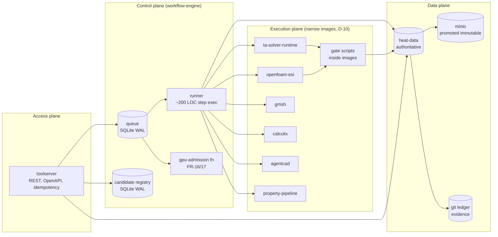
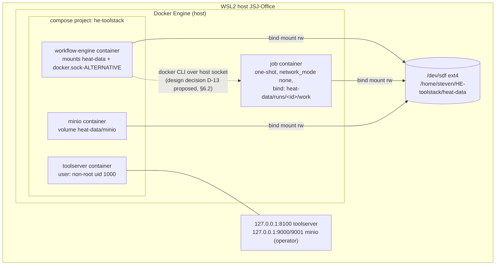
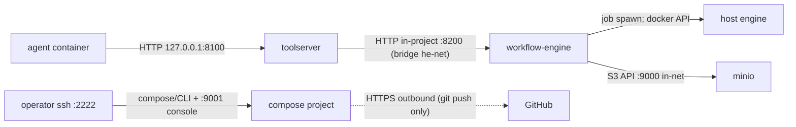

# HE-toolstack Technical Design Document

**Document:** `HE-TOOLSTACK-TECHNICAL-DESIGN.md` · v1.0 · 2026-11-14
**Status:** Draft for formal architecture review (Phase 2 deliverable A of DesignStandards §8)
**Companions:** `HE-TOOLSTACK-REQUIREMENTS.md` (requirement IDs FR-xx/NFR-xx/T-xx/OR-xx),
`HE-TOOLSTACK-ADR.md` (decision IDs D-xx/X-x/F-x/OQ-x), `PHASE1-ARCHITECTURE-DISCOVERY.md`
(evidence inventory C1–C6, gaps G1–G11).
**Evidence tags used throughout:** [V] verified live 2026-11-14 · [E] PD-toolstack evidence
artifact (STACK-AS-BUILT `SA`, STACK-DESIGN-v3 `SD`, ledgers) · [P] proposed here, not yet
implemented · [U] unverified assumption. **Nothing marked [P]/[U] is presented as existing
functionality.** Where the standards document mandates a component that Phase 1 proved does
not exist (e.g. "GPU broker", §6.4), this document specifies what actually carries that
responsibility instead of restating the phantom.

---

## 1. Executive Summary

**Purpose.** HE-toolstack is the agentic engineering tool stack for designing, testing, and
refining heat engines: an AI agent (the primary "user") drives geometry, meshing, CFD, FEA,
thermo-property and validation tools through a narrow HTTP/JSON API, while every run leaves
auditable, digest-verified physics evidence. It is the second attempt; the first
(PD-toolstack) is frozen and read as evidence only [U→user ruling].

**Problems this architecture solves.** Attempt 1 proved the physics loop works end-to-end on
CPU (D2 gate pass [E]) but died of *operational* failure modes: state scattered across three
filesystems with no declared owner (D25), an orphaned infrastructure container with no
consumer (C4), a design that referenced components never built (C1), and hardware premises
that no longer matched reality (C4/C5/C6 [V]). HE-toolstack keeps every validated asset and
re-architects the operating envelope around single-lifecycle, single-writer, file-visible
state.

**Approach.** One Docker Compose project owns every stack service including MinIO (D-01). A
thin toolserver exposes job submission over loopback HTTP; a workflow engine (SQLite queue +
registry + ~200-line runner over `workflows/` files) owns scheduling and resumable state
(D-02). Six narrow, digest-pinned tool images (OpenFOAM-ESI, TaSMET runtime, gmsh,
CalculiX, agentcad, property-pipeline — measured 0.31–2.82 GB each [V]) execute the tools as
one-shot containers spawned per job (D-10). Canonical state lives in one host directory,
`/home/steven/HE-toolstack/heat-data`, with normative write-ahead ordering
artifacts→state→ledger (D-05); MinIO holds the promoted immutable tier.

**Major decisions.** D-01 single compose; D-02 files-first workflow engine, framework behind
tripwires; D-03 no broker daemon — queue serialization + dispatcher admission; D-04 shared
RTX 5060 Ti GPU tier with hard budget, inert until re-measure (C6); D-05 host-dir state owner;
D-10 no image consolidation (user ruling — narrow images = future adaptability); D-11 the
GB10/ARM64 sglang host is excluded from compute.

**Key technologies.** Docker Compose (single project), FastAPI-class toolserver [P], SQLite
WAL queue/registry [P], MinIO (in-project), 6 pinned solver/tool images, `he` python client
over HTTP (no MCP, D-09 inherited).

**Capabilities (initial release).** M0 vertical slice (config→deck→1D solve→gate→ledger,
CPU-only, target <10 min — proposal OR-01) through M2 hardening: 6 tool classes, candidate
registry, promoted-artifact tier, cold-session resume ≤10 min, GPU *machinery* present but
class flag off. **Limitations:** single host, single operator, no auth beyond loopback
binding, GPU unproven until C6, no multi-host scaling, no web UI.

**Significant risks.** GPU passthrough state volatility (C6 materialized; contingency = CPU-
only Option A always available); hand-rolled runner bugs (crash-matrix T-07 is an M0
acceptance artifact); host-disk SPOF (versioned MinIO tier is the copy); phantom-component
recurrence (every §6 component lists its *existing* code lineage or is marked [P]).

**Readiness.** Architecture is review-ready: requirements baselined (63 IDs, 100%
trace-mapped), 12 ADRs (5 accepted incl. 3 user-rulled, 7 proposed pending sign-off), 4 open
questions surfaced (OQ-1…4). No milestone's acceptance depends on an unverified premise.

---

## 2. Project Scope and Objectives

### 2.1 Goals
1. Reproduce attempt-1's validated physics result (1D thermal loop, D2 gate [E]) on the new
   stack — same answers, same tolerance, bit-identity checked (FR-22, T-04).
2. Make every agent session resumable from disk in ≤10 min cold (NFR-18; D25's failure made
   this non-negotiable).
3. Make the stack's lifecycle total and disposable: `make down` ⇒ zero stack containers
   (NFR-01; C4's failure made partial lifecycle unacceptable).
4. Keep tool capability independently swappable: one capability = one image = one service
   (D-10 user ruling).

### 2.2 Functional scope (initial release)
Tool execution (6 classes), engine-config generation, solver execution, GPU-class *admission
machinery* (flag off), physics gating, file-based workflow orchestration with SQLite queue,
artifact hot tier + MinIO promoted tier, candidate registry + historical comparison,
crash-safe resume, `he` HTTP client. Requirement rows: FR-01…FR-40.

### 2.3 Explicitly excluded (initial release)
Multi-user/multi-tenant; API authentication beyond loopback binding (F-1); image registry
(host-seed + `pull_policy: never` + MANIFEST digests instead, A6/F-5); multi-host workers
(FR-41/42 boundary, M3+); web dashboard/UI; metrics/tracing stack (optional profile, F-3);
Windows-host direct execution; ARM64 builds (D14 lesson [E] — images are amd64-only by
decision).

### 2.4 Users and consuming systems
- **Primary consumer:** the coding/physics agent (Hermes sessions) via `he` client →
  toolserver HTTP on `127.0.0.1`.
- **Human operator:** Steven — compose lifecycle, ledger review, MinIO console (host port),
  host disk.
- **Downstream:** future optimizer/MDO loops (M3+, FR-41) read the candidate registry; the
  memory subsystem (cognee/Ollama, external) is *not* a stack consumer and is protected as a
  co-resident service (D-04 floor).

### 2.5 Primary operational use cases
UC-1 Design-to-result: agent submits a run (config→geometry→mesh→solve→post→gate→ledger).
UC-2 Sweep/compare: registry queries historical candidates; new run references parent digests.
UC-3 Resume: new agent session reconstructs in-flight work from `workflows/` + registry
alone (T-02 harness). UC-4 Ops: operator `make up/down`, backup = heat-data + git, restore
drill on versioned MinIO (T-11).

### 2.6 System boundaries
Inside: compose project services (toolserver, workflow-engine, minio), spawned per-job
tool containers, `heat-data` host dir, repo (`MANIFEST`, `workflows/`, CI).
Outside (dependencies, §11.9): host Docker Engine + WSL2, host disk `/dev/sdf`, GitHub
remote (ledger/git evidence), sglang LLM host `gx10-9d06` (192.168.1.102:8000, agent-side
inference only [V]), Ollama embeddings (`host.docker.internal:11434` [V]), SSH to host
(port 2222). Boundary rule: nothing stack-owned may be created outside the compose project
(NFR-10).

### 2.7 Assumptions and constraints
A1 single WSL2 host (JSJ-Office) remains the deployment target [V]; A2 no private registry
this release (A6 inherited) [E]; A3 GitHub remote stays available for ledger pushes, degraded
= local-commit queueing [P]; A4 all physics evidence to date is CPU-only — no GPU number may
be claimed until C6 passes [V]; A5 agent runtime (Hermes container) can reach host loopback
ports [V]; A6 uid 1000 maps host↔containers by convention [V]; A7 MinIO replaces only when
requirements exceed it, none identified (D-01). Constraints: 8 GiB VRAM ceiling / 5.5 GiB
floor (D-04, adjustable via OQ-2), 1 concurrent GPU job, CPU cores shared with co-resident
services.

### 2.8 Initial release vs later releases
Initial = M0–M2 (§16.1–16.4). Later = M3 fleet/multi-host (FR-41/42), M4 optimizer
automation (FR-41) — specified only as boundaries, not as promised functionality.

---

## 3. Requirements

The normative baseline is `HE-TOOLSTACK-REQUIREMENTS.md` v1.0: **40 functional (FR-01…42,
two reserved for M3+), 21 non-functional (NFR-01…21), 16 verification tests (T-01…16), 5
open requirements (OR-01…05)**. Every row carries ID, description, priority, rationale,
verification method, acceptance criteria; §5 of that file is the requirement→component→test
traceability matrix (script-verified 100% mapped, no dangling IDs). DesignStandards §3's
mandatory categories are each populated: tool invocation FR-06…15, config generation FR-04,
solver execution FR-10…14, GPU management FR-16…19, physics validation FR-20…22, workflow
orchestration FR-23…26, artifact management FR-27…29, run tracking FR-31…32, registry
FR-30…34, recovery FR-35…38, agent interaction FR-39…40; NFR categories map to §3.1–3.10 of
the baseline (reliability/perf/scalability/security/maintainability/observability/
portability/data-integrity/recoverability/extensibility). This design references those IDs;
it does not restate or renumber them. Sections 5–16 carry a "covers:" line per component so
reviewers can move both directions through the matrix.

---

## 4. Current-State Architecture and Lessons Learned

### 4.1 What worked (retained because evidence says so)
| Asset | Evidence | Retention |
|-------|----------|-----------|
| Physics loop end-to-end on CPU (fork + dataset + gate + ledger; D2 gate pass incl. negative test) | SA Stage D/E rows [E] | Migrated as-is (D-12); gate methodology → physics-gate (§6.3) |
| 6 tool images (measured 0.31–2.82 GB [V]) with build recipes carrying hard lessons (D8 OpenFOAM-from-source on noble, D13 hash-pinned property stack, D14 amd64-only wheels) | host `docker images` [V]; SA [E] | Kept unchanged as proven baselines (D-10); append-frozen |
| Digest/MANIFEST discipline (`resolve.py`, `pull_policy: never`) | SA infra rows [E] | Becomes dispatcher admission rule (FR-16, NFR-09, T-16) |
| Claim/done ticket + append-only ledger workflow practice | SA Stage-E practice [E] | Formalized as `workflows/` state law (§8) |
| Backup/restore drill against MinIO | SA restore rows [E] | Re-hosted in-project (D-01), drill becomes T-11 |
| `/mnt/c` avoided for solver I/O (28–39× measured penalty) | SA D9 [E] | Encoded as heat-data-on-ext4 constraint (D-05) |

### 4.2 What failed, and why (the design drivers)
| Failure | Root cause | Design response |
|---------|-----------|-----------------|
| `infra-minio-1` orphaned — worked, then consumed nothing and outlived its project (C4) | lifecycle split across compose projects; ownership ≠ use | D-01: one project owns all; T-13 zero-orphan gate |
| State/artifact divergence; session could not answer "what is in-flight" (D25) | no declared state owner; writes ordered arbitrarily | D-05 write-ahead protocol; T-07 crash matrix |
| Design docs listed components that never existed as code (C1: gpu-broker; C2: gate "service") | summaries copied forward without code verification | This doc's evidence tags; CI MANIFEST-vs-service check (NFR-11); Phase 1 verified inventory [V] |
| gpu1 premise (DGX Spark as compute worker) | hardware reality moved: gx10-9d06 is GB10 **ARM64** running sglang; gpu2 (5090) never purchased [V] | D-04/D-11: host-only compute, ARM64 excluded, GPU budgeted + flag-gated |
| `nvidia-smi` over SSH returned no rows this pass while the card exists (C6) | WSL GPU passthrough/driver state volatility [V] | GPU class inert until C6 re-measure ticket passes; T-06 uses simulated numbers until then |
| Docker-run uid friction forced chown workarounds | container uid ≠ host uid on bind mounts [E A1] | heat-data at uid 1000 by design (D-05); NFR-08 non-root audit |

### 4.3 Previous → proposed migration comparison
| Area | Previous (attempt 1) | Proposed (HE-toolstack) | Rationale | Risk carried |
|------|----------------------|-------------------------|-----------|--------------|
| Lifecycle | stack + separate `infra` project | one compose project incl. MinIO | orphan failure mode is ownership, not tech (C4) | healthcheck coupling on `up` (§11.5 profiles) |
| GPU path | gpu-broker (designed) → deleted, never ran | dispatcher admission fn + queue class | a mechanism must exist where code exists (D-03, C1) | lease semantics deferred (worker seam, NFR-05) |
| Workflow engine | LangGraph leaning (SD v3) + agent-memory state | files-first runner + SQLite; tripwires (§8) | resume-from-context-loss is a checkpoint pattern; durable-exec platform cost unjustified (D-02) | hand-rolled runner bugs → T-07 required M0 artifact |
| State location | container scratch + host tree + git, no owner | `heat-data` host dir, write-ahead normative | single-writer collapse; cold-session `ls`/`jq` contract (D-05) | manual host-dir drift → digest checks NFR-16 |
| Images | 8 images / 4 services (v1), ≤4 consolidation drafted (v2) | N images, 1 per capability, append-frozen (D-10 ruling) | user ruling: narrow scope = future adaptability; blast radius per digest | sprawl drift → MANIFEST CI; per-image host seed step (§11.3) |
| Physics-gate | scripts + methodology (proven) mis-described as service | methodology in images + thin one-endpoint wrapper (D-06) | keep what D2 proved; enforcement point without phantom daemon | wrapper drift → T-03 runs both paths |

### 4.4 Lessons directly encoded as requirements
C4→NFR-01/10; D25+C1→evidence tags + §6 lineage rule; D9→FR/D-05 ext4 placement; D8/D13→
NFR-09/11 image discipline; D14→amd64-only + D-11 exclusion; D7 (driver floor ≥591.59
sm_120)→C6 prerequisite; cleanup observation→NFR-12 per-ticket clause.

---

## 5. Target System Architecture

### 5.1 System context
The agent runs in a Hermes container on the host's Docker Engine and reaches the stack via
loopback HTTP (A5 [V]). The stack never calls the LLM; the LLM/embeddings services are
*co-residents to protect* (D-04 floor), not dependencies of any job. TaSMET/OpenFOAM/OCCT/
CoolProp are in-image dependencies; GitHub is the evidence remote outside the boundary.

```mermaid
graph TB
    subgraph Host["Host JSJ-Office (WSL2, RTX 5060 Ti, /dev/sdf 1TB ext4)"]
        subgraph Stack["HE-toolstack compose project (one lifecycle)"]
            TS[toolserver :8100 loopback]
            WE[workflow-engine<br/>queue+registry+runner]
            MO[minio :9000/:9001]
            JOB[per-job tool containers<br/>openfoam-esi / ta-solver-runtime /<br/>gmsh / calculix / agentcad / property-pipeline]
        </div>
        HD[("heat-data host dir<br/>/home/steven/HE-toolstack/heat-data<br/>state+artifacts — D-05")]
        AG[agent / Hermes container<br/>(he client)]
        EMB[Ollama embeddings<br/>:11434 — co-resident, protected]
        TS --- HD; WE --- HD; JOB --- HD
        AG -- "HTTP/JSON 127.0.0.1:8100" --> TS
        TS --> WE; WE -- "docker run (host engine)" --> JOB
        WE -- "promote (boto3)" --> MO
        JOB -- "nvidia runtime, flag-gated (C6)" --> GPU[(RTX 5060 Ti<br/>1 concurrent GPU job, ≤8 GiB)]
    end
    AGX[sglang LLM gx10-9d06<br/>192.168.1.102:8000 ARM64 — NOT compute (D-11)]
    AG -. "OpenAI-compatible inference (agent side only)" .-> AGX
    Stack -. "ledger git push" .-> GH[(GitHub jstevenjacobs/HE-toolstack)]
```
*Diagram 1 — system context. Solid = stack-internal; dotted = external dependency.*

### 5.2 Logical architecture
Four logical planes, one process topology. **Access plane:** toolserver (HTTP edge, auth
boundary = loopback). **Control plane:** workflow-engine — SQLite(WAL) queue + registry +
runner + GPU-admission function (the *replacement* for the designed-but-never-built broker,
D-03). **Execution plane:** spawned one-shot tool containers; images are append-frozen
capability units. **Data plane:** heat-data host dir (hot, authoritative) + MinIO (cold,
immutable, versioned) + git (evidence). State flows one way per D-05 ordering.


*Diagram 2 — logical components. Every box names real or [P]-proposed code; no broker box
exists because D-03 deleted the responsibility into ADM.*

### 5.3 Physical / deployment architecture
Single host; single compose project; toolserver published **loopback only**; MinIO published
on host for operator console only (config parameter `MINIO_CONSOLE_BIND=127.0.0.1`, §11.6 —
[proposal], not current config). Spawned job containers attach the default `he-net` bridge
only when they need egress (none in initial release — tools run offline, an explicit
posture: `network_mode: none` for solver jobs [P]).


*Diagram 3 — deployment boundaries. The job-spawn channel is a tracked open design item
(OQ-5 §17 / §6.2): mounting `docker.sock` is the known-simple path but grants container
escape-class power; alternatives listed there rather than hand-waved.*


*Diagram 4 — network communication. No inbound path exists from LAN or compose net to the
toolserver (NFR-07, T-15); external egress is git-over-HTTPS and nothing else in M0.*

### 5.4 Architectural principles
1. **One lifecycle per system** (D-01). Implication: every service has compose healthcheck +
   restart policy; `make down` is an acceptance test (T-13), not a convenience.
2. **State has exactly one owner per artifact** (D-05). Implication: heat-data is
   authoritative; MinIO/git are derived tiers; agent scratch is defined non-authoritative —
   deletion is always safe, which makes the cleanup rule enforceable (NFR-12).
3. **Write-ahead ordering is protocol, not convention**: artifacts fsync → state.json atomic
   rename → ledger append + git push. Implication: every crash window has a defined recovery
   (§12 FMEA rows FM-6/FM-8) and the crash matrix T-07 is a required M0 artifact.
4. **Thin, domain-agnostic core** (SD inheritance [E]): engine/queue/gate code contains zero
   TaSMET/OpenFOAM specifics; domain knowledge lives in images + job-type registry rows.
   Implication: new tool = new image + service + registry row (NFR-20), reviewed for
   core-diff absence at M1 (T-14).
5. **HTTP/JSON at every boundary; nothing crosses a process boundary that isn't specified**
   (§7). Implication: undocumented internals are prohibited; interfaces precede
   implementation (contract tests T-08 before endpoints mark done).
6. **Filesystem-visible state is the agent contract** (NFR-14): everything answerable by
   `ls`/`jq` over heat-data + `workflows/`, without container logs — because the consumer is
   a context-limited agent, not a dashboard.
7. **Append-frozen capability units** (D-10): images gain *versions*, never new tools;
   capability growth spawns a new image/service pair. Implication: blast radius per digest,
   rebuild recipes stay single-purpose, and A/B bit-identity (FR-22) gates every bump.
8. **Budgeted sharing over exclusive claims** (D-04): GPU/CPU admission at the dispatcher,
   with floors protecting co-resident services; no job may assume it owns hardware.
9. **Evidence tags survive into code**: MANIFEST digests, ledger `ref:` fields, and CI
   MANIFEST-vs-compose checks keep phantom components structurally impossible (NFR-09/11).

---

## 6. Detailed Component Design

Component inventory note (DesignStandards §6 lists "Solver service" and "GPU broker" as
subsections): the verified architecture has **no long-running solver service** (solvers are
one-shot containers spawned per job — verified pattern from Stage D/E [E] plus D-03) and **no
GPU broker** (deleted in v3.2 before Stage E; C1). §6.2 and §6.4 specify what actually
carries those responsibilities. Each component below answers the §7 reviewability questions
(problem solved, necessity, responsibilities, interfaces, data owned, dependencies, failure,
testing, deployment, limits). Code-lineage column: **[existing]** = code in PD-toolstack
evidence tree [E]; **[P]** = new code this design proposes; **[asset]** = methodology/scripts
proven by ledger.

### 6.1 Toolserver  [P — thin; lineage: no prior HTTP server existed; agent called scripts directly [E]]
- **Problem/necessity:** the agent needs one narrow, contract-testable door into jobs,
  queue, registry and gate — instead of ssh-and-pray shell access (attempt-1 practice). It
  is also the single place loopback security (NFR-07) and idempotency (FR-39) live.
- **Owns:** HTTP request validation, job submission records, idempotency-key store,
  OpenAPI surface, error envelope. **Explicitly does not own:** scheduling (engine), state
  writes into workflows/ (runner), physics verdicts (gate scripts), MinIO credentials
  (engine's promote worker holds them).
- **Internal modules [P]:** `api.py` (FastAPI app, ~400 LOC budget), `jobs_repo.py`
  (SQLite via same WAL file as engine — single-writer discipline: engine opens RW, toolserver
  opens read + insert-queue only), `idempotency.py` (key→job-id map, 24 h window),
  `errors.py` (single envelope §7.3).
- **Tech/version:** python 3.12-slim base (same base as property-pipeline image pattern [V]),
  FastAPI + uvicorn (versions pinned at first build; no version claimed here — none verified).
- **Interfaces:** §7.2 (all endpoints). **Configuration (§11.6):** `TS_BIND` (default
  127.0.0.1 — enforced non-overridable in entrypoint check), `TS_PORT=8100`,
  `HE_DATA=/data`, `QUEUE_DB`, `IDEMPOTENCY_TTL`.
- **Persistence:** none of its own beyond queue DB rows + idempotency table.
- **Startup/shutdown:** compose `depends_on: workflow-engine: condition: service_healthy`;
  boot = open WAL read/insert, serve; SIGTERM = drain in-flight HTTP (≤5 s), no job state to
  flush (all durable state is in SQLite WAL).
- **Health/logging:** `/healthz` (DB open + writable check); JSON stdout logs with
  `run_id/job_id` fields (NFR-13).
- **Failure modes:** crash ⇒ zero data loss (stateless edge; agent retries with same
  idempotency key, FR-39); WAL lock contention with engine ⇒ single-writer ordering means
  toolserver inserts are rare small writes; p95 read target NFR-04 (T-09 under load).
- **Security:** loopback-only bind, non-root uid 1000, no MinIO creds, request body caps
  (artifact pointers not bytes — §7.4), CORS off.
- **Testing:** contract suite T-08 (OpenAPI fixtures incl. error envelope, idempotency
  replay, 413/409/422 paths). Deployed as compose service `toolserver` (§11.3).
- **Limits:** no authN/Z (F-1); single instance; not a file server (never streams artifact
  bytes — agent reads heat-data directly [V host-dir contract]).

### 6.2 Job dispatcher + queue + runner (the "workflow engine")  [P core; runner lineage: Stage-E claim/done scripts [E asset]]
- **Problem/necessity:** serializes contention-prone resources (the GPU, CPU slots),
  survives agent-context loss, and enforces the write-ahead protocol (§5.4-3) in one place.
  This is the component that *replaces* both the never-built gpu-broker and the LangGraph
  leaning (D-02/D-03).
- **Owns:** queue rows, job leases (single-writer within this process), worker seam,
  `workflows/` state law enforcement, ledger appends, promotion triggers. **Does not own:**
  HTTP edge (§6.1), physics logic, image builds.
- **Internal modules [P]:** `queue.py` (SQLite WAL, states §8.2, one-writer loop),
  `admission.py` (GPU budget fn: nvidia-smi-when-available + reservation ledger, FR-16/17;
  pure function, unit-tested with simulated values — T-06 — because C6 is unresolved),
  `worker_docker.py` (**the Worker seam**: interface `Worker.spawn(job_spec)->handle`;
  initial impl spawns via Docker; how the engine container reaches the Docker daemon is
  OQ-5: (a) mount host `docker.sock` — simplest, grants escape-class power, chosen only if
  operator accepts (b) a second tiny "spawn-sidecar" container with the socket, shrinking
  blast radius to it, (c) engine runs as a host systemd unit, no socket in any container.
  Decision needed at M0 — §17 OQ-5), `runner.py` (~200 LOC: read `workflows/<flow>/state.json`
  → claim next ticket → exec step → write-ahead per D-05), `promote.py` (boto3 client →
  MinIO, gated by FR-29 rule), `ledger.py` (append + git push + local-commit queue when
  remote unreachable, A3).
- **Job-type registry (not a separate service):** table `job_types(tool, image_digest,
  entry, cpu_class|gpu_class, limits…)` — the extensibility point NFR-20; new tool = row +
  image + compose service entry, zero core edits (T-14 proves at M1).
- **Concurrency control:** `max_concurrency` per class (cpu: cores-based default 2 [P];
  gpu: **1** hard, D-04); GPU class refuses to start any job while
  `GPU_CLASS_ENABLED=false` (default until C6 passes — FR-18).
- **Startup/shutdown:** boot = crash-recovery pass (§8.6: reconcile running-state jobs vs
  container reality), then loop; SIGTERM = stop claiming, finish current step boundary, WAL
  clean close.
- **Health/logging:** `/healthz` (loop heartbeat <30 s old), queue-depth gauge in JSON logs;
  every state transition emits one structured event (run_id, from, to, cause).
- **Failure modes/recovery:** full matrix T-05/T-07; crash mid-claim = lease timeout
  re-queues (idempotent step exec: step re-run sees its own artifact manifest and skips —
  FR-38); WAL survives kill -9 (NFR-02).
- **Security:** sole holder of MinIO root creds (§10); sole writer to `workflows/`; if OQ-5
  lands on docker.sock, that container is the security-critical one (review gate).
- **Performance:** queue ops are sub-ms local SQLite [P, measure at M0]; step overhead
  budget counted into OR-01 timing (NFR-03 flag).
- **Testing:** unit (admission math, lease logic), integration (queue+reboot T-05), crash
  matrix T-07, cold-session harness T-02. **Deployed:** compose service `workflow-engine`.

### 6.3 Physics-gate  [asset: gate.py + probes + negative test proven D2 [E]; wrapper [P thin]]
- **Problem/necessity:** no run may claim `succeeded` without a verdict (FR-20); attempt-1
  proved the methodology *including a negative test that catches corrupted results* (D2).
  The design decision (D-06) is to ship the scripts unchanged inside images and add one thin
  endpoint — the endpoint adds no verdict logic.
- **Owns:** gate checklist definitions (`gates/*.py` in repo → baked/bound), report format,
  tolerance tables (dataset-derived, from D2 evidence [E]). **Does not own:** solver numerics,
  verdict interpretation beyond pass/fail/warn.
- **Execution path:** runner step `gate` runs `python -m gates <run-dir>` inside the tool
  image that owns the physics (TaSMET/OpenFOAM) — same image = same numeric stack (bit-
  identity FR-22); toolserver `POST /gate/run` execs the identical command in a spawned
  container (T-03 tests both entry paths produce byte-identical reports).
- **Inputs/outputs:** run-dir (state.json + artifacts + digests) in; `gate_report.json`
  (checks[], values, tolerances, verdict, digests covered) out — written to heat-data,
  referenced by ledger row.
- **Failure/recovery:** script crash ⇒ verdict `error`, run cannot succeed (fail-closed);
  report absent ⇒ registry refuses `succeeded` (constraint enforced at registry write, not
  convention).
- **Tech:** numpy/CoolProp already in images [V]; no new dependencies (deliberate).
- **Testing:** T-03 incl. the carried-over corruption-injection negative test; tolerance
  changes require an ADR row (physics semantics = decisions).

### 6.4 "GPU broker" responsibility — dispatcher admission  [P; lineage: designed never built, deleted v3.2 [E C1/D-03]]
- **Problem/necessity:** one shared 16 GB card with a protected 4.98 GiB embeddings floor
  [E] needs *admission control*, which is arithmetic + a reservation ledger — not a daemon.
- **How "handles GPU jobs" is actually implemented [P]:** `admission.can_start(job)` reads
  (1) class flag, (2) current GPU-class running count (queue truth), (3) reserved VRAM sum,
  (4) latest `nvidia-smi --query-gpu=memory.used` sample (cache ≤30 s; when probe returns
  nothing — the C6 state — behaves as if usage = floor + safety margin), and refuses unless
  `running == 0` and `reserved + job.vram_ceiling ≤ total − floor`. Reservation lives in the
  queue row (crash-safe; no separate store). Numbers: ceiling 8 GiB / floor 5.5 GiB (D-04
  defaults, OQ-2 adjustable), all three as config keys (§11.6), none hard-coded.
- **What it explicitly is not:** no worker protocol, no leases to remote hosts (M3+ re-ADR
  per D-03 revisit clause), no MPS/time-slicing (job count is 1 by policy).
- **Failure modes:** probe lies (WSL volatility, C6) ⇒ class stays off (flag) or admission
  errs conservative (margin) — the *acceptance schedule* is protected because no M0–M2 gate
  uses GPU (FR-19).
- **Testing:** T-06 pure-function suite over simulated `nvidia-smi` matrices + flag-off
  refusal + boundary math; live variant runs only after C6.

### 6.5 MinIO / artifact storage  [existing image pattern [E]; now in-project (D-01); promote worker [P thin]]
- **Problem/necessity:** attempt-1's one *successful* storage story (backup/restore drill)
  must survive without orphan risk (C4). MinIO = versioned, immutable, S3-API cold tier for
  promoted evidence; it is deliberately **not** in the solver hot path (X-5).
- **Owns:** buckets `he-promoted` (+ `he-quarantine`), object versioning + retention config,
  lifecycle: put-only from promote worker; operator UI on host loopback. **Does not own:**
  hot artifacts (heat-data, D-05), registry links (engine writes, registry row stores
  bucket+key+versionId).
- **Promote path [P]:** engine step after ledger push (ordering §8.4): files listed in the
  gate-passed manifest → `s3:PutObject` (versioning on) → versionId recorded in registry →
  ledger row `minio:` field. Restore drill T-11: delete local copy, `GetObject` by
  versionId, digest-compare.
- **Startup/shutdown:** compose `minio` service, healthcheck `mc ready local`; volume under
  heat-data so backup = one dir (plus MinIO metadata inside it — single-owner principle).
- **Failure/recovery:** unavailable ⇒ promote step retries with backoff; **runs keep
  succeeding** (promotion is an evidence step, not a physics step — a job blocked on MinIO
  surfaces as `degraded-evidence` state §8.2, never `failed`); disk-full shares FM-6 §12.
- **Security:** root creds env-injected to engine only; console binds loopback (§11.6
  proposal); anonymous access disabled; buckets private. **Supply chain:** A11 Chainguard
  rebuild question stays an open ticket (OR-05) — digest pin in MANIFEST meanwhile.
- **Testing:** T-11 drill + T-13 lifecycle + T-16 digest admission for its image.

### 6.6 HE Python client (`he`)  [P thin; lineage: none — agent used shell [E]]
- **Problem/necessity:** the agent's resume guarantee (FR-36/T-02) requires that status
  questions be answerable by *files*, but day-to-day driving wants a typed call surface; the
  ruling D-09 [E SD v3.8.1] keeps it HTTP, not MCP.
- **Owns:** request/response models mirroring §7, retry-with-backoff honoring
  `Retry-After`, idempotency-key generation (uuid4 default), `he` CLI for humans.
  **Does not own:** any state — it is a stateless stub (resume runs on files regardless).
- **Distribution:** installed in the agent container image via repo wheel (dev: `-e`);
  versioned with the repo (client/server drift caught by contract suite T-08 fixtures).
- **Failure modes:** server down ⇒ typed `ConnError` after bounded retries with identical
  keys (no duplicate submits, FR-39); long solves ⇒ client may exit; job state unaffected
  (NFR-18 contract).
- **Testing:** T-08 client-side fixtures; T-02 proves *nothing essential* needs the client.

### 6.7 Candidate registry  [P; lives in the engine's SQLite (D-08), one file, one writer]
- **Problem/necessity:** M3 optimizer work (and human review) needs "what have we tried,
  with what config, what gate verdict, where is the evidence" — attempt-1 had the D-ledger
  prose but no queryable store (G-gap, P1).
- **Schema (design, §A-json):** `candidates(run_id UNIQUE, parent_run, config_digest,
  tool_versions_json, gate_verdict, metrics_json, created_at)` + `evidence(run_id, kind,
  path|bucket+key+versionId, digest)` + `job_types` (§6.2). Foreign keys + `PRAGMA
  foreign_keys=ON`; registry rows are the only join point between the three tiers.
- **Write rule (enforced, not conventional):** a candidate may reach `succeeded` **only** if
  a gate_report with matching digests exists (DB trigger rejects otherwise — FR-20 mechanical
  enforcement). Legacy: one-time import of the PD-toolstack D-ledger *read-only* (OQ-3
  pending) as provenance rows tagged `legacy:` with digest-of-file (D-ledger evidence row
  probe, T-10).
- **Reads:** toolserver `/candidates*` (§7.2); comparison views = SQL over metrics_json.
- **Failure/recovery:** same WAL durability as queue (NFR-02); corruption = restore from
  promoted ledger + rebuild script (registry is derivable from ledger+heat-data — declared
  *rebuildable*, not sacred).
- **Testing:** T-10 lifecycle, link integrity, trigger refusal path.

### 6.8 Supporting infrastructure
- **compose project + Makefile [P]:** services `toolserver`, `workflow-engine`, `minio`;
  profiles `gpu` (post-C6), `console` (MinIO UI), `postgres` (F-2 parked). `make up|down|
  logs|test`; zero-orphan acceptance T-13.
- **CI [P, pattern proven in SA: gitleaks ran in CI [E]]:** gitleaks on push; MANIFEST↔
  compose image cross-check (NFR-11); pytest suites (unit/contract); done-check lint
  (cleanup attestation present — NFR-12). GitHub Actions on private repo (standard runners;
  nothing exotic claimed).
- **Host pre-seed step [P, one script]:** loads 6+ images from saved tars / builds on host,
  writes digests to MANIFEST, verifies `docker images --digests` match (A6 no-registry
  consequence, FR-16/T-16, NFR-15 reproducibility).
- **heat-data layout:** normative tree §9.2 + Appendix directory listing.

---

## 7. API and Interface Specifications

### 7.1 Conventions
Base `http://127.0.0.1:8100`; JSON only; auth: **none by design in initial release — the
loopback bind *is* the control** (NFR-07; deferred auth F-1 documented there, never implied
present). All timestamps RFC 3339 UTC. All list endpoints cursor-paginated (`?cursor=&limit=`,
default 50). Errors (§7.3) on every endpoint; unknown fields rejected (`422`) so contract
drift is loud. Idempotency: mutation endpoints accept `Idempotency-Key` header (client-
generated uuid4; server keeps 24 h map; replays return stored response + `Idempotent-Replay:
true`, FR-39). Timeouts: server request timeout 30 s except submission endpoints (payloads
are pointers, not bytes — §7.4); client default 10 s + 3 retries w/ backoff on 5xx/conn.

### 7.2 Endpoints [P — proposed contract; T-08 fixtures are the normative artifact]
| Method | Path | Purpose | Auth | Idem | Success | Notable errors |
|--------|------|---------|------|------|---------|----------------|
| GET | `/healthz` | liveness (toolserver/healthz mirrors engine/minio reach) | — | — | 200 | 503 deps down |
| POST | `/jobs` | submit tool job `{tool, params, run_id?, vram_ceiling?, priority}` | loopback | ✔ | 201 `{job_id, queue_pos}` | 422 unknown tool/digest not in MANIFEST (`409 digest_unpinned`); 413 body>1 MiB; 429 queue-full (bound 200 [P]) |
| GET | `/jobs/{id}` | status `{state, started?, finished?, exit?, gate?}` | loopback | — | 200 | 404 |
| GET | `/jobs?state=&tool=&cursor=` | list/filter | loopback | — | 200 | — |
| POST | `/jobs/{id}/cancel` | request cancel (SIGTERM→grace→kill 30 s [P]) | loopback | ✔ | 202 | 409 already terminal |
| POST | `/runs` | create run `{goal, parent_run?, config{}}` | loopback | ✔ | 201 `{run_id}` | 409 parent unknown |
| GET | `/runs/{id}` / `/runs/{id}/state` | run meta / state.json mirror | loopback | — | 200 | 404 |
| GET | `/runs/{id}/artifacts` | manifest listing `{path, digest, size, promoted?}` | loopback | — | 200 | — |
| POST | `/gate/run` | run gate for run `{run_id, checks?}` → exec §6.3 path | loopback | ✔ | 201 → job_id (async) | 409 run not in gateable state |
| GET | `/candidates` / `/candidates/{run_id}` | registry queries + comparison `{metrics, gate, evidence[]}` | loopback | — | 200 | 404 |
| GET | `/workflow/{flow}` | `workflows/<flow>/state.json` mirror (agent resume aid) | loopback | — | 200 | 404 |
Example `POST /jobs`: req `{"tool":"gmsh","params":{"geo":"runs/r7/geom.step","hmax":0.4},"run_id":"r7"}` → 201 `{"job_id":"j-01H…","state":"queued","queue_pos":2}`.

### 7.3 Error envelope (single shape everywhere)
`{"error":{"code":"digest_unpinned","message":"image sha256:aa.. not in MANIFEST rev 0ed664b","details":{…},"trace_id":"t-…"}}` + matching HTTP class (4xx caller, 5xx stack). `trace_id` appears in server JSON logs (NFR-13 correlation).

### 7.4 Artifact rule (interface-relevant)
API moves **pointers + digests**, never bytes; byte access is the filesystem (agent mount /
host path) or presigned-free in-net S3 for tool containers. Keeps the HTTP edge stateless
and the p95 latency budget honest (NFR-04).

### 7.5 Component-to-component interfaces
- **toolserver → engine:** same SQLite WAL (insert queue rows; engine = sole RW updater) —
  deliberate *no-HTTP* hop (one less moving part; D-08 colocation). Consistency: `BEGIN
  IMMEDIATE` inserts; busy_timeout 5 s. Marked [P]; if review objects to shared-DB coupling,
  the alternative (engine internal HTTP) is tracked as OQ-6, contract would then mirror §7.2
  subset.
- **engine → tool containers:** `docker run` equivalents from `job_types` rows: image by
  digest, `--network none`, binds `heat-data/runs/<id>/work`, env allowlist, cpu/mem
  limits, GPU device + nvidia runtime only when class enabled (FR-18). Exit code + captured
  stdout/stderr tail (64 KiB) become artifact rows. **spawn channel = OQ-5.**
- **engine → MinIO:** boto3 (S3 API, in-net `minio:9000`), put+versioning, creds env-only.
- **engine → git:** `git -c user…commit` + `push` on heat-data mirror; remote failure = local
  queue + retry each loop tick (A3).
- **agent ↔ everything else:** §7.2 + filesystem. Legacy D-ledger import (D-06/T-10): file-
  system read of frozen PD-toolstack evidence (git clone), one-shot importer inside engine —
  no runtime dependency on the frozen repo (it stays source-of-information only [U ruling]).
- **TBD, explicitly:** multi-host worker protocol (M3+ ADR; not fabricated here); auth
  headers (F-1); webhook/event callbacks (no consumer exists — none invented).
